2026年秋は、サイバー攻撃が「IT 部門の問題」から「国全体の問題」へと変わった時期として記憶されるでしょう。わずか 5 週間のうちに、ランサムウェアが大学と大手クラウド事業者のシステムを停止させ、数十社がデータ侵害を公表し、修正パッチが出る前に PHP の重大な脆弱性が悪用され、大手インターネット企業グループが 5,000 万ドルの身代金要求を拒否しました。本記事では、攻撃の規模、手口、主要なインシデント、そして組織がいま取るべき対策を解説します。

*数値は 2026年10月28日時点の報道に基づきます。記録件数の多くは「影響を受けた可能性がある最大数」であり、漏えいが確定した件数ではありません。調査は現在も続いています。*

## 過去最多の一年、そして国家的な緊急事態

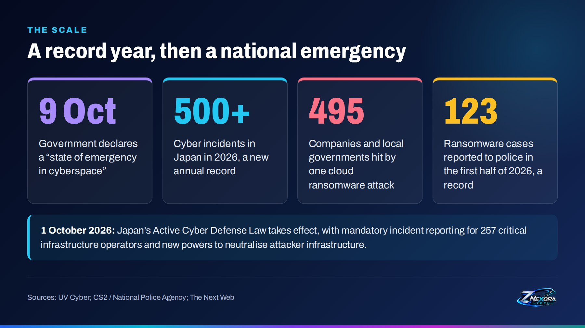

状況を示す 4 つの数字があります。

- **サイバーインシデント 500 件超：** 2026年の日本国内の件数で、11月を待たずに年間の過去最多を更新しました。
- **495 の企業・自治体：** クラウド事業者 IDC フロンティア 1 社へのランサムウェア攻撃で影響を受けました。
- **ランサムウェア被害 123 件：** 2026年上半期に警察へ報告された件数で過去最多。その多くが中小企業でした。
- **10月9日：** 政府が「サイバー空間における緊急事態」を宣言しました。

タイミングにも意味があります。2026年10月1日に、能動的サイバー防御に関する法律が施行されました。257 の重要インフラ事業者にインシデント報告を義務付け、攻撃者のインフラを無害化する新たな権限を政府に与えるものです。

## 5 週間にわたる公表の連鎖

被害の公表は急速に広がりました。テレビ朝日の集計では、約 1 か月で 40 件を超える情報漏えいの発表がありました。

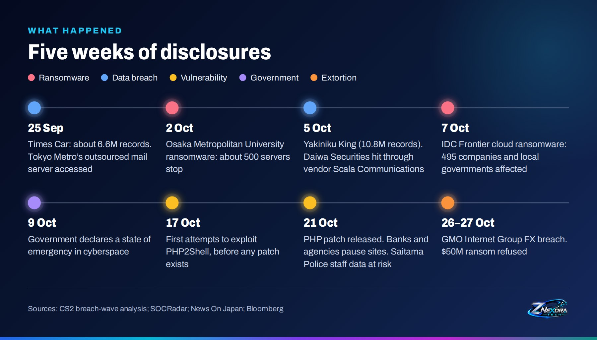

| 日付 | 出来事 |
| --- | --- |
| 9月25日 | タイムズカーで約 660 万件の情報流出の可能性を公表。東京メトロの委託先のメールサーバーに不正アクセス |
| 10月2日 | 大阪公立大学でランサムウェア被害、約 500 台のサーバーが停止 |
| 10月5日 | 焼肉きんぐ（1,080 万件）。大和証券が委託先のスカラコミュニケーションズ経由で被害 |
| 10月7日 | IDC フロンティアのクラウドがランサムウェア被害、495 の企業・自治体に影響 |
| 10月9日 | 政府が「サイバー空間における緊急事態」を宣言 |
| 10月17日 | 修正パッチの公開前に、PHP2Shell の脆弱性を悪用する最初の試みを確認 |
| 10月21日 | PHP の修正版が公開。日本の銀行や官公庁がサイトを一時停止。埼玉県警の職員約 1 万 3,000 人分の情報に流出の恐れ |
| 10月26〜27日 | GMO インターネットグループの FX サービスへの不正アクセス。5,000 万ドルの身代金要求を拒否 |

## 攻撃の 6 つのパターン

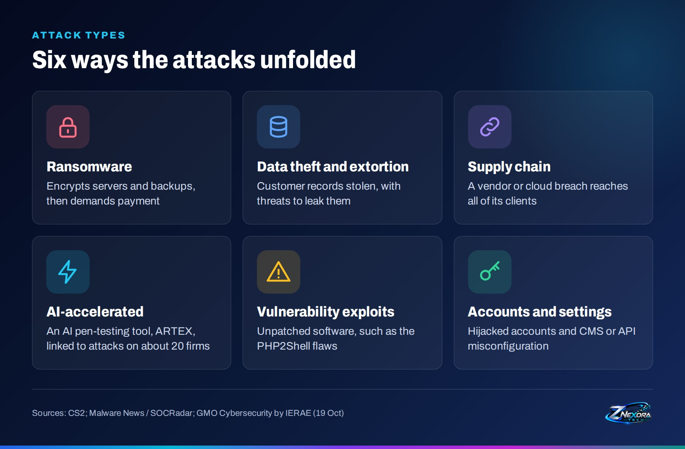

一連のインシデントは、大きく 6 つのパターンに分けられます。

- **ランサムウェア。** サーバーを暗号化し、今回の一連の攻撃ではバックアップまで暗号化したうえで、支払いを要求しました。
- **データ窃取と恐喝。** 顧客情報を盗み出し、公開すると脅します。10月の急増の最大の要因です。
- **サプライチェーン。** 委託先やクラウド事業者が侵害されると、そこに依存するすべての顧客に被害が及びます。
- **脆弱性の悪用。** 修正されていないソフトウェアが狙われました。代表例が PHP2Shell です。
- **アカウントと設定。** 乗っ取られたアカウントや、CMS・API の設定不備が侵入口になりました。
- **AI による加速。** 10月19日、GMO サイバーセキュリティ byイエラエは、日本企業約 20 社を狙ったインフラが、中国で開発された AI ペネトレーションテストツール「ARTEX」に関連していると発表しました。特定の攻撃者は公式には名指しされていません。

## 主要なインシデント

### ランサムウェア：共有された 1 つの基盤、数百の被害組織

**IDC フロンティア（ソフトバンクのクラウド子会社）。** 10月7日午前 3時40分ごろ、「IDCF クラウド 東日本リージョン 1」がランサムウェアの被害を受け、495 の顧客組織に同時に影響が出ました。その後、JR 東日本やビューカードなどの顧客が、最大約 600 万件の会員情報が流出した可能性を公表しました。IDC フロンティアは、被害を受けたゾーンのデータは復旧が難しいとして、顧客に自社のバックアップからの復元を求めました。

**大阪公立大学。** 10月2日、5 つのキャンパスすべてでシステム障害が発生しました。攻撃者は多くのシステムの土台となる共有の仮想化基盤に到達し、約 500 台のサーバーが停止。バックアップの大半も暗号化されました。

**教訓：** 本番環境と同じ基盤上にあるバックアップや復旧の仕組みは、本番環境と一緒に機能しなくなります。攻撃を受けた基盤に依存しているバックアップは、本当の意味でのバックアップではありません。

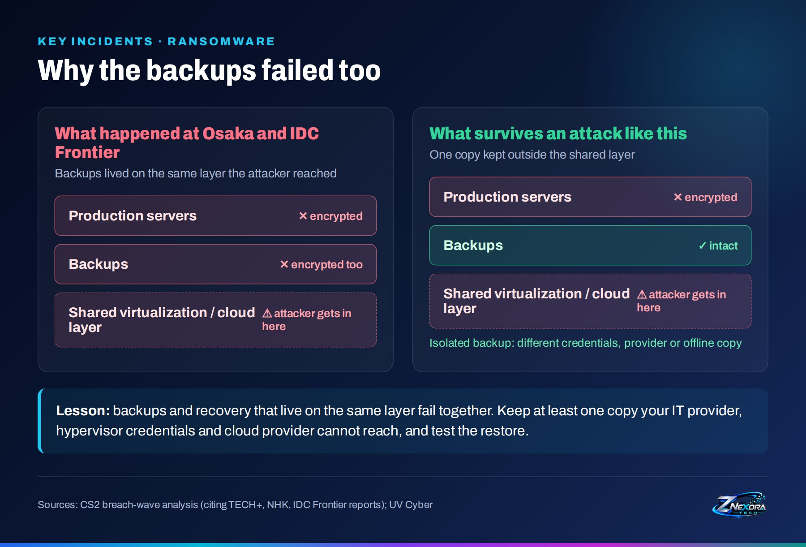

### データ侵害：攻撃者はどこから侵入したのか

侵入経路が公表された事例を見ると、その入口はありふれたものでした。

| 侵入口 | 公表された事例 |
| --- | --- |
| 委託先のサーバー | スカラコミュニケーションズ：大和証券（約 11 万件）、シチズン時計（約 10 万件）。東京メトロのメール委託先（約 5 万 9,000 件） |
| API・CMS の設定 | 集英社：設定ミスにより、攻撃者が API 経由で高い権限のアカウントを作成 |
| ソフトウェアの脆弱性 | GMO リサーチ&AI（最大 94 万 8,000 件）、ミスターマックス（最大 170 万人分の会員情報） |
| 1 つの乗っ取られたアカウント | 日本経済新聞社：1 つの Microsoft 365 アカウントから約 9,000 通のフィッシングメールが送信 |
| 仮想化・クラウド基盤 | 大阪公立大学、IDC フロンティアとその顧客 |

検知の遅れも深刻です。発見の経緯がわかっている 7 件のうち 5 件で、最初に異常に気付いたのは顧客、第三者、プラットフォーム事業者、委託先といった外部でした。

### PHP2Shell：修正前に悪用された脆弱性

PHP2Shell は、PHP に見つかった 2 つの重大なメモリ安全性の脆弱性 **CVE-2026-109618** と **CVE-2026-109619** の総称です。PHP 5.4〜8.5 が影響を受け、認証なしでリモートからコードを実行される恐れがあります。PHP は世界の Web サイトの大きな割合で使われているため、影響範囲は広大です。

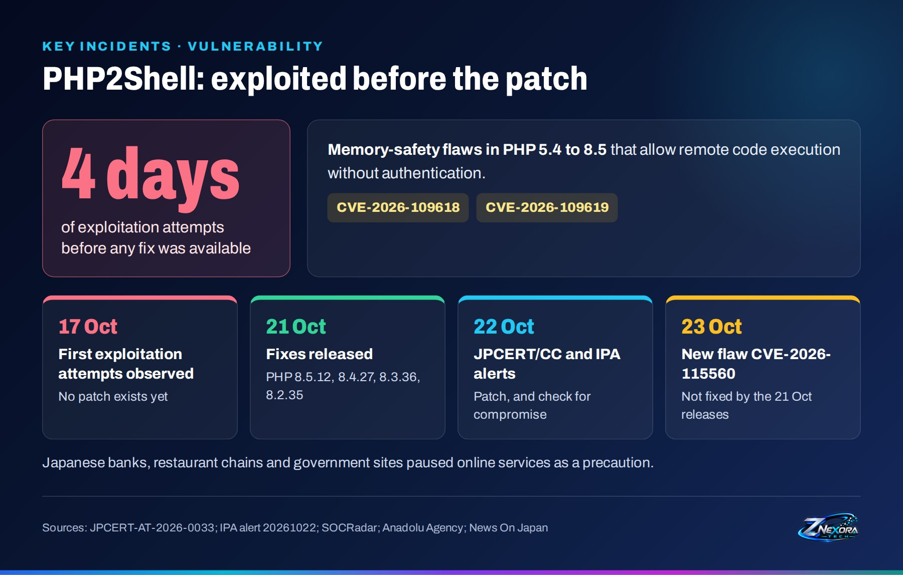

- **10月17日：** 最初の悪用の試みを確認。修正版の公開より 4 日早い段階でした。
- **10月21日：** PHP 8.5.12、8.4.27、8.3.36、8.2.35 で修正。日本の銀行、飲食チェーン、官公庁のサイトが予防的にオンラインサービスを一時停止しました。
- **10月22日：** JPCERT/CC と情報処理推進機構（IPA）が注意喚起を発表し、修正の適用と、すでに侵害されていないかの確認を呼びかけました。
- **10月23日：** セッション処理に関する別の脆弱性 CVE-2026-115560 が公表されました。10月21日の修正版では対処されていません。

### GMO インターネットグループ：最新の標的

この事案は現在も進行中です。攻撃者は GMO の「お名前.com デスクトップクラウド」（FX の個人トレーダーが利用する仮想デスクトップサービス）から侵入し、最大 2 万 6,739 台のサーバーが影響を受けた可能性があります。5 つの FX 証拠金取引サービスが侵害されて不正な取引が行われ、70 社を超える証券・FX 会社の口座に被害が及びました。

攻撃者は 5,000 万ドル（約 79 億円）を要求しました。初期の報道では 100 万ドルとされていましたが、GMO の代表が 5,000 万ドルという金額を明らかにし、支払わない方針を示しました。GMO は顧客に対し、PC のウイルススキャン、ファイルのバックアップ、ケーブルを抜いて電源を切ることを求め、取引上の損失の補償と、利用者 1 人あたり 5,000 円の見舞金の支払いを表明しています。

**その後の動き：** GMO が支払いを拒否した後、攻撃者は 10月27日に顧客情報とする内容を公開しました。また GMO は、施行されたばかりの能動的サイバー防御の適用を国に緊急要請していました。適用されれば、法律の施行後初めての事例となります。GMO の代表はブログで、社内の技術者からセキュリティ上の課題を事前に指摘されていながら、対応が十分ではなかったことを認めました。なお、GMO は今回の侵害と PHP の脆弱性との関連を示していません。

## 被害を受けた場合：今すぐ取るべき 6 つのステップ

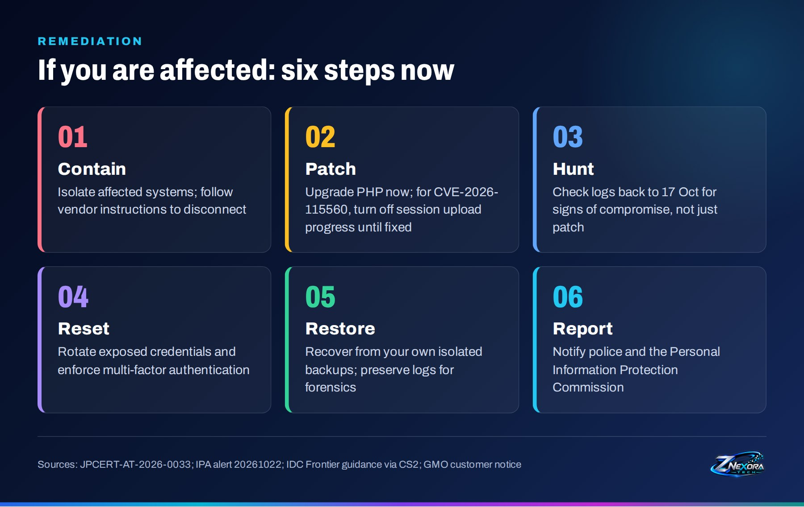

1. **封じ込め。** 影響を受けたシステムを隔離します。事業者から切断を求められたら、従ってください。
2. **修正。** PHP を 10月21日の修正版に更新します。暫定的な緩和策は特定の経路を防ぐだけなので、根本的な対策は更新だけです。CVE-2026-115560 については、修正版が出るまでセッションのアップロード進捗機能を無効にしてください。
3. **調査。** 10月17日までさかのぼってログを確認し、侵害の痕跡を探します。修正を適用するだけでは、すでに侵入した攻撃者は排除できません。
4. **リセット。** 流出した可能性のある認証情報を変更し、多要素認証を必須にします。
5. **復元。** 自社で管理する分離されたバックアップから復旧し、フォレンジックのためにログを保全します。
6. **報告。** 警察と個人情報保護委員会に届け出ます。

## 予防：今回の攻撃が使った入口をふさぐ

以下の対策は、今回確認された侵入口にそれぞれ対応しています。

| 対策 | 理由 |
| --- | --- |
| VPN の修正と多要素認証の導入 | 警察のデータでは、ランサムウェアの最初の侵入口として最も多いのが VPN 機器 |
| 分離されたバックアップを用意し、復元をテストする | 大阪公立大学と IDC フロンティアでは、本番と同じ基盤上のバックアップが失われた |
| 委託先を把握する | 顧客データを預けている委託先を把握し、契約終了時には削除を確認する。吉野家の情報は、すでに利用をやめた採用プラットフォームから流出した |
| 新しい管理者アカウントの作成を通知する | 集英社の事案では、攻撃者が API 経由で高い権限のアカウントを作成した |
| サインイン履歴を毎日確認する | 多くの侵害は、被害組織より先に外部が気付いていた |
| 迅速に修正し、JVN の情報を確認する | PHP2Shell は修正版が出る前に悪用された |
| 対応時の連絡先リストを作る | IT、クラウド、フォレンジック、警察、個人情報保護委員会の連絡先を事前に決めておく |

## まとめ

**今回の侵入口に新しいものは 1 つもありません。AI が変えているのは手口ではなく、スピードです。**

委託先のサーバー、設定不備のある API、修正されていないソフトウェア、乗っ取られた 1 つのアカウント、共有インフラは、いずれも以前から知られた弱点です。変わったのはスピードです。AI ツールによって、攻撃者は多くの組織の弱点を一度に見つけられるようになりました。攻撃者は IDC フロンティアの暗号化にわずか数分しかかからなかったと主張しています（未確認）。検知に何日もかかっていては、もう間に合いません。修正の適用、多要素認証、分離されたバックアップ、委託先の管理、毎日の監視という基本対策こそが、今回の攻撃の大半を防ぐ力になります。

## 出典

### 公的機関の注意喚起

- [JPCERT/CC 注意喚起 JPCERT-AT-2026-0033（PHP の脆弱性）](https://www.jpcert.or.jp/at/2026/at260033.html)
- [IPA 重要なセキュリティ情報：PHP2Shell（2026年10月22日）](https://www.ipa.go.jp/security/security-alert/2026/alert20261022.html)
- [Japan Vulnerability Notes（JVN）](https://jvn.jp/)

### 分析

- [CS2: Japan’s October 2026 breach wave](https://www.cybers2.com/blog/japan-breach-wave-october-2026.html)
- [UV Cyber: Japan’s cyber emergency and its ripple effects](https://www.uvcyber.com/resources/threat-advisories/threat-advisory-japans-cyber-emergency-and-its-ripple-effects)
- [Malware News / SOCRadar: Inside the October surge](https://malware.news/t/japan-data-breaches-2026-inside-the-october-surge/126558)
- [SOCRadar: PHP2Shell explained](https://socradar.io/blog/php2shell-cve-2026-109618-cve-2026-109619/)

### ニュース

- [Bloomberg: Trading platform rocked by Japan hack, $50 million ransom](https://www.bloomberg.com/news/articles/2026-10-26/japan-s-katayama-vows-to-address-cyber-attack-on-fx-with-urgency)
- [News On Japan: GMO refuses to pay $50 million cyberattack ransom](https://newsonjapan.com/article/151147.php)
- [Finance Magnates: Hackers publish alleged GMO customer data](https://financemagnates.com/forex/hackers-publish-alleged-gmo-customer-data-as-broker-fxtf-shuts-out-overseas-logins)
- [共同通信（熊本日日新聞）：GMO、サイバー防御を緊急要請](https://kumanichi.com/articles/2050148)
- [News On Japan: Cyberattacks hit Japanese police and businesses](https://newsonjapan.com/article/151111.php)
- [The Next Web: Japan steps up cyber warnings as data leaks hit millions](https://thenextweb.com/news/japan-cyberattacks-warning-data-leaks)
- [Anadolu Agency: Japan suspends websites over critical PHP vulnerabilities](https://www.aa.com.tr/en/asia-pacific/japan-suspends-several-websites-over-critical-php-security-vulnerabilities/4096314)
- [Tech Times: Japan declares first cyberspace emergency](https://www.techtimes.com/articles/328908/20261012/japan-declares-first-cyberspace-emergency-ai-turns-ransomware-carpet-bombing.htm)

## スライド

[スライドを PDF でダウンロード](../../assets/files/japan-s-october-2026-cyber-emergency.pdf)

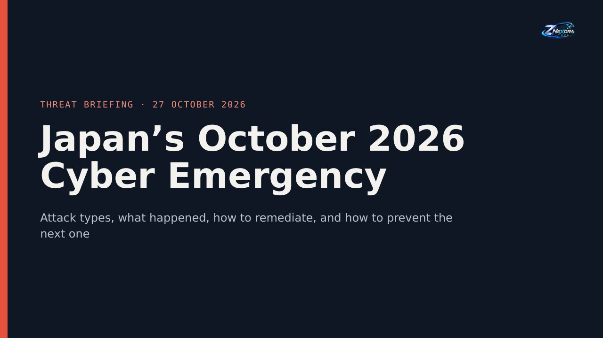

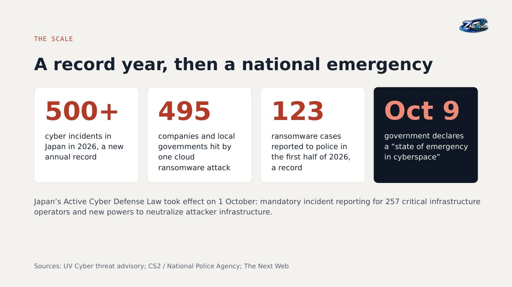

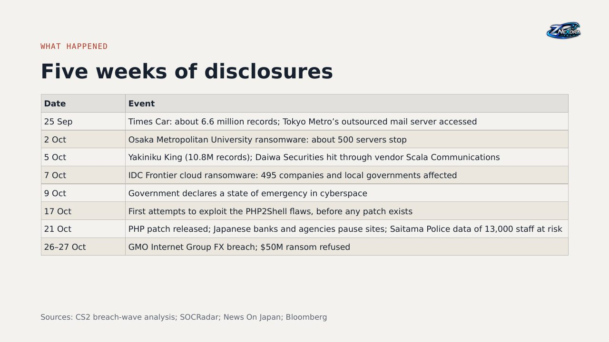

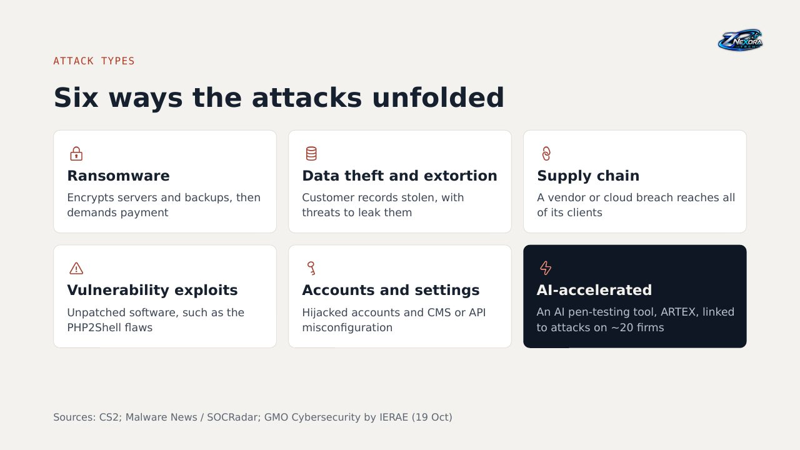

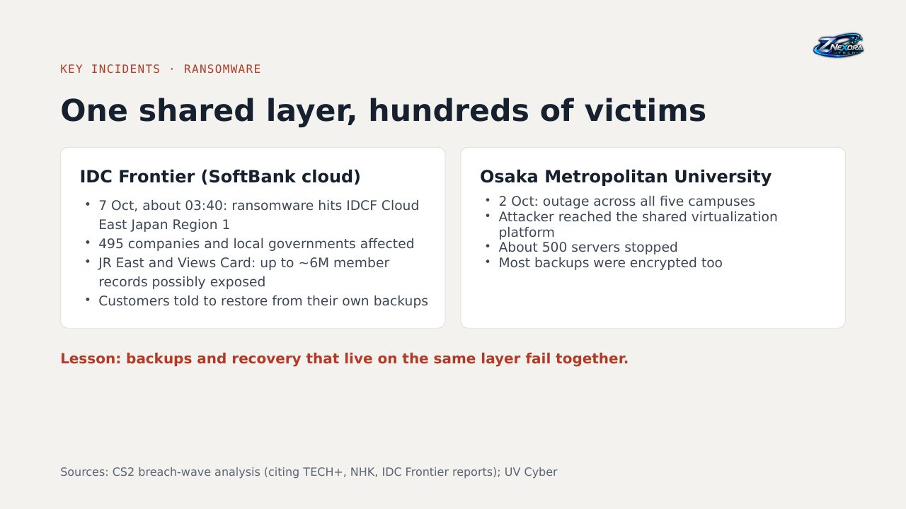

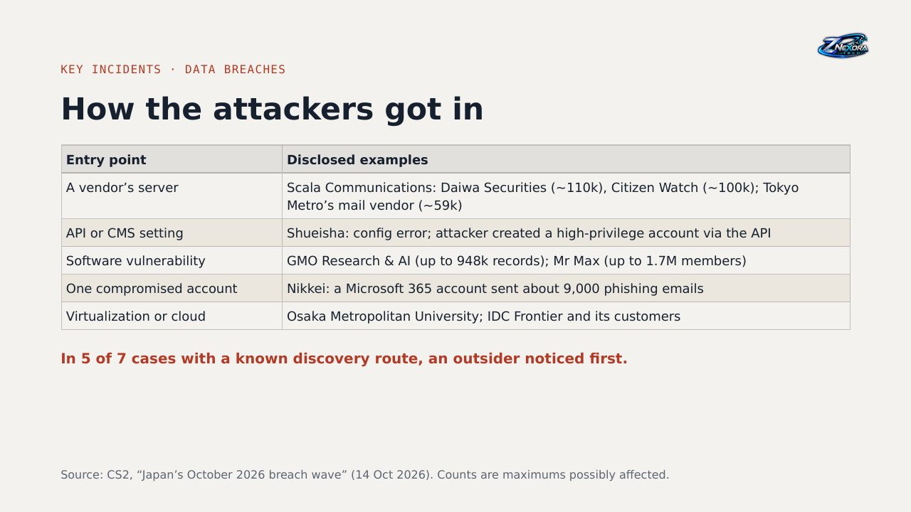

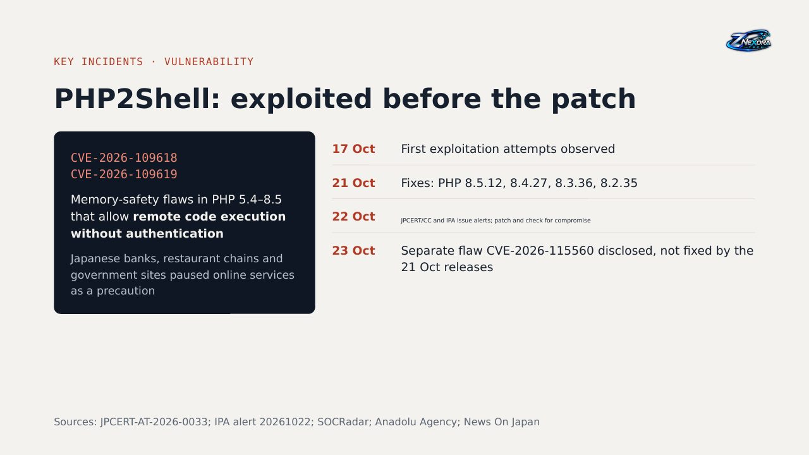

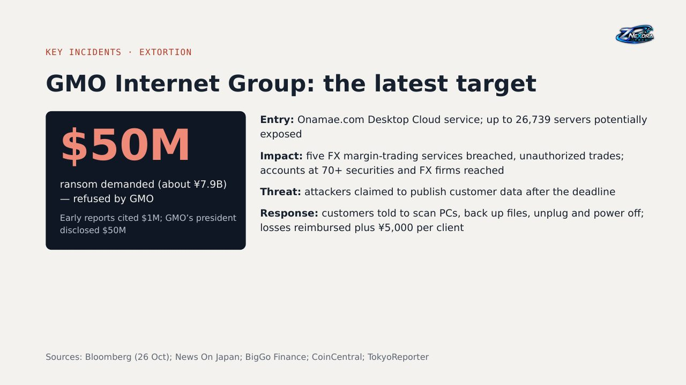

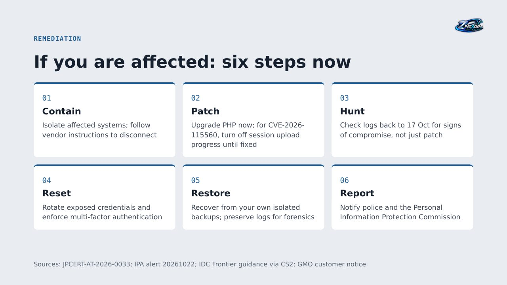

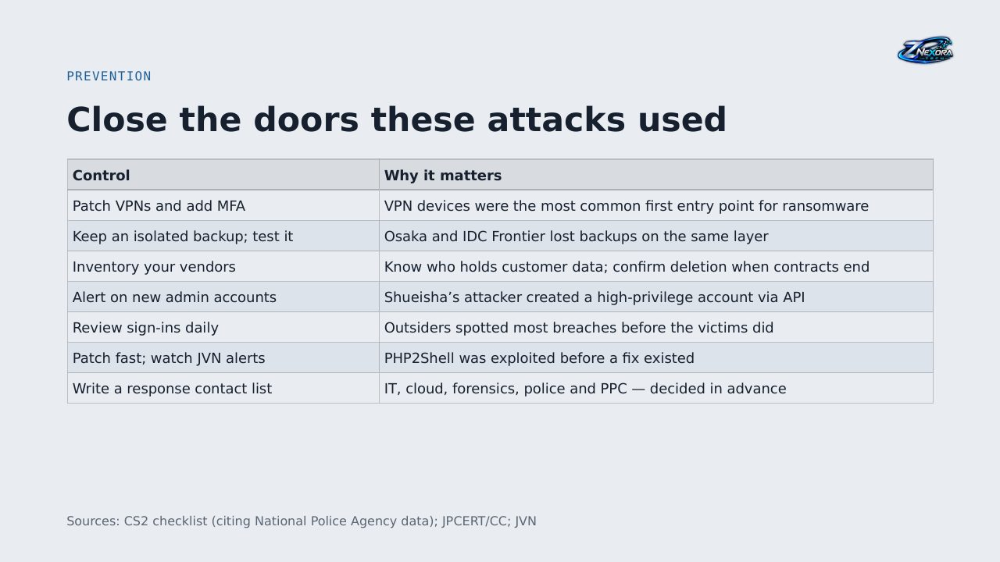

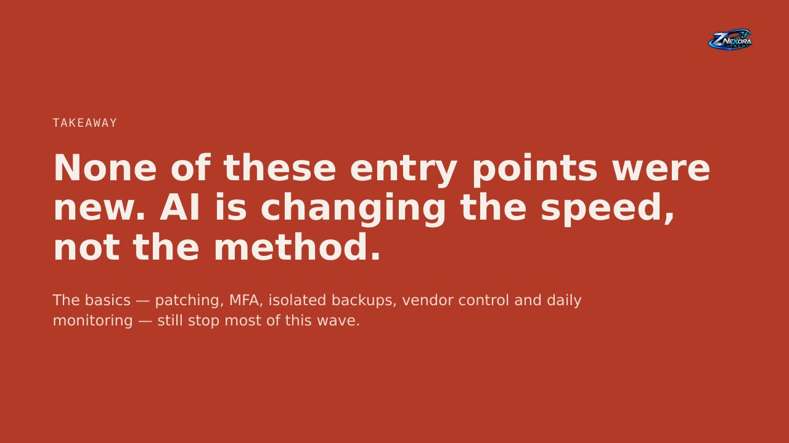

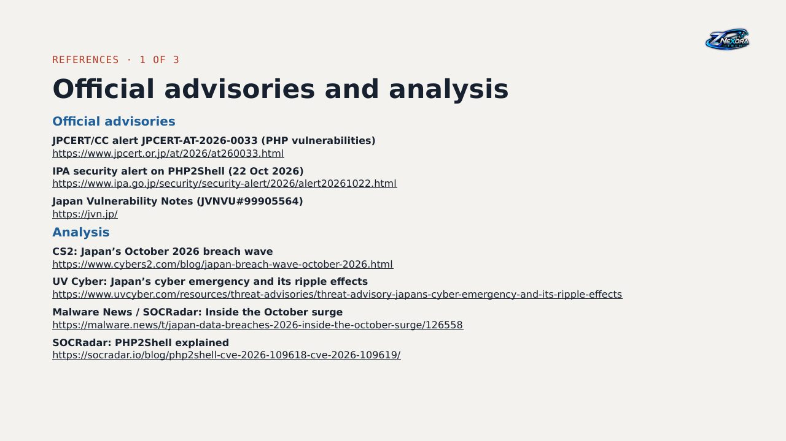

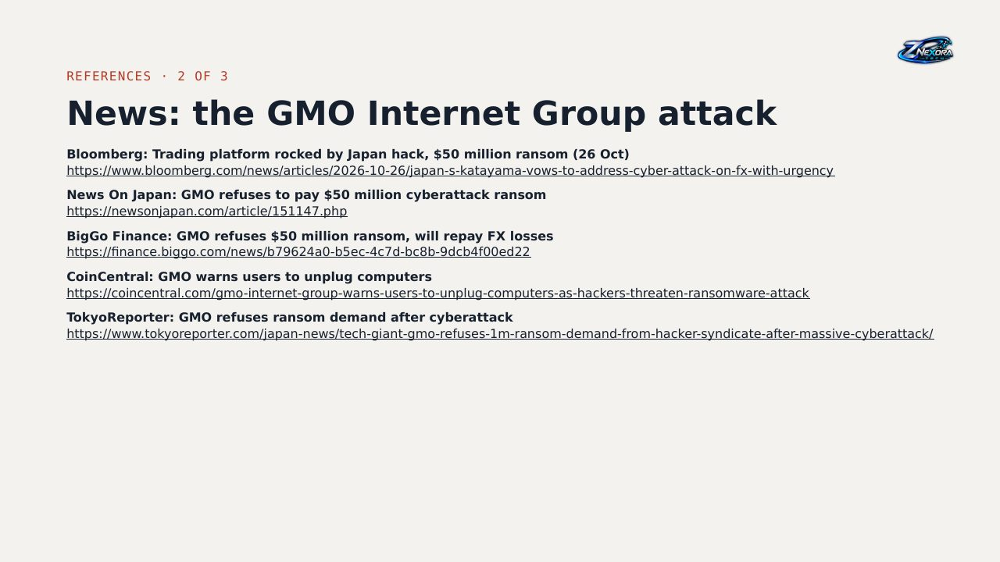

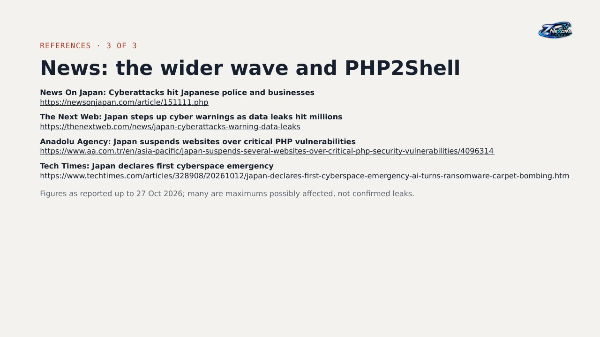
