## Key points

### Personal hygiene for your digital life
- 01 · WHAT IS CYBER HYGIENE?
- Small routines, done every day, that keep you, your devices and our data healthy.
- AT HOME
- AT WORK
- Wash your hands
- Install updates
- Removes known weaknesses
- Lock your front door
- Lock your screen
- Stops casual access
- Copy important papers
- Back up your work
- Recover when things go wrong
- Keep your home tidy
- Clean desk
- Nothing left for others to find
- ZNexora Tech
- ZNexora Tech · 2

[0:40 – 1:40] So what is cyber hygiene? It's exactly like personal hygiene, but for your digital life: small routines, done every day, that keep you, your devices and our data healthy. You already do the physical versions without thinking. You wash your hands to remove germs; installing updates removes known weaknesses. You lock your front door; locking your screen stops casual access. You keep copies of important papers; backing up your work lets you recover when things go wrong. And you keep your home tidy; a clean desk leaves nothing for others to find. None of these feel like a big deal, and that's the point. They become automatic.

### Most attacks exploit the basics
- 02 · WHY BASICS MATTER
- 31%
- of breaches now start by exploiting an unpatched vulnerability
- Verizon DBIR 2026
- 99%+
- of identity attacks blocked by phishing-resistant MFA
- Microsoft Digital Defense Report 2025
- $4.99M
- global average cost of a data breach
- IBM 2026
- Attackers look for  the easiest way in . Good habits close those doors.
- Sources: Verizon DBIR 2026 · Microsoft Digital Defense Report 2025 · IBM Cost of a Data Breach 2026
- ZNexora Tech · 3

[1:40 – 2:30] Why do the basics matter so much? Because most attacks exploit them. Verizon's 2026 report found that 31 percent of breaches now start by exploiting an unpatched vulnerability: a weakness that an update would already have fixed. Microsoft reports that phishing-resistant MFA blocks over 99 percent of identity attacks. And when the basics fail, IBM puts the global average cost of a breach at 4.99 million dollars. Attackers aren't usually looking for the hardest way in. They look for the easiest. Good habits simply close those easy doors.

### Eight habits that make the difference
- 03 · THE HABITS
- 1
- Update
- 2
- Lock
- 3
- Back up
- 4
- Clean desk
- 5
- Strong logins
- 6
- Think before you click
- 7
- Use approved tools
- 8
- Report
- We'll look closely at the  first four , then quickly at the rest.
- ZNexora Tech
- ZNexora Tech · 4

[2:30 – 3:00] Here are the eight habits that make the difference: update, lock, back up, keep a clean desk, use strong logins, think before you click, use approved tools, and report. We'll look closely at the first four, which are the everyday basics this session is about, and then quickly cover the other four, which we've explored in more depth in earlier sessions.

### Install updates promptly
- HABIT 1 · UPDATE
- WHAT TO DO
- Install updates when prompted, don't postpone
- Restart your computer at least once a week
- Update your phone and its apps too
- Remove apps you no longer use
- WHY IT MATTERS
- Updates fix security holes that attackers already know about. Every day you delay is a day the door stays open.
- QUICK TIP
- Postponing? Pick a time today, like lunch, and restart then.
- ZNexora Tech
- ZNexora Tech · 5

[3:00 – 4:00] Habit one: install updates promptly. When your computer or phone asks to update, don't keep clicking 'remind me later'. Restart your computer at least once a week, because many updates only finish when you restart. Update your phone and its apps too, since they hold your email, chats and MFA codes. And remove apps you no longer use, because every app is something else that needs patching. Why does it matter? Updates fix security holes that attackers already know about, and often already exploit. Every day you delay is a day that door stays open. A quick tip: if you can't restart right now, pick a time today, like lunchtime, and do it then.

### Lock it when you leave it
- HABIT 2 · LOCK
- WHAT TO DO
- Windows: press  Win + L
- Mac: press  Ctrl + Cmd + Q
- Set your phone to auto-lock quickly
- Never share your PIN or password
- WHY IT MATTERS
- An unlocked screen lets anyone read your email, send messages as you, or copy files, in seconds.
- QUICK TIP
- Make it muscle memory: stand up, lock, then walk away.
- ZNexora Tech
- ZNexora Tech · 6

[4:00 – 5:00] Habit two: lock it when you leave it. Every time you step away from your desk, even for a minute, lock your screen. On Windows, press the Windows key and L. On a Mac, press Control, Command and Q. Set your phone to auto-lock quickly, and never share your PIN or password, even with colleagues. Why does it matter? An unlocked screen lets anyone read your email, send messages as you, or copy files, and it takes only seconds. It's also one of the easiest ways for a visitor or an insider to cause harm. The tip: make it muscle memory. Stand up, lock, then walk away.

### Back up so you can bounce back
- HABIT 3 · BACK UP
- THE 3-2-1 RULE
- 3
- copies
- 2
- storage types
- 1
- off-site
- Three copies of important data, on two types of storage, with one kept off-site or in the cloud.
- AT WORK
- Save work to [OneDrive / SharePoint / company drive]
- Not only on your desktop or a USB drive
- Back up your phone and personal files too
- Report anything missing or locked straight away
- A backup you've never restored is only a hope.  Test it.
- ZNexora Tech
- ZNexora Tech · 7

[5:00 – 6:00] Habit three: back up so you can bounce back. Ransomware, a lost laptop, a spilled coffee or an accidental delete can all wipe out your work. A simple rule is 3-2-1: three copies of important data, on two different types of storage, with one kept off-site or in the cloud. At work, that mostly happens for you, as long as you save your work to [OneDrive, SharePoint or the company drive], not only on your desktop or a USB drive. Back up your phone and personal files too. And if files suddenly go missing or won't open, report it straight away. One last point, mostly for IT: a backup you've never restored is only a hope. Test it.

### Keep a clean desk and clear screen
- HABIT 4 · CLEAN DESK
- WHAT TO DO
- No passwords on sticky notes
- Lock away papers and devices when you leave
- Collect printouts straight away; shred, don't bin
- Wipe whiteboards after meetings
- WHY IT MATTERS
- Visitors, cleaners and video calls can all see what's on your desk or screen. Paper leaks data too.
- QUICK TIP
- Before you leave each day: clear the desk, lock the drawer, log off.
- ZNexora Tech
- ZNexora Tech · 8

[6:00 – 7:00] Habit four: keep a clean desk and a clear screen. No passwords written on sticky notes, under keyboards or on monitors. Lock away papers and devices when you leave your desk at the end of the day. Collect printouts straight away, and put confidential paper in the shredding bin, not the normal bin. And wipe whiteboards after meetings. Why does it matter? Visitors, cleaners, delivery staff and even people on your video calls can see what's on your desk or screen. Paper leaks data just as easily as email. The tip: before you leave each day, clear the desk, lock the drawer and log off.

### Four more habits, in brief
- HABITS 5 TO 8
- Strong logins
- Use a password manager, unique passwords and MFA. Never approve a prompt you didn't start.
- Think before you click
- Pause on urgent or unexpected messages. Check the sender and the link.
- Use approved tools
- No personal email, cloud, USB or public AI tools for company data.
- Report
- Something odd? Tell IT on [contact] straight away. No blame.
- Covered in depth in our phishing, session theft and insider threat sessions.
- ZNexora Tech
- ZNexora Tech · 9

[7:00 – 7:50] Here are the other four habits, in brief. Strong logins: use a password manager, a unique password for every account, and MFA, and never approve an MFA prompt you didn't start. Think before you click: pause on urgent or unexpected messages, and check the sender and the link. Use approved tools: no personal email, personal cloud storage, USB drives or public AI tools for company data. And report: if something seems odd, tell IT on [contact] straight away. You will never be blamed for reporting. We've covered these in more depth in our phishing, session theft and insider threat sessions.

### Your daily cyber hygiene routine
- 04 · PUTTING IT TOGETHER
- Start of day
- Install pending updates; check for odd sign-in alerts
- Stepping away
- Lock your screen, every time
- During the day
- Pause before clicking; save to approved storage
- End of day
- Clear desk, lock drawer, log off or lock
- Monthly
- Restart, review apps, check your backups
- Altogether, it takes  just a few minutes a day .
- ZNexora Tech
- ZNexora Tech · 10

[7:50 – 8:40] Let's put it together into a simple daily routine. At the start of the day, install any pending updates and glance at any unusual sign-in alerts. Every time you step away, lock your screen. During the day, pause before clicking and save your work to approved storage. At the end of the day, clear your desk, lock your drawer and log off or lock. And once a month, restart, review the apps you have installed, and check your backups are working. Altogether, that takes just a few minutes a day.

### How healthy is your cyber hygiene?
- 05 · SELF-CHECK
- My devices are fully updated
- I lock my screen every time I leave
- My work is saved to approved storage
- No passwords on notes or my desk
- I use a password manager and MFA
- I never approve MFA prompts I didn't start
- I use only approved apps and storage
- I know how to report a problem
- Missed any?  Pick one habit and start it today.
- ZNexora Tech
- ZNexora Tech · 11

[8:40 – 9:30] Let's finish with a quick self-check. Count how many of these are true for you. My devices are fully updated. I lock my screen every time I leave. My work is saved to approved storage. There are no passwords on notes or my desk. I use a password manager and MFA. I never approve MFA prompts I didn't start. I use only approved apps and storage. And I know how to report a problem. If you ticked all eight, great work. If you missed any, don't worry: pick one habit and start it today. Small changes add up quickly.

### Small habits. Big protection.
- QUESTIONS AND DISCUSSION
- Update. Lock. Back up. Keep it clean. Start today.
- Thank you · Presented by ZNexora Tech

[9:30 – 10:00] To wrap up: cyber hygiene isn't about being a security expert. It's about small habits, done every day: update, lock, back up, and keep it clean. They take seconds, but together they stop most attacks before they start. Small habits, big protection. Start today. Thank you. I'm happy to take any questions.

## Slides

[Download the slides as PDF](../../assets/files/cyber-hygiene.pdf)

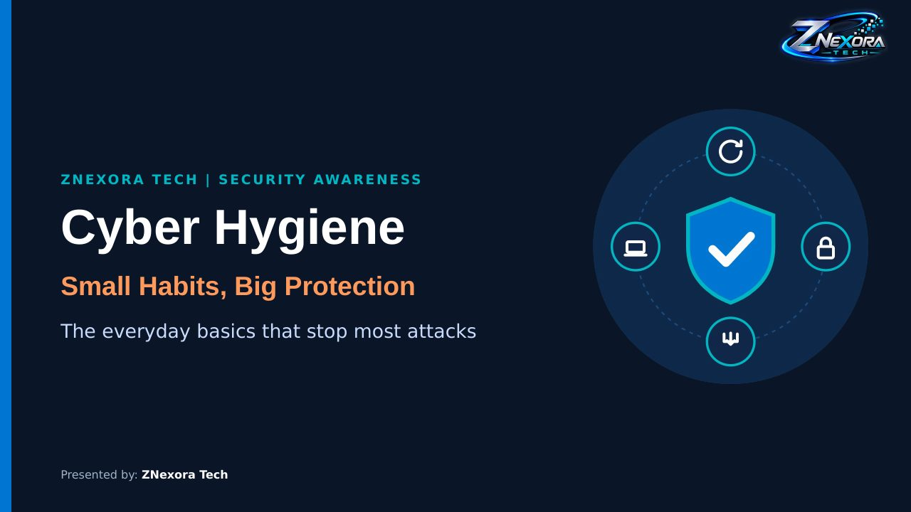

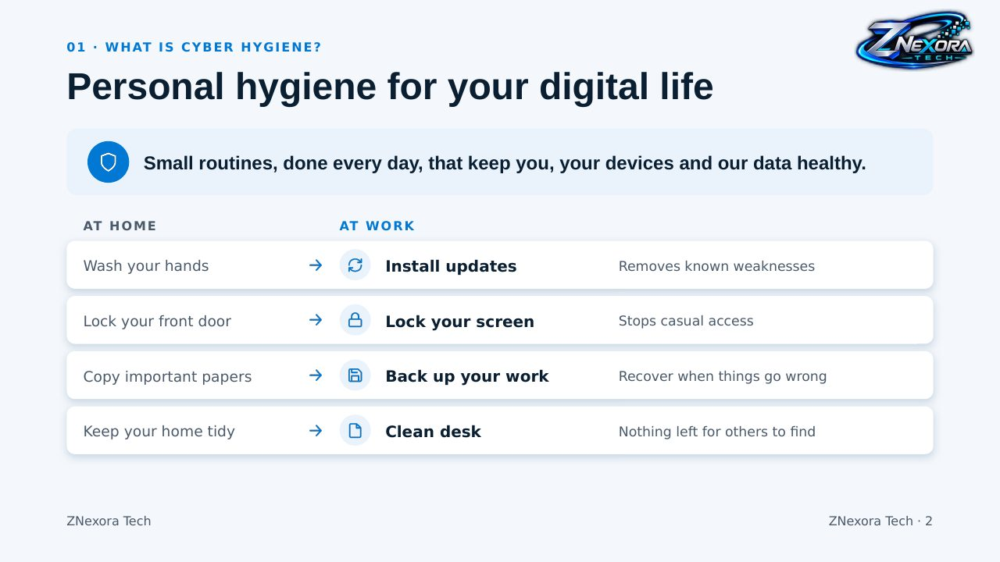

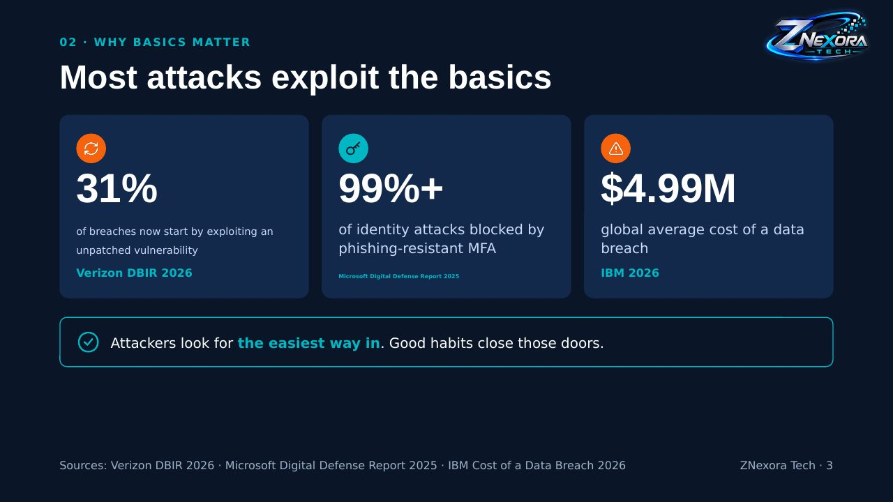

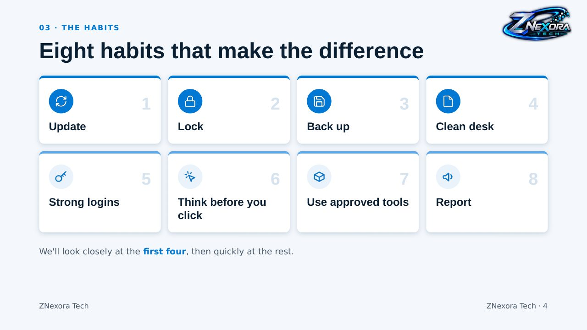

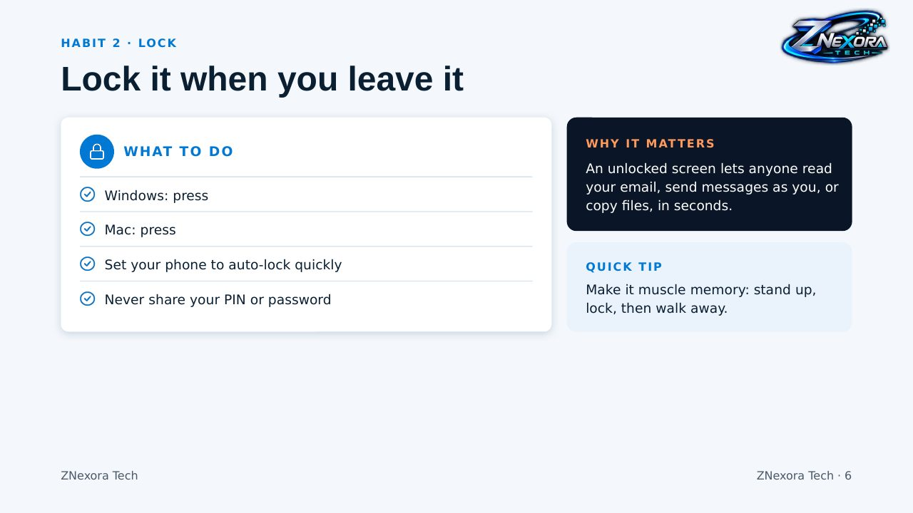

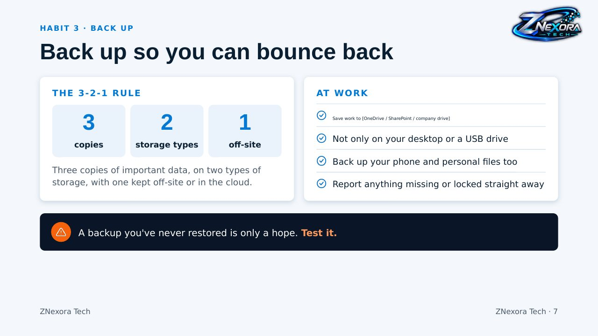

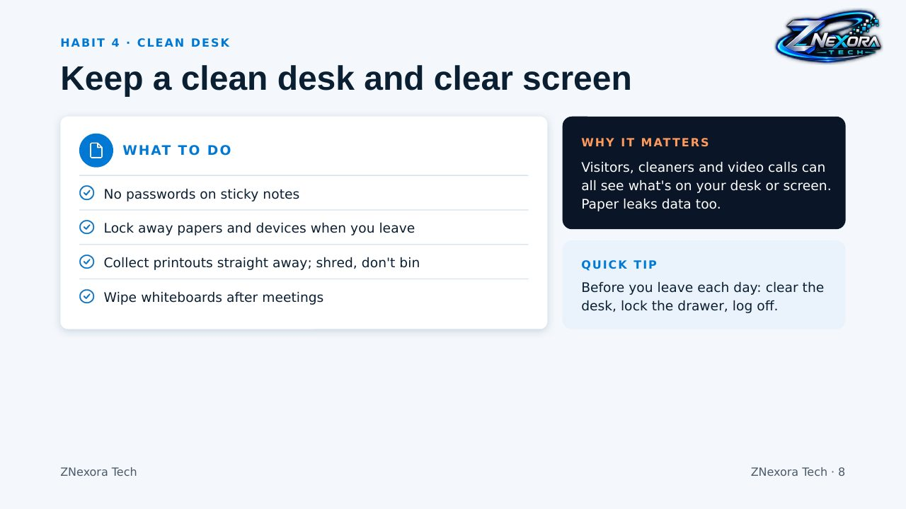

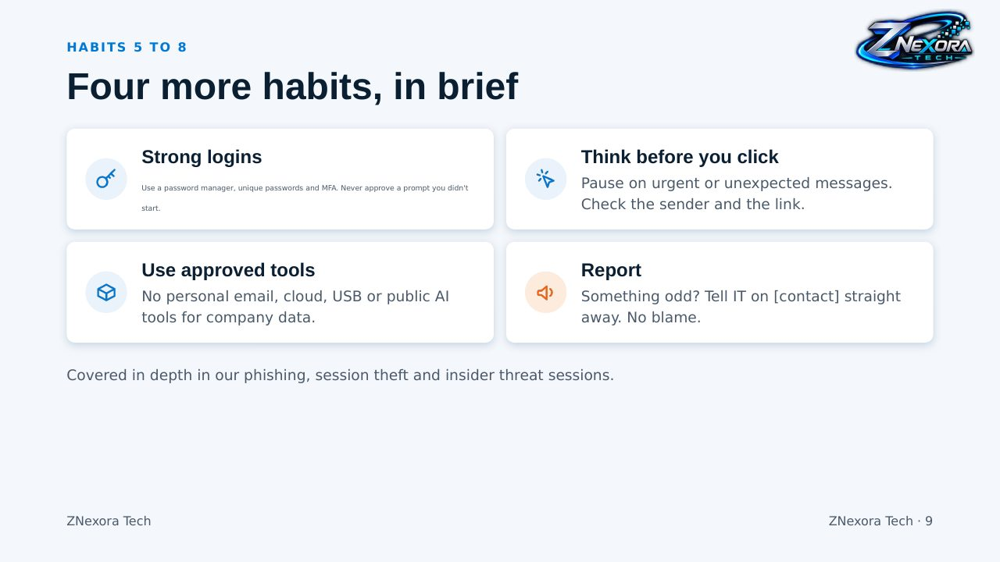

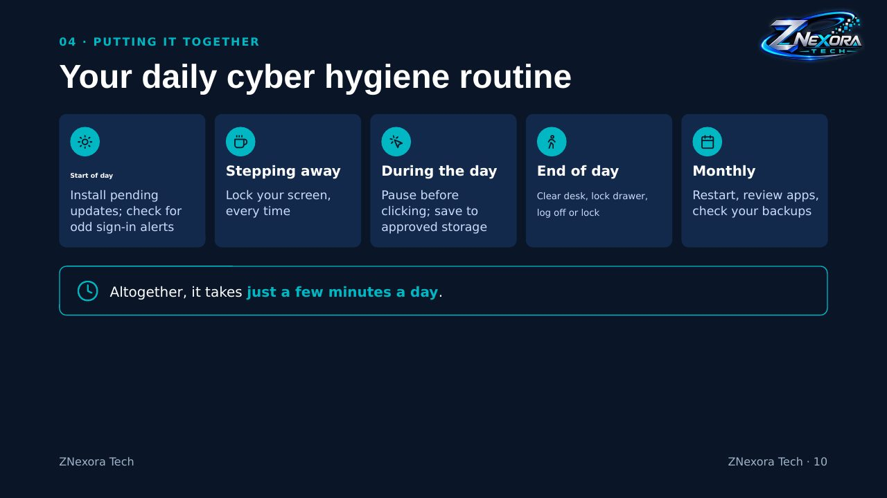

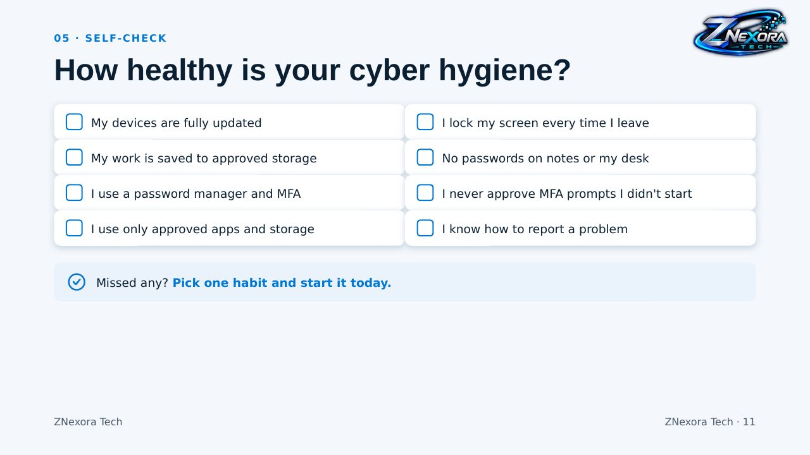

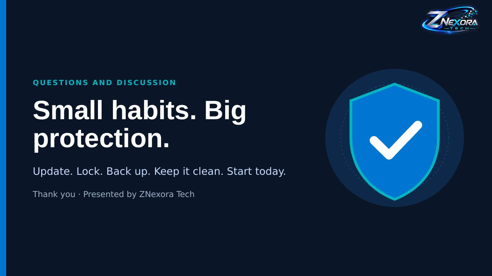
