## Key points

### Malware never sleeps
- 01 · THE SCALE OF THE THREAT
- 560,000
- new malware threats identified every day
- 500,000
- malicious files detected or blocked daily
- 11 sec
- between automated attacks
- 2,086
- attacks per organisation each week, up 9.6%
- In the 10 minutes of this briefing, automated attacks will strike  around 55 times .
- Source: SentinelOne, Malware Statistics 2026
- ZNexora Tech · 2

[0:40 – 1:30] Let's start with the scale. According to SentinelOne, around 560,000 new and distinct malware threats are identified every single day, and around 500,000 malicious files are detected or blocked daily. Automated systems launch an attack roughly every 11 seconds. And the average organisation now faces about 2,086 cyber attacks every week, up almost 10 percent year on year. To put that into perspective: in the ten minutes of this briefing, automated attacks will strike around 55 times. Malware is not an occasional event. It's constant background pressure, and every one of us is part of the defence.

### Top malware delivery routes
- 02 · HOW MALWARE GETS IN
- Email attachments and links
- 41%
- Compromised websites
- 23%
- Software vulnerabilities
- 17%
- Removable media
- 9%
- Supply chain
- 7%
- +563%
- fake CAPTCHA lure incidents
- SentinelOne
- +131%
- malware-laden emails
- Hornetsecurity
- 31%
- of breaches start by exploiting a vulnerability, now the top entry route
- Verizon DBIR
- Sources: SentinelOne 2026 · Hornetsecurity 2026 · Verizon DBIR 2026
- ZNexora Tech · 3

[1:30 – 2:40] How does malware get in? SentinelOne's data shows email is still the number one route: 41 percent of malware is delivered through email attachments or links. 23 percent comes from compromised websites, 17 percent from software vulnerabilities, 9 percent from removable media like USB drives, and 7 percent through the supply chain. Two trends stand out on the right. Incidents using fake CAPTCHA lures, the 'prove you're human' pages that trick people into running commands, rose by 563 percent. Hornetsecurity saw a 131 percent increase in malware-laden emails. And Verizon's 2026 report found that 31 percent of breaches now start with an exploited vulnerability, overtaking stolen credentials as the top entry route. So email, websites and unpatched software are where we need to be most careful.

### Infostealers lead the pack
- 03 · MALWARE TYPES ON THE RISE
- 155,000+
- infostealer detections in early 2026, the most active malware type
- Most detected: Agent Tesla, Formbook and Lumma
- 72,000+
- Remote Access Trojan detections, #2 worldwide
- +220%
- growth in targeted credential-stealer infections
- +124%
- rise in IoT malware attacks
- 37%
- of new malware uses AI-enhanced evasion
- Source: SentinelOne, Malware Statistics 2026
- ZNexora Tech · 4

[2:40 – 3:30] Which types of malware are growing? Infostealers are now the most active type. More than 155,000 were detected in early 2026, with Agent Tesla, Formbook and Lumma the most common. Infostealers quietly harvest saved passwords, browser cookies and crypto wallets, and that stolen data is sold to other criminals. Remote access trojans, which give attackers hidden control of a device, rank second with over 72,000 detections. Targeted credential-stealer infections have grown by 220 percent, IoT malware attacks rose 124 percent, and 37 percent of new malware now uses AI to help it evade detection. The message is clear: attackers want our credentials more than ever.

### Ransomware in nearly half of breaches
- 04 · RANSOMWARE
- RANSOMWARE SHARE OF BREACHES
- 10%
- DBIR 2021
- 44%
- DBIR 2025
- 48%
- DBIR 2026
- 69%
- of victims refused to pay, up from 64%
- $139,875
- median ransom payment, down from $150,000
- Top 4
- active families early 2026: Qilin, Akira, Clop, The Gentlemen
- Sources: Verizon DBIR 2021–2026 · SentinelOne 2026
- ZNexora Tech · 5

[3:30 – 4:30] Ransomware remains the most damaging form of malware. Verizon's Data Breach Investigations Report shows how dramatically it has grown: ransomware was present in about 10 percent of breaches in 2021, 44 percent in the 2025 report, and 48 percent in the 2026 report. That's almost half of all breaches. There is some good news: 69 percent of victims refused to pay, up from 64 percent, and the median ransom payment fell to 139,875 dollars. That's thanks to better backups and recovery planning. The most active ransomware families in early 2026 include Qilin, Akira, Clop and The Gentlemen. For us, this means good backups and fast reporting are essential.

### Attackers move in minutes
- 05 · SPEED AND STEALTH
- 29 min
- average eCrime breakout time
- 27 sec
- fastest breakout observed
- 82%
- of detections were malware-free
- +89%
- attacks by AI-enabled adversaries
- Breakout time  is how long an attacker needs to move from first access to other systems.
- Malware-free  attacks use stolen logins and trusted tools instead of malicious files.
- Source: CrowdStrike 2026 Global Threat Report
- ZNexora Tech · 6

[4:30 – 5:30] Attackers are also getting much faster. CrowdStrike's 2026 Global Threat Report found that the average breakout time, how long it takes an attacker to move from their first foothold to other systems, fell to just 29 minutes. The fastest they observed was 27 seconds. At the same time, 82 percent of detections were malware-free. Attackers increasingly log in with stolen credentials and use trusted tools, instead of dropping obvious malicious files. And attacks by AI-enabled adversaries rose 89 percent. What this means for us: we can't rely on antivirus alone, and every minute matters. If something looks wrong, reporting it straight away gives our security team a chance to stop an attacker before they spread.

### No sector is immune
- 06 · WHO IS TARGETED
- Manufacturing
- 34.7%
- of malware incidents; ransomware drives 61% of its malware breaches
- Healthcare
- $6.64M
- average breach cost, the highest of any sector for 13 years
- Financial services
- $6.29M
- average breach cost, up from $5.56M
- Government and public sector
- 19%
- of global malware incidents
- Small and mid-size businesses
- 88%
- of SMB breaches involve ransomware, vs 39% at large firms
- Sources: SentinelOne 2026 · Verizon DBIR 2026 · IBM Cost of a Data Breach 2026
- ZNexora Tech · 7

[5:30 – 6:20] Who is being targeted? The honest answer is everyone. Manufacturing accounts for about 35 percent of malware incidents, and Verizon found that ransomware drives 61 percent of malware breaches in that sector. Healthcare has the highest breach costs of any industry, at 6.64 million dollars on average, for the thirteenth year running. Financial services is close behind at 6.29 million. Government and the public sector account for 19 percent of global malware incidents. And small and mid-size businesses are hit especially hard: ransomware appears in 88 percent of SMB breaches, compared with 39 percent at larger firms. No organisation is too small or too unimportant to be a target, and that includes us.

### What a breach costs in 2026
- 07 · THE COST
- GLOBAL AVERAGE COST OF A BREACH
- $4.99M
- Up 12% in a year, the highest IBM has ever recorded
- $11.5M
- average breach cost in the US
- 247 days
- to identify and contain a breach
- $5.29M
- average cost when phishing, vishing or smishing is the entry point
- $1.93M
- saved per breach with AI and automation in security
- Source: IBM Cost of a Data Breach Report 2026
- ZNexora Tech · 8

[6:20 – 7:20] What does all this cost? IBM's 2026 Cost of a Data Breach Report puts the global average at 4.99 million dollars per breach. That's up 12 percent in a year and the highest figure IBM has ever recorded. In the United States the average is 11.5 million. Breaches take an average of 247 days to identify and contain, and slower containment means higher costs. Phishing, including voice and SMS phishing, was the costliest entry point, at 5.29 million dollars on average. On the positive side, organisations using AI and automation in their security operations saved 1.93 million dollars per breach. Speed of detection and reporting directly reduces the damage.

### Behind most statistics is one moment: a click, a paste or a reused password.
- THE COMMON THREAD
- That moment is where each of us can stop an attack.

[7:20 – 7:50] If we step back from all these numbers, there's a common thread. Email is the top delivery route, fake CAPTCHA lures are surging, and 82 percent of attacks use stolen credentials rather than malware. Behind most of these statistics is one human moment: someone clicked a link, pasted a command, or reused a password. That's actually good news, because it means that moment is exactly where each of us can stop an attack.

### From statistics to action
- 08 · WHAT THIS MEANS FOR OUR UNIT
- THE STATISTIC
- OUR ACTION
- Email is the #1 malware route (41%)
- Pause before opening unexpected links and attachments
- Fake CAPTCHA lures up 563%
- Never paste or run commands a website gives you
- 82% of detections are malware-free
- Protect your logins: MFA and unique passwords
- 31% of breaches start with a vulnerability
- Install updates promptly and restart when asked
- Ransomware in 48% of breaches
- Save work to backed-up storage, not just your desktop
- 29-minute average breakout
- Report anything suspicious to IT immediately
- Sources: SentinelOne · Verizon DBIR · CrowdStrike, all 2026
- ZNexora Tech · 9

[7:50 – 9:00] So what does this mean for our unit? Let's turn each statistic into an action. Email is the number one malware route, so pause before opening unexpected links and attachments. Fake CAPTCHA lures are up 563 percent, so never paste or run commands that a website gives you. 82 percent of detections are malware-free, so protect your logins with MFA and unique passwords. 31 percent of breaches start with an unpatched vulnerability, so install updates promptly and restart when asked. Ransomware appears in 48 percent of breaches, so save your work to backed-up storage, not just your desktop. And with an average breakout time of 29 minutes, report anything suspicious to IT immediately. Six simple actions that directly address the biggest risks in the data.

### Sources
- 09 · REFERENCES
- SentinelOne
- Malware Statistics for 2026, updated 7 May 2026
- Verizon
- 2026 Data Breach Investigations Report
- IBM
- Cost of a Data Breach Report 2026
- CrowdStrike
- 2026 Global Threat Report
- Hornetsecurity
- Cybersecurity Report 2026
- Figures are as published by each source. Some SentinelOne figures aggregate third-party research.
- Global Malware Attack Statistics 2026
- ZNexora Tech · 10

[9:00 – 9:30] For anyone who wants to read further, here are the sources behind today's figures: SentinelOne's malware statistics for 2026, Verizon's 2026 Data Breach Investigations Report, IBM's 2026 Cost of a Data Breach Report, CrowdStrike's 2026 Global Threat Report, and Hornetsecurity's 2026 Cybersecurity Report. Note that some of SentinelOne's figures bring together research from other organisations, so exact numbers can vary between reports. But the trends are consistent across all of them.

### Every statistic starts with one click.
- QUESTIONS AND DISCUSSION
- Stay alert. Protect your logins. Report fast.
- Thank you · Presented by ZNexora Tech

[9:30 – 10:00] To wrap up: malware attacks are constant, faster than ever, and increasingly built around stolen credentials. But every statistic we've seen today starts with a single moment, often one click. If we stay alert, protect our logins, and report fast, we take ourselves out of these statistics. Thank you for your time. I'm happy to take any questions.

## Slides

[Download the slides as PDF](../../assets/files/global-malware-attack-statistics-2026.pdf)

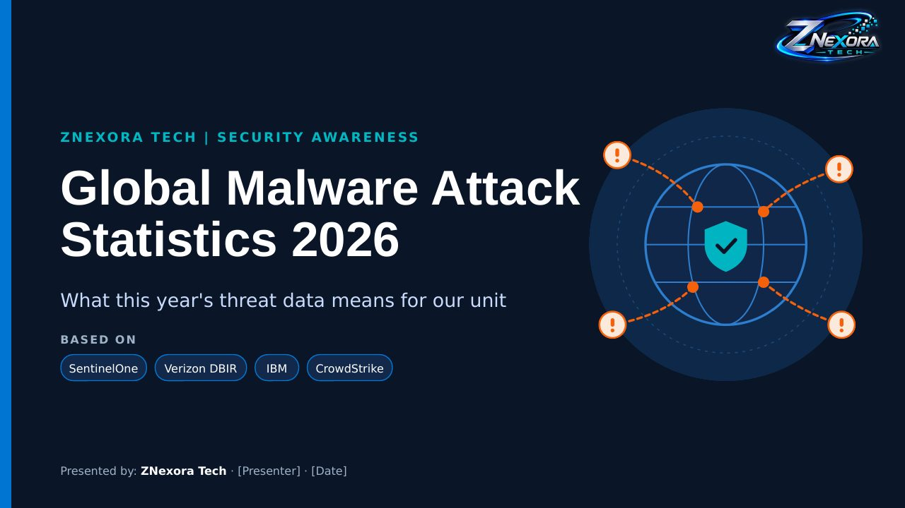

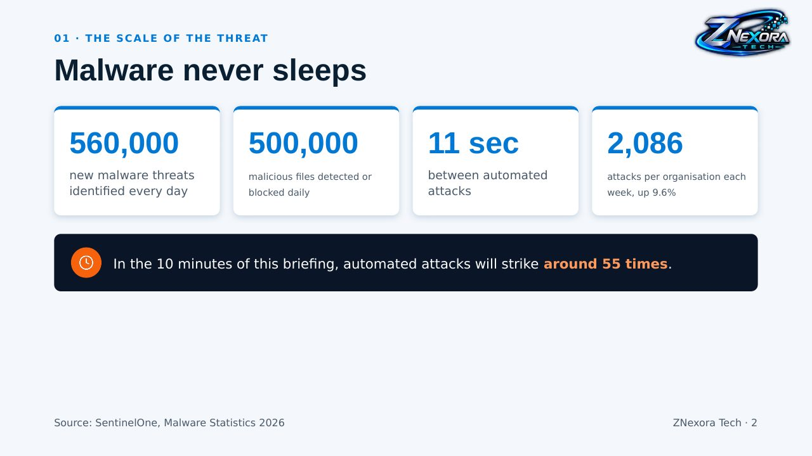

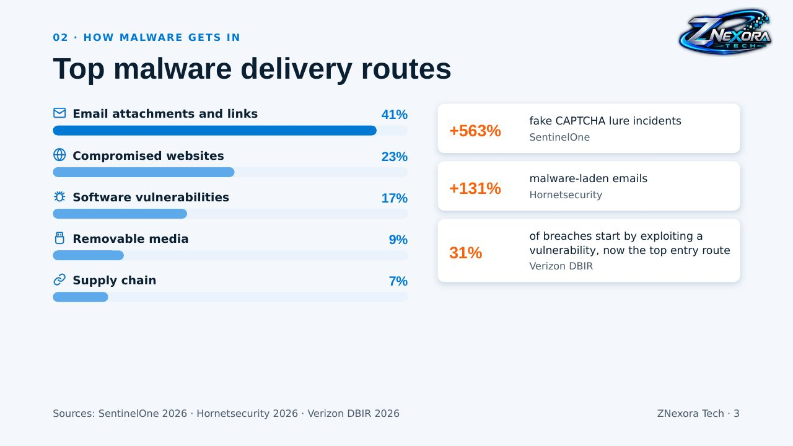

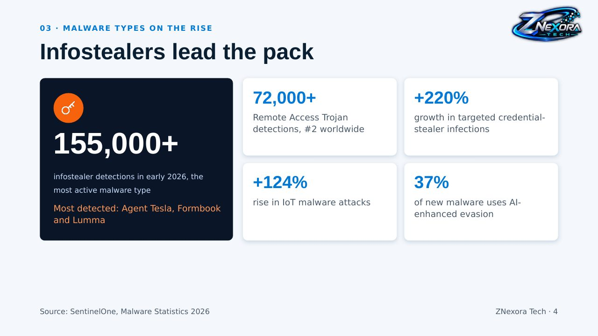

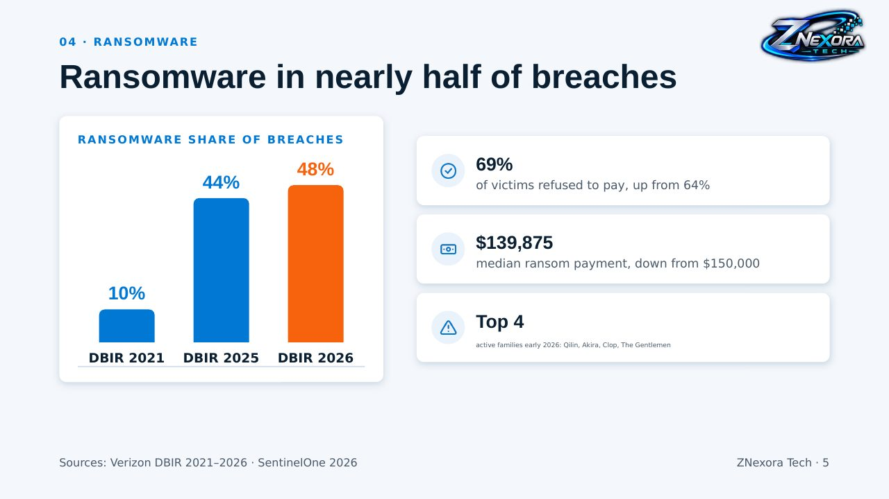

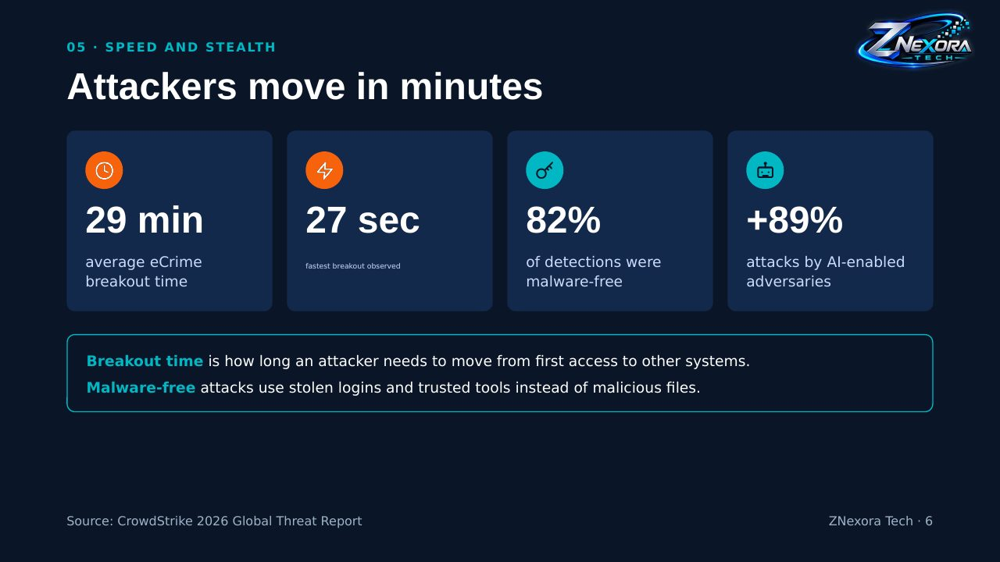

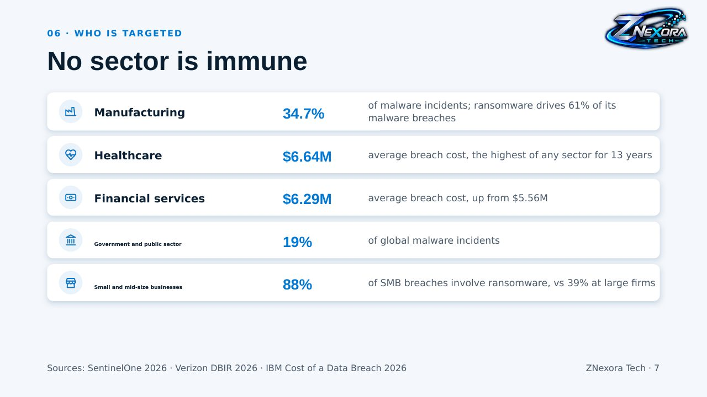

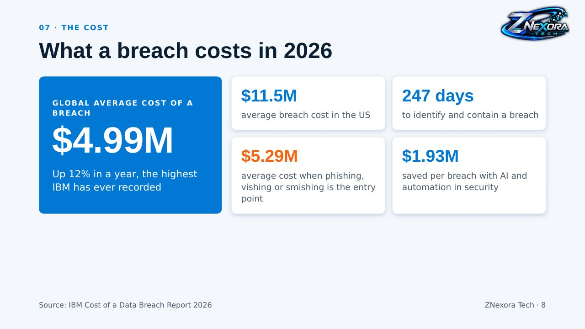

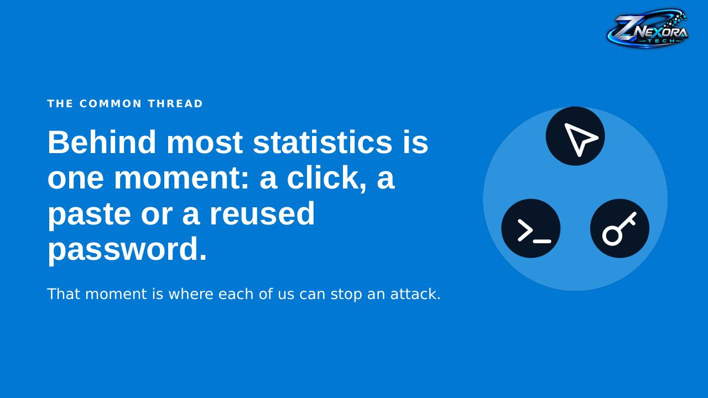

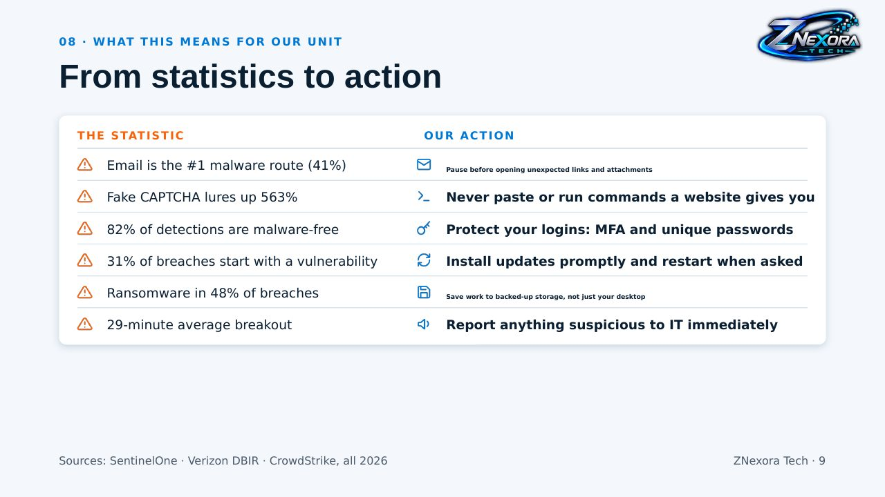

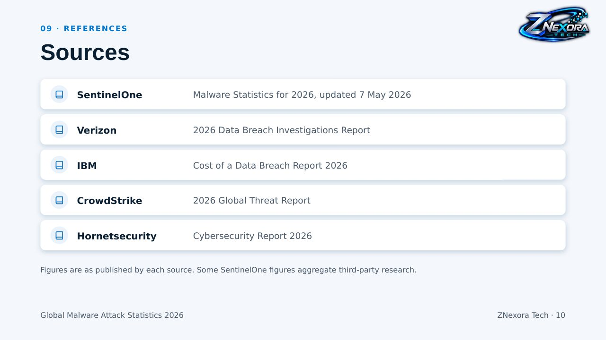

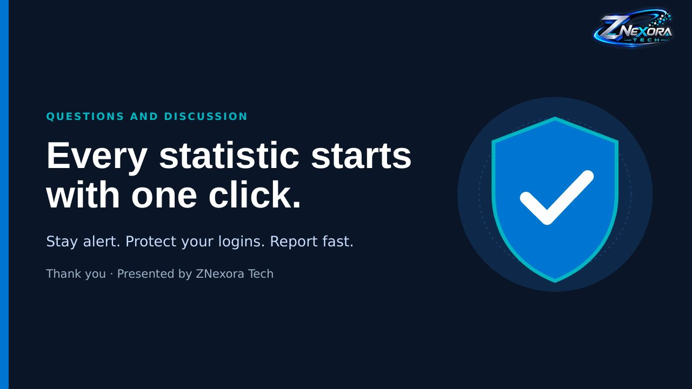
