## Key points

### Your session cookie is a festival wristband
- 01 · WHAT IS A SESSION?
- 1. Show your ticket
- Password + MFA at the gate
- In IT terms: Your login
- 2. Get a wristband
- Staff now check the band, not the ticket
- In IT terms: Your session cookie
- 3. Someone steals the band
- They walk in as you, no ticket needed
- In IT terms: Session hijacking
- A simple way to understand session hijacking
- ZNexora Tech · 2

[0:40 – 1:40] First, what is a session? Think about going to a music festival. At the gate, you show your ticket and ID. That's your password and MFA. Once you're checked, you get a wristband. For the rest of the day, staff don't check your ticket again; they just look at your wristband. On a website, that wristband is called a session cookie. After you log in, your browser stores it so you don't have to enter your password and MFA code on every click. Now imagine someone steals your wristband. They walk straight in as you, with no ticket and no ID check. That's session hijacking, and it's exactly what attackers do with stolen cookies.

### MFA protects the login, not the session
- 02 · WHY IT MATTERS
- 8.6B
- stolen session cookies found in criminal data in a single year
- SpyCloud 2025
- 59%
- of taken-over accounts had MFA switched on
- Proofpoint
- +146%
- rise in adversary-in-the-middle phishing in one year
- Obsidian Security
- A stolen session is now worth as much as a stolen password,  and MFA can't see it.
- Sources: SpyCloud · Proofpoint · Obsidian Security, as compiled in 2026 MFA bypass research
- ZNexora Tech · 3

[1:40 – 2:30] Why does this matter? Because MFA protects the login, not the session that comes after it. Look at the numbers. SpyCloud recovered 8.6 billion stolen session cookies from criminal data in a single year. Proofpoint found that 59 percent of taken-over accounts actually had MFA switched on. And adversary-in-the-middle phishing, which we'll look at in a moment, rose 146 percent in a year. MFA is still essential, and it blocks the vast majority of attacks. But a stolen session cookie lets an attacker skip the login completely, so MFA never gets the chance to check them.

### Three ways attackers steal your session
- 03 · HOW SESSIONS ARE STOLEN
- 1
- Infostealer malware
- Malware like Lumma and Vidar copies cookies straight from your browser.
- ARRIVES VIA
- Fake CAPTCHAs, cracked software, malicious downloads
- 2
- Fake login pages (AiTM)
- A fake page passes your real login through and keeps the session it creates.
- ARRIVES VIA
- Phishing emails, texts and QR codes
- 3
- Code and consent tricks
- You're asked to enter a code or approve an app, giving it access to your account.
- ARRIVES VIA
- “Enter this code to verify”, “Allow this app”
- Sources: SpyCloud · Obsidian Security · Huntress, 2026
- ZNexora Tech · 4

[2:30 – 3:30] There are three main ways attackers steal a session. One: infostealer malware, like Lumma and Vidar from our earlier sessions. Once it's on your device, it copies the cookies straight out of your browser. It arrives through fake CAPTCHAs, cracked software and malicious downloads. Two: fake login pages, known as adversary-in-the-middle or AiTM phishing. These pages sit between you and the real website, pass your real login through, and keep the session it creates. They arrive through phishing emails, texts and QR codes. And three: code and consent tricks, where you're asked to enter a code or approve an app, which quietly gives the attacker access to your account. Huntress reported a huge spike in this kind of code phishing in 2026.

### How fake login pages steal sessions
- 04 · FAKE LOGIN PAGES
- You
- Enter your real password and approve MFA
- Fake page (proxy)
- Looks real; relays everything; copies your cookie
- Real website
- Sees a genuine login and issues a session
- Your login  succeeds . The MFA prompt is  real . The attacker still gets in.
- Adversary-in-the-middle (AiTM) phishing
- ZNexora Tech · 5

[3:30 – 4:40] Let's look closer at fake login pages, because they're the most surprising. You click a link in an email, and see what looks exactly like your normal login page. But it's a proxy, a go-between, sitting between you and the real website. You type your password; the fake page instantly passes it to the real site. The real site sends you a genuine MFA prompt, and you approve it, because you really are logging in. The real website then issues a session cookie, and the fake page copies it on the way back to you. You land in your account, everything looks normal, and you carry on working. But the attacker now has your wristband. Your login succeeded, the MFA prompt was real, and the attacker still gets in.

### Infostealers take every session at once
- 05 · MALWARE ROUTE
- 0:00
- Infostealer runs
- after a fake CAPTCHA or download
- 0:01
- Cookies copied
- every site you're signed in to
- 0:02
- Sent and sold
- bundled into “logs” online
- Later
- Attacker logs in as you
- email, cloud apps, admin tools
- Changing your password alone doesn't help.  The stolen session keeps working.
- Sessions must be revoked  so every stolen cookie stops working.
- Links to our Lumma Stealer and Top 10 Malware sessions
- ZNexora Tech · 6

[4:40 – 5:40] The second route is malware, and this is where our Lumma and malware sessions come in. Once an infostealer runs, perhaps after a fake CAPTCHA or a malicious download, it copies the cookies for every website you're signed in to: email, cloud storage, chat, even admin tools. Within a couple of minutes, they're bundled into logs and sold online. Later, a buyer loads your cookies into their own browser and is instantly logged in as you. Here's the critical point: changing your password alone doesn't help, because the stolen session keeps working. The sessions themselves have to be revoked, so every stolen cookie stops working. That's why reporting quickly matters so much.

### Signs your session may be stolen
- 06 · WARNING SIGNS
- Signed out unexpectedly
- from email or apps, for no clear reason
- “New sign-in” alerts
- from a location or device you don't recognise
- Emails you didn't send
- or new inbox rules forwarding your mail
- An MFA prompt via a link
- right after logging in from an email link
- Someone asks for a code
- “enter this code to verify your account”
- Unknown apps or extensions
- connected to your account or browser
- Notice any of these?  Report it to IT straight away.
- ZNexora Tech security guidance
- ZNexora Tech · 7

[5:40 – 6:30] How might you notice that your session has been stolen? Watch for these signs. Being signed out unexpectedly from email or apps for no clear reason. 'New sign-in' alerts from a location or device you don't recognise. Emails in your sent folder that you didn't send, or new inbox rules forwarding your mail. An MFA prompt right after logging in through a link in an email, which can mean you've just used a fake login page. Someone asking you to enter a code to 'verify your account'. And unknown apps or browser extensions connected to your account. If you notice any of these, report it to IT straight away.

### Six habits that protect your session
- 07 · PROTECT YOURSELF
- Go direct, don't follow links
- Use bookmarks or type the address to sign in.
- Check the address bar
- Before typing your password, every time.
- Use passkeys where offered
- Fake pages can't steal a passkey login.
- Never enter codes for others
- No real IT or service asks you to.
- Avoid unknown extensions
- Install only approved browser add-ons.
- Sign out on shared devices
- And don't tick “stay signed in” there.
- ZNexora Tech security guidance
- ZNexora Tech · 8

[6:30 – 7:30] So how do you protect your session? Here are six habits. One: go direct, don't follow links. To sign in to an important service, use a bookmark or type the address yourself, rather than clicking a link in an email. Two: check the address bar before typing your password, every time. Three: use passkeys where they're offered. A passkey is tied to the real website, so a fake page can't use it. Four: never enter codes for other people. No real IT team or service will ever ask you to enter a code they send you. Five: avoid unknown browser extensions, and install only approved add-ons. And six: sign out on shared devices, and don't tick 'stay signed in' there.

### Layered defences against session theft
- 08 · FOR IT AND SECURITY TEAMS
- Phishing-resistant MFA
- Passkeys and FIDO2 keys block over 99% of identity attacks (Microsoft)
- Device-bound sessions
- Token protection so a stolen cookie fails on another device
- Shorter sessions
- Limited lifetimes and continuous access evaluation
- Detect odd session use
- New location, new device or impossible travel
- EDR against infostealers
- Stop cookie theft at the source
- Block risky sign-in flows
- Restrict device code sign-in and app consent
- Sources: Microsoft Digital Defense Report 2025 · NIST SP 800-207
- ZNexora Tech · 9

[7:30 – 8:20] For our IT and security teams, here's the layered defence. First, phishing-resistant MFA: passkeys and FIDO2 security keys, which Microsoft reports block over 99 percent of identity-based attacks, because a fake page can't relay them. Second, device-bound sessions, using token protection so a stolen cookie fails when it's used on another device. Third, shorter sessions, with limited lifetimes and continuous access evaluation. Fourth, detect odd session use, such as a new location, a new device, or impossible travel. Fifth, EDR to stop infostealers at the source. And sixth, block risky sign-in flows, such as device code sign-in and unrestricted app consent where they aren't needed.

### Session stolen? Act fast
- 09 · IF IT HAPPENS
- 1
- Report immediately:   Call IT on [contact]. Minutes matter.
- 2
- Revoke all sessions:   IT signs you out everywhere, killing stolen cookies.
- 3
- Reset password and MFA:   Change your password and re-register MFA methods.
- 4
- Check your account:   Remove unknown inbox rules, apps and devices.
- 5
- Clean the device:   If malware is suspected, IT scans or rebuilds it.
- REMEMBER
- A new password doesn't end a stolen session. Revoking it does.
- ZNexora Tech incident guidance
- ZNexora Tech · 10

[8:20 – 9:10] If you think your session has been stolen, act fast. One: report it immediately to IT on [contact]. Minutes matter. Two: IT revokes all your sessions, signing you out everywhere so every stolen cookie stops working. Three: reset your password and re-register your MFA methods. Four: check your account for anything the attacker left behind, such as unknown inbox rules, connected apps or registered devices. And five: if malware is suspected, IT will scan or rebuild your device, because an infostealer would simply steal your new sessions too. Remember: a new password doesn't end a stolen session. Revoking it does.

### Protect the session, not just the password.
- QUESTIONS AND DISCUSSION
- Go direct. Check the address. Report anything odd.
- Thank you · Presented by ZNexora Tech

[9:10 – 9:40] To wrap up: attackers no longer need your password if they can steal your wristband, your session cookie. MFA is still vital, but it protects the login, not the session. So protect the session too: go direct to login pages, check the address bar, use passkeys, never enter codes for others, and report anything odd straight away. Thank you. I'm happy to take any questions.

## Slides

[Download the slides as PDF](../../assets/files/hacked-without-a-password.pdf)

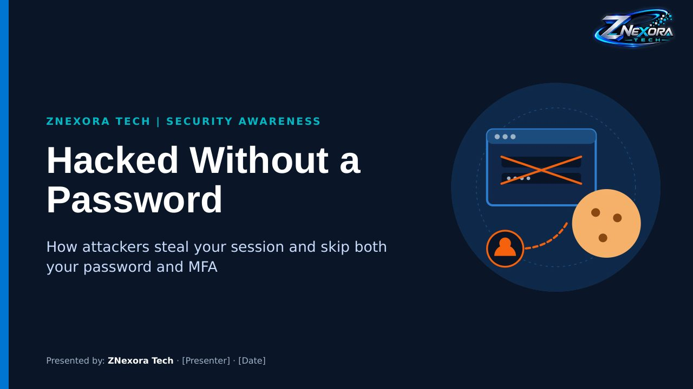

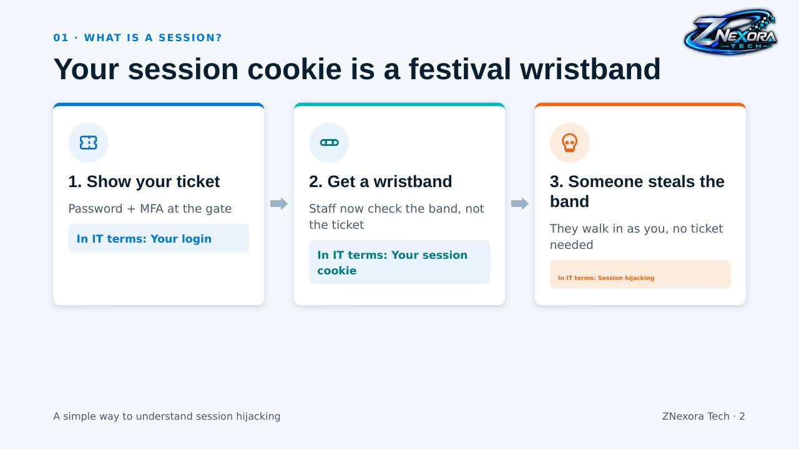

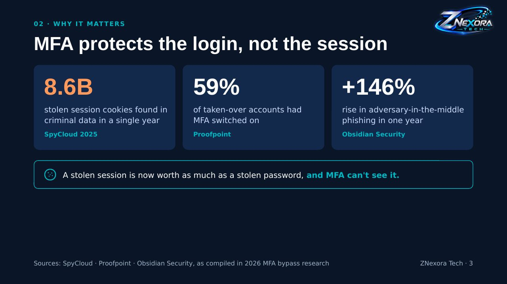

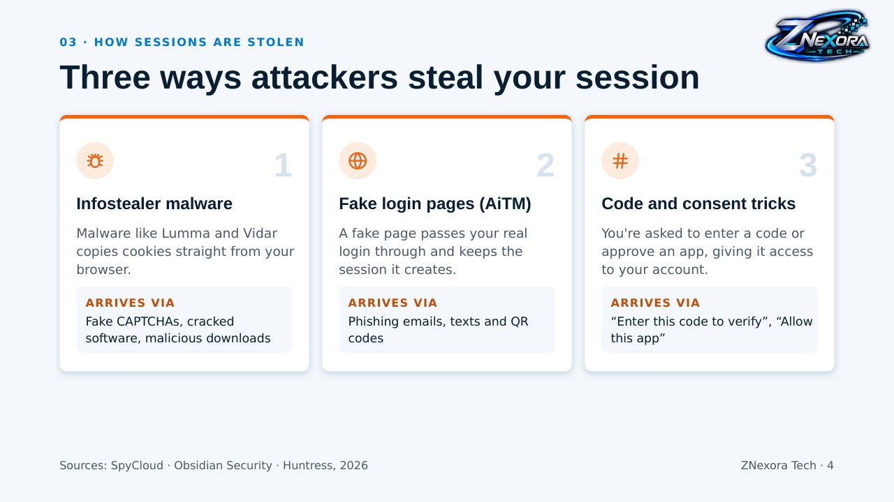

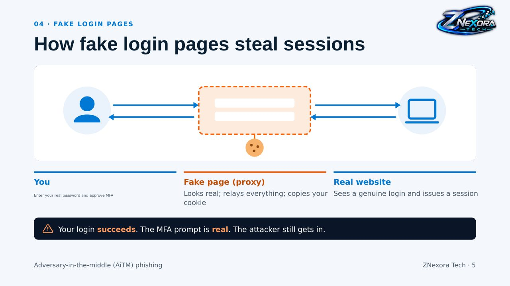

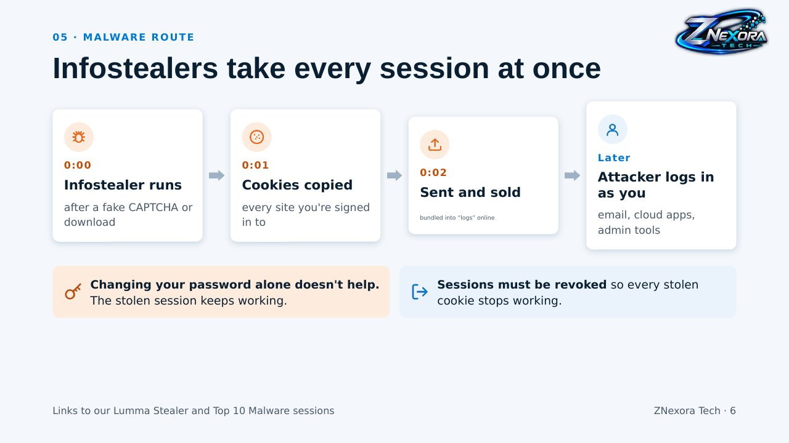

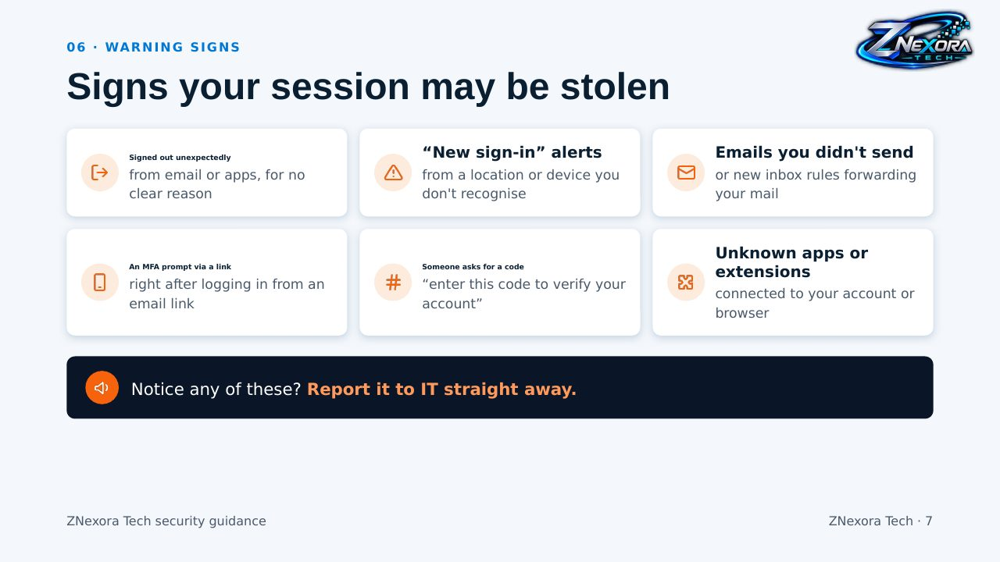

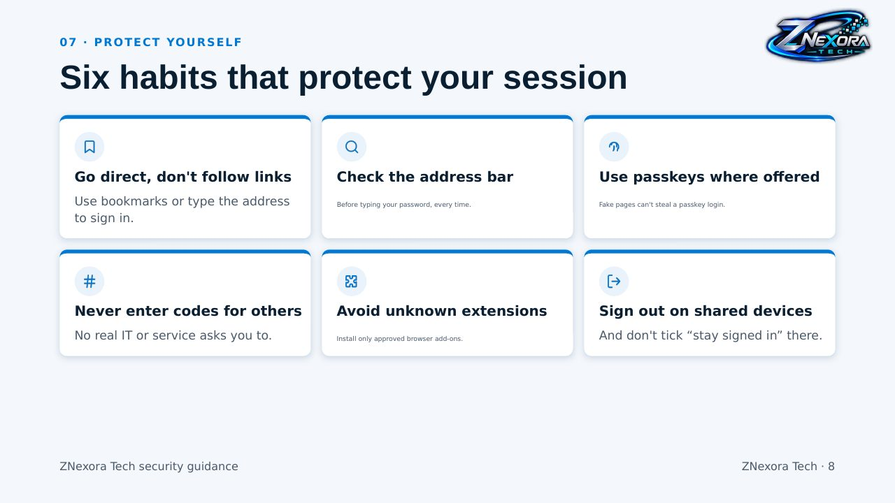

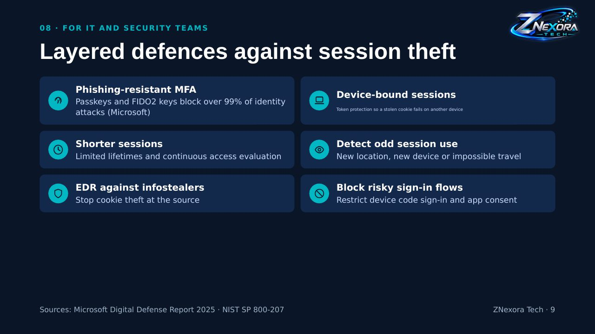

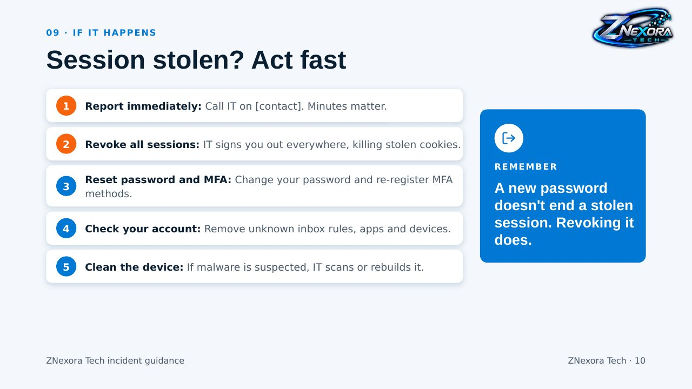

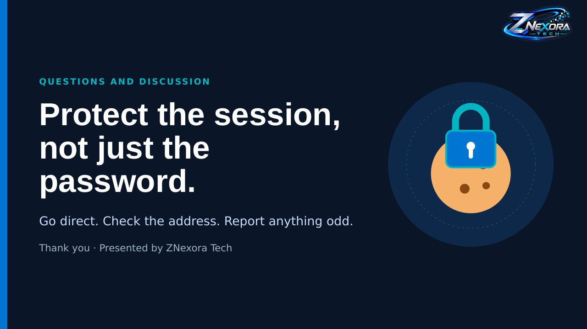
