## Key points

### What is an insider threat?
- 01 · THE DEFINITION
- Anyone with  legitimate access  who harms our data or systems,  on purpose or by accident .
- Employees
- Full-time and part-time staff
- Contractors and temps
- With temporary access
- Partners and suppliers
- Connected to our systems
- Former staff
- If access isn't removed
- Because insiders already have access, firewalls and antivirus often  can't tell the difference  between normal work and harm.
- ZNexora Tech
- ZNexora Tech · 2

[0:40 – 1:30] So what is an insider threat? It's anyone with legitimate access who harms our data or systems, whether on purpose or by accident. That includes employees, contractors and temporary staff, partners and suppliers connected to our systems, and former staff whose access wasn't removed when they left. What makes insider threats hard is that insiders already have the keys. Firewalls and antivirus are designed to keep outsiders out, so they often can't tell the difference between someone doing normal work and someone causing harm.

### Most insider incidents are mistakes
- 02 · THREE TYPES
- SHARE OF INSIDER INCIDENTS
- 53%
- 27%
- 20%
- 53%
- Careless
- Honest mistakes: wrong recipient, lost laptop, risky sharing
- 27%
- Malicious
- Deliberate harm: data theft, fraud, sabotage
- 20%
- Compromised
- Account hijacked by an outsider through stolen credentials
- Source: Ponemon Institute and DTEX, 2026 Cost of Insider Risks Global Report
- ZNexora Tech · 3

[1:30 – 2:30] Insider threats come in three types. According to the 2026 Cost of Insider Risks report from the Ponemon Institute and DTEX, 53 percent of insider incidents are caused by careless or negligent employees: honest mistakes like sending data to the wrong person or losing a laptop. 27 percent are malicious: someone deliberately stealing data, committing fraud or causing sabotage. And 20 percent are compromised insiders, where an outsider steals an employee's credentials and acts as them, which links back to our phishing and session theft sessions. The key message: most insider incidents aren't villains. They're good people making mistakes, and that means most of them are preventable.

### Everyday mistakes that leak data
- 03 · CARELESS INSIDERS
- Wrong recipient
- Email autocomplete sends data to the wrong person
- “Anyone with the link”
- Files shared far more widely than intended
- Personal cloud or email
- Work files sent home to “finish later”
- Pasting into AI tools
- Confidential data put into public chatbots
- Lost devices
- Unencrypted laptops, phones or USB drives
- Printouts and screens
- Documents left on printers or desks
- None of these people meant harm.  All of them caused a data breach.
- ZNexora Tech
- ZNexora Tech · 4

[2:30 – 3:30] Let's start with the most common type: careless mistakes. Sending an email to the wrong recipient because autocomplete picked the wrong name. Sharing a file with 'anyone with the link', so it's open to the whole internet. Sending work files to a personal email or cloud account to finish later. Pasting confidential information into public AI chatbots. Losing an unencrypted laptop, phone or USB drive. And leaving documents on the printer or confidential information visible on a screen. None of these people meant any harm. But every one of them can cause a real data breach, with legal and financial consequences for the organisation.

### When someone means harm
- 04 · MALICIOUS INSIDERS
- COMMON MOTIVES
- Money
- Selling data or access to criminals or competitors
- Grievance
- Revenge after a conflict, demotion or dismissal
- Ideology or pressure
- Personal beliefs, or coercion by outsiders
- WHAT THEY DO
- Copying client lists before leaving for a competitor
- Deleting or sabotaging systems or data
- Committing fraud using their access
- Selling login details to ransomware groups
- The most common moment:  the weeks before someone leaves.
- ZNexora Tech
- ZNexora Tech · 5

[3:30 – 4:30] Less common, but often more damaging, are malicious insiders: people who deliberately cause harm. The motives usually fall into three groups: money, such as selling data or access to criminals or competitors; grievance, revenge after a conflict, demotion or dismissal; and ideology or pressure, including people coerced by outsiders. What do they do? They copy client lists before leaving for a competitor, delete or sabotage systems, commit fraud using their access, or even sell their login details to ransomware groups. One pattern is very common: data theft often happens in the weeks before someone leaves the organisation.

### Watch behaviours, not people
- 05 · WARNING SIGNS
- Unusual downloads
- Bulk copying or large exports
- Access outside their role
- Browsing data they don't need
- Odd working hours
- Late-night access with no reason
- Personal storage use
- USB drives, personal email or cloud
- Bypassing controls
- Disabling security or asking for exceptions
- Open grievances plus exit
- Strong resentment and plans to leave
- Concerned?  Report it confidentially.  Don't investigate or confront anyone yourself.
- ZNexora Tech
- ZNexora Tech · 6

[4:30 – 5:20] How do we spot insider risk? The rule is: watch behaviours, not people. Warning signs include unusual downloads, such as bulk copying or large exports; accessing data outside someone's role; working at odd hours with no clear reason; using personal storage like USB drives, personal email or cloud accounts; trying to bypass security controls or asking for unusual exceptions; and strong resentment combined with plans to leave. One sign on its own usually means nothing. But if you're concerned, report it confidentially to [security contact]. Please don't investigate or confront anyone yourself. Leave that to the right team.

### Insider incidents are expensive
- 06 · THE COST
- $19.5M
- average annual cost of insider risk per organisation, up 20% in two years
- 67 days
- average time to contain an insider incident
- $7.7M
- less when contained within 30 days ($14.2M) than after 90 days ($21.9M)
- The faster an incident is reported,  the less it costs.
- Source: Ponemon Institute and DTEX, 2026 Cost of Insider Risks Global Report
- ZNexora Tech · 7

[5:20 – 6:00] Insider incidents are expensive. The 2026 Ponemon report found the average annual cost of insider risk reached 19.5 million dollars per organisation, up 20 percent in two years. It takes an average of 67 days to contain an insider incident. And speed makes a huge difference: incidents contained within 30 days cost an average of 14.2 million dollars, while those that take more than 90 days cost 21.9 million. That's a 7.7 million dollar difference. The message is the same as in our other sessions: the faster an incident is reported, the less it costs.

### Not all data is equal
- 07 · KNOW YOUR DATA
- LEVEL
- WHO CAN SEE IT
- EXAMPLES
- Public
- Approved for anyone
- Website, press releases
- Internal
- For staff only
- Policies, internal news
- Confidential
- Limited to those who need it
- Customer data, contracts, finance
- Restricted
- Strictly controlled
- Passwords, health data, legal matters
- The higher the level, the more care it needs.  Not sure? Treat it as Confidential.
- Adapt to [Organisation name]'s data classification policy
- ZNexora Tech · 8

[6:00 – 6:50] Protecting sensitive data starts with knowing what's sensitive. Most organisations use levels like these. Public: approved for anyone, like our website. Internal: for staff only, like policies and internal news. Confidential: limited to people who need it, such as customer data, contracts and financial information. And Restricted: strictly controlled, such as passwords, health data and legal matters. The higher the level, the more care it needs when you store, share or send it. And a simple rule: if you're not sure, treat it as Confidential. [Adapt these levels to our organisation's data classification policy.]

### Six habits that protect sensitive data
- 08 · YOUR ROLE
- Double-check recipients
- Before sending anything sensitive
- Share with named people
- Never “anyone with the link”
- Use approved storage only
- No personal email, cloud, USB or AI tools
- Lock screen, clear desk
- Every time you step away
- Access only what you need
- And give back what you don't
- Report mistakes at once
- No blame for honest mistakes
- ZNexora Tech security guidance
- ZNexora Tech · 9

[6:50 – 7:50] So what can each of us do? Six habits. One: double-check recipients before sending anything sensitive; autocomplete is a common culprit. Two: share files with named people, never 'anyone with the link'. Three: use approved storage only, with no personal email, personal cloud, USB drives or public AI tools for work data. Four: lock your screen and keep a clear desk every time you step away. Five: access only what you need, and give back access you no longer use. And six, the most important: report mistakes at once. If you send something to the wrong person, tell IT immediately. Honest mistakes reported quickly can often be fixed, and you won't be blamed.

### Layered protection against insider risk
- 09 · WHAT WE DO AS AN ORGANISATION
- Least privilege
- Access matched to each role
- Regular access reviews
- Remove access people no longer need
- Clean offboarding
- All access removed on the last day
- Data loss prevention
- Blocks risky sharing and uploads
- Behaviour analytics
- Flags unusual data access
- Speak-up culture
- Confidential reporting and support
- Identity management and behaviour analytics delivered the largest cost savings in the 2026 Ponemon study.
- Source: Ponemon Institute and DTEX, 2026 Cost of Insider Risks Global Report
- ZNexora Tech · 10

[7:50 – 8:40] As an organisation, we protect against insider risk in layers. Least privilege: access matched to each role. Regular access reviews, removing access people no longer need. Clean offboarding, so all access is removed on someone's last day, including cloud apps and shared accounts. Data loss prevention, which blocks risky sharing and uploads. Behaviour analytics, which flags unusual data access, such as a sudden bulk download. And a speak-up culture, with confidential reporting and support for people who are struggling, because helping someone early can prevent a grievance from becoming an incident. In the 2026 Ponemon study, identity management and behaviour analytics delivered the biggest cost savings.

### Made a mistake or seen something?
- 10 · SPEAK UP
- I made a mistake
- Sent data to the wrong person, lost a device or shared too widely.
- Tell IT immediately on [contact]. No blame for honest mistakes.
- I've seen something
- Unusual behaviour or data handling that worries you.
- Report confidentially to [security / HR contact]. Don't investigate yourself.
- ZNexora Tech
- ZNexora Tech · 11

[8:40 – 9:20] So what should you do? If you've made a mistake, such as sending data to the wrong person, losing a device or sharing a file too widely, tell IT immediately on [contact]. There's no blame for honest mistakes, and acting quickly often lets us recall the email, wipe the device or close the link before any harm is done. If you've seen something that worries you, report it confidentially to [security or HR contact]. Please don't investigate or confront anyone yourself. Reporting a concern isn't accusing anyone. It simply lets the right people take a careful look.

### Security starts with the people inside.
- QUESTIONS AND DISCUSSION
- Handle data with care. Report mistakes fast. Speak up.
- Thank you · Presented by ZNexora Tech

[9:20 – 9:50] To wrap up: insider threats are mostly honest mistakes, sometimes deliberate harm, and sometimes outsiders using stolen accounts. In every case, the people inside are also our strongest defence. Handle data with care, report mistakes fast, and speak up when something feels wrong. Thank you. I'm happy to take any questions.

## Slides

[Download the slides as PDF](../../assets/files/insider-threats.pdf)

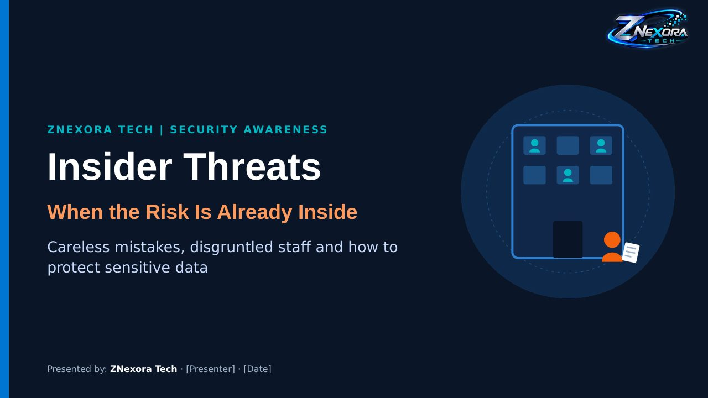

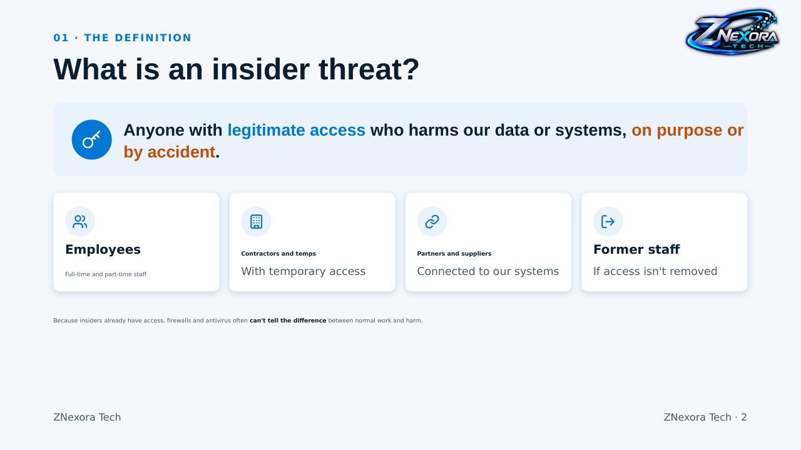

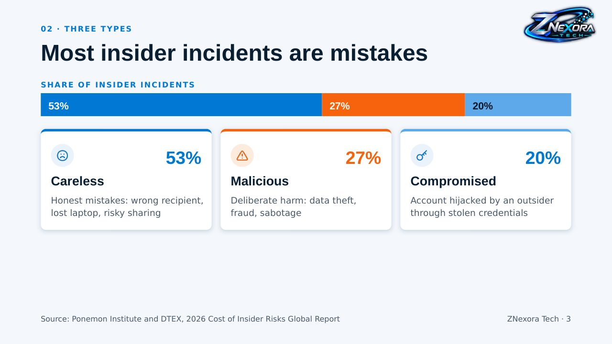

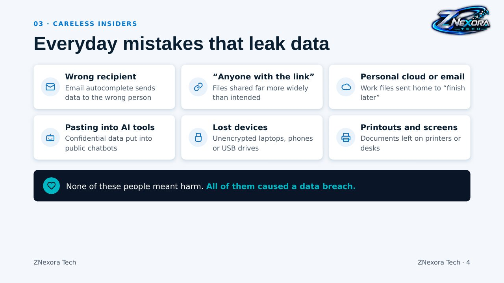

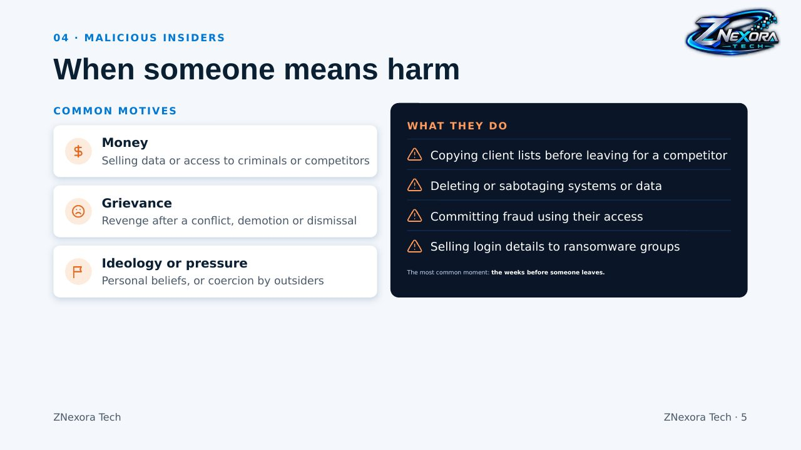

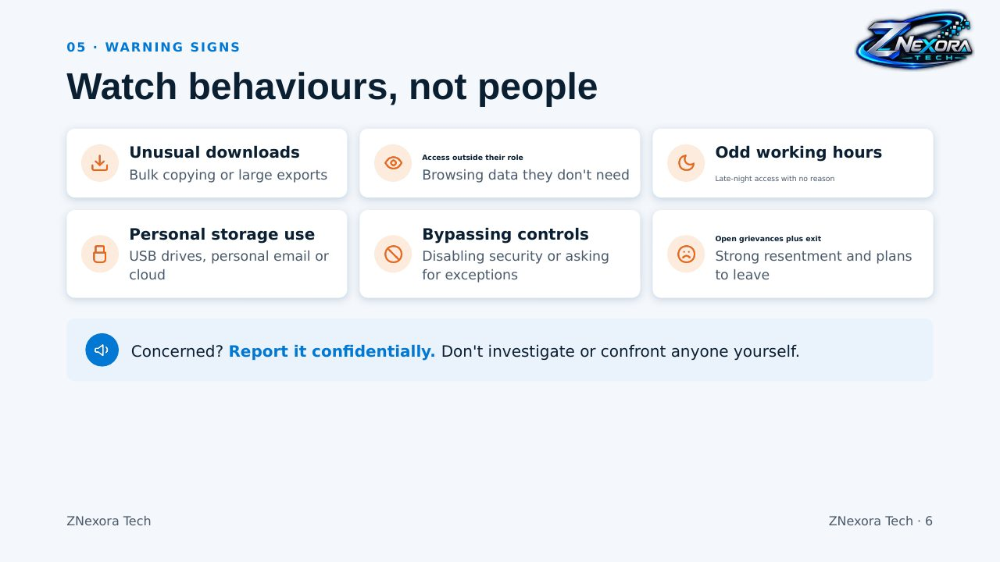

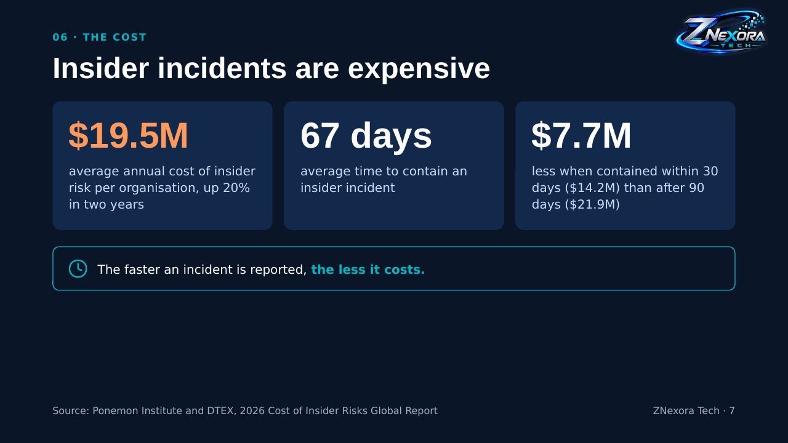

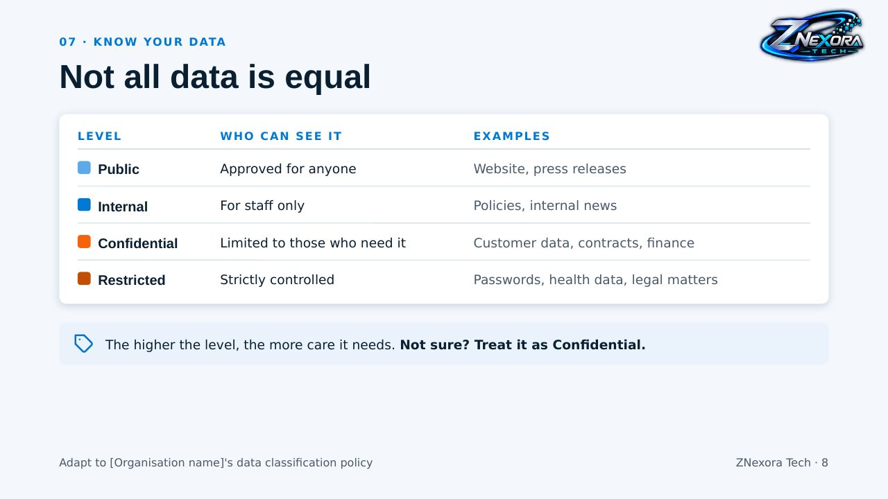

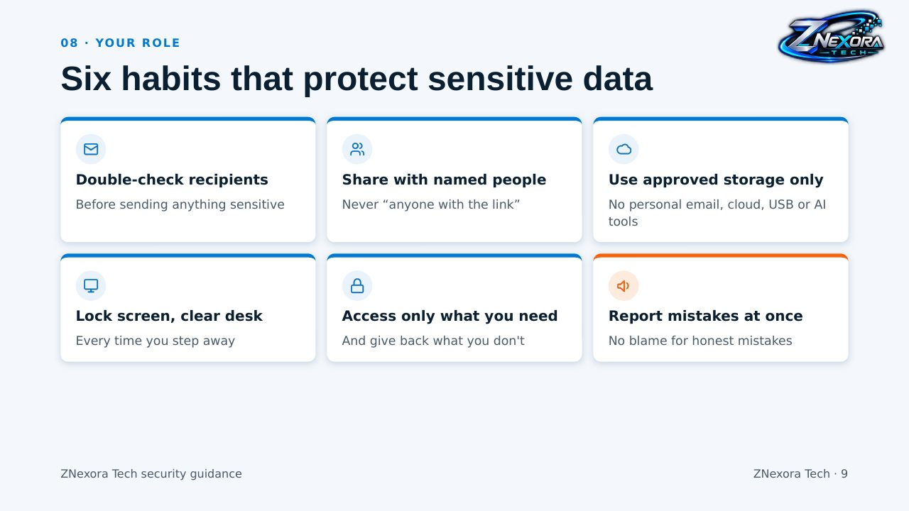

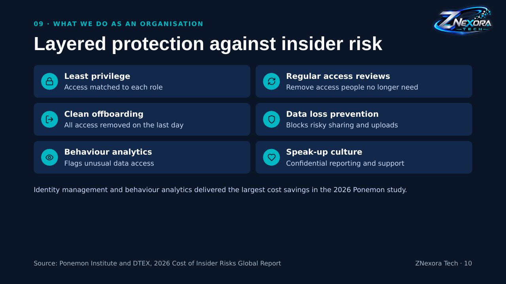

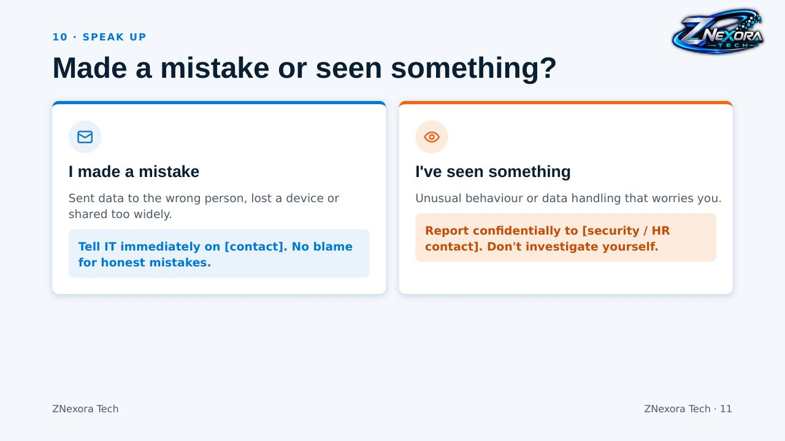

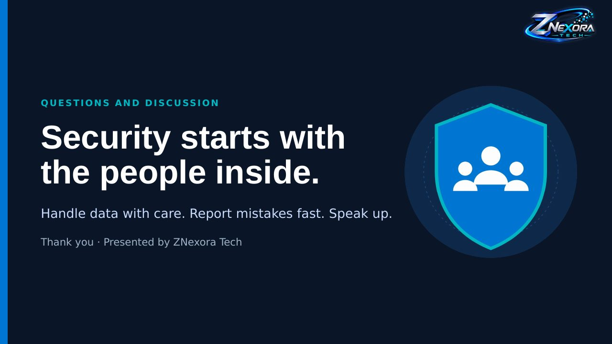
