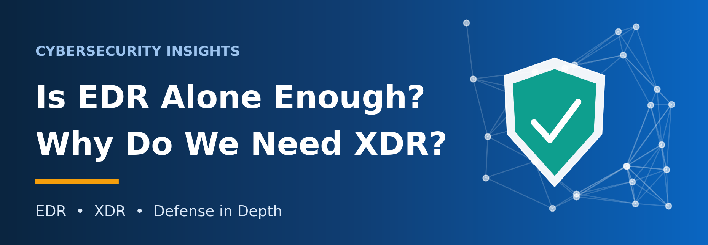

*Understanding EDR, XDR, and Defense in Depth*

EDR is an essential safeguard, but on its own it cannot protect an organization. Modern attacks move across email, identities, networks, and cloud services, and defending against them requires **broader visibility** and **multiple layers of control**.

In this article, will explain what Endpoint Detection and Response (EDR) does, where its visibility ends, why Extended Detection and Response (XDR) has gained momentum, and how both fit within a Defense in Depth strategy.

## 1. What Is EDR?

EDR stands for Endpoint Detection and Response. It continuously monitors endpoints, detects suspicious behavior, supports investigations, and provides tools to contain security incidents.

Endpoints are the devices connected to an organization's IT environment: laptops, desktops, servers, and mobile devices. Some printers and other networked devices also qualify, although agent support varies by device and vendor.

Most EDR solutions depend on a lightweight agent installed on each supported device. The agent collects security telemetry, such as process execution, file activity, network connections, and system events, and forwards it to a central management console or cloud platform.

An EDR agent is **not spyware**. It exists solely to enable legitimate security monitoring, threat detection, investigation, and response.

Reliable communication between the agent and the management platform enables centralized monitoring, policy updates, and remote response. A temporary loss of connectivity, however, does not necessarily disable protection. Depending on the product, local detection and response functions may continue to operate offline.

## 2. EDR Architecture: On-Premises vs. Cloud-Based

Traditionally, many organizations deployed EDR management servers on-premises, within their own offices or data centers, with endpoint agents reporting to this internal infrastructure. Managing endpoints outside the corporate network typically required a VPN or another secure remote connectivity solution.

The main advantage of on-premises deployment is direct control over infrastructure and data handling. The trade-off is operational burden: organizations must manage hardware, maintenance, patching, backups, availability, and staffing.

Today, cloud-based EDR is widely adopted because it simplifies centralized management and supports remote endpoints over secure internet connectivity. Key advantages include:

- Reduced infrastructure management overhead.
- Easier management of geographically distributed endpoints.
- Improved scalability and centralized visibility.
- Less dependence on internally maintained management servers.

Cloud-based EDR is not, however, automatically cheaper. Subscription fees, licensing, connectivity requirements, data residency, and compliance obligations must all be considered.

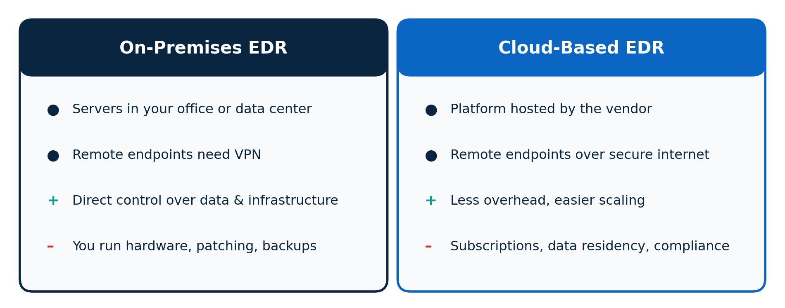

*Figure 1. On-premises vs. cloud-based EDR at a glance*

Ultimately, the right deployment model depends on the organization's security requirements, operational capabilities, regulatory environment, and budget.

## 3. Is EDR Alone Enough for Cybersecurity?

**No.** EDR is a critical component of endpoint security, but it is **not a complete cybersecurity solution**.

EDR's visibility is bounded by the telemetry available from the endpoints it protects. It cannot see everything happening across email systems, networks, identities, cloud services, and applications.

Yet security teams must be able to answer questions that span all of these domains: where an attack originated, which accounts were compromised, which systems were accessed, and how the attacker moved laterally.

Without that visibility, detecting and responding to sophisticated attacks becomes far more difficult.

*What a security team cannot see, it cannot defend.*

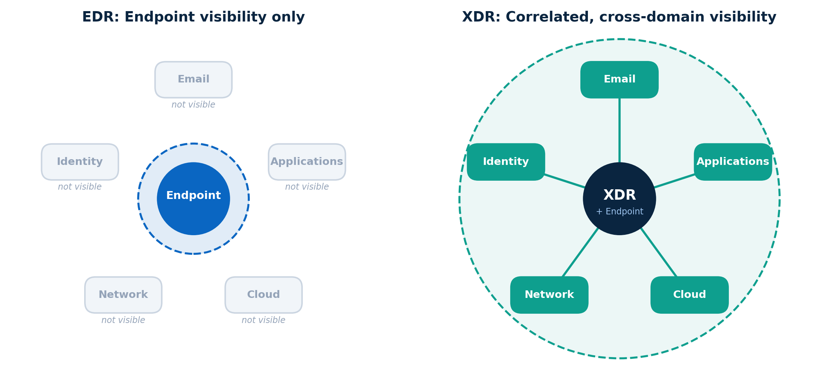

*Figure 2. EDR sees the endpoint; XDR connects events across domains*

XDR addresses this gap. Rather than replacing EDR, it extends visibility beyond the endpoint and connects events across multiple security domains.

## 4. Defense in Depth: The Onion Layer Security Model

Defense in Depth is a cybersecurity strategy that uses multiple, overlapping security controls to protect an organization's systems, networks, applications, and data.

A useful analogy is an onion, with multiple layers surrounding its core. Security works the same way: controls are applied across different layers so that if one fails, others can still prevent, detect, or limit the impact of an attack.

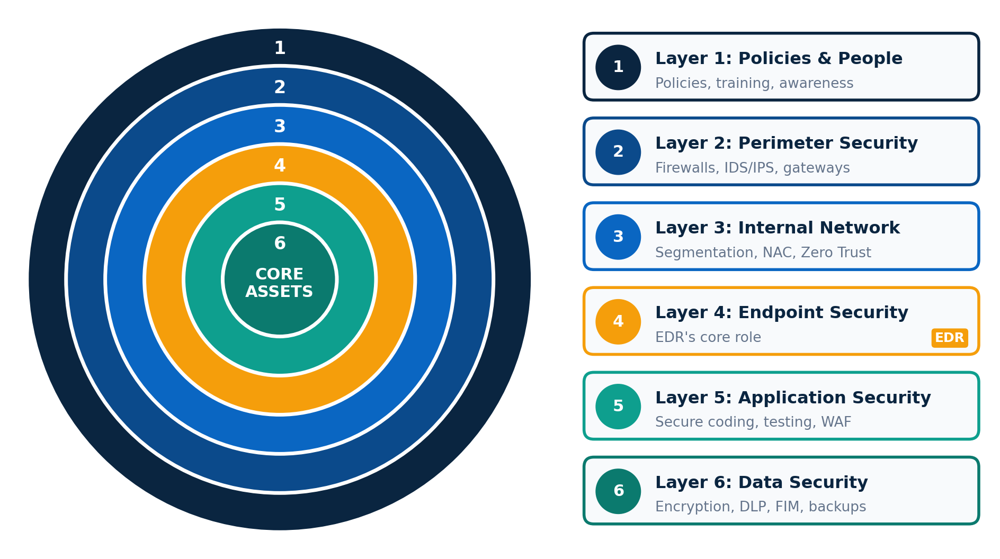

*Figure 3. The six layers of Defense in Depth*

## ▌ Layer 1: Policies and People

The first layer consists of security policies, procedures, and people. Examples include:

- Information security policies.
- Access control policies.
- Incident response procedures.
- Cybersecurity awareness training.
- Phishing awareness and reporting procedures.

Employees are the **first line of defense**. They should know how to recognize suspicious emails, protect their credentials, follow security policies, and report potential incidents promptly.

## ▌ Layer 2: Perimeter Security

Perimeter security protects the boundary between an organization's environment and external networks. Typical controls include firewalls, intrusion detection and prevention systems (IDS/IPS), secure web gateways, and email security gateways.

These controls identify or block unauthorized traffic, malicious connections, and harmful content before they reach internal systems.

## ▌ Layer 3: Internal Network Security

Internal network security protects communications and controls access within the organization's network. Common controls include network segmentation, network access control, network monitoring, and Zero Trust principles.

For example, separating employee networks from server networks and critical systems limits the blast radius: an attacker who compromises one device cannot easily reach the rest of the environment.

## ▌ Layer 4: Endpoint Security (EDR's Core Role)

This is the **primary layer where EDR operates**. EDR monitors supported endpoints for suspicious processes, malware execution, unusual behavior, and other security events.

Depending on the solution, it may also support endpoint isolation, termination of malicious processes, investigation, and other incident response actions.

## ▌ Layer 5: Application Security

Application security protects web applications, business applications, and software throughout their development and operation. Common controls include secure coding practices, vulnerability assessments, application security testing, and web application firewalls (WAFs).

Organizations with development teams should embed security throughout the software development lifecycle rather than treating it as a final checkpoint.

## ▌ Layer 6: Data Security

Data is one of an organization's most valuable assets and must be protected against unauthorized access, modification, theft, and destruction. Relevant controls include:

- Encryption.
- Data Loss Prevention (DLP).
- File Integrity Monitoring (FIM).
- Data access controls.
- Secure backups and recovery procedures.

This layer is the last safeguard: it keeps sensitive information protected even when other controls have been bypassed.

Note that these six layers are an illustrative model rather than a universal standard. Organizations may structure their controls differently based on their architecture, risk profile, and operational needs.

## 5. What Is XDR?

XDR stands for Extended Detection and Response. Where EDR focuses primarily on endpoint telemetry, XDR unifies security data from multiple domains, potentially including endpoints, networks, email systems, identities, and cloud environments.

It correlates and analyzes related events to reveal attack patterns that are difficult to recognize when each security tool operates in isolation.

Consider a phishing attack. A malicious email reaches an employee's inbox, and the employee opens the attachment. EDR may detect the resulting suspicious activity on that device.

But endpoint telemetry alone cannot answer the wider questions: Was the same email delivered to other employees? Was a user account compromised? Did the attacker go on to access other systems?

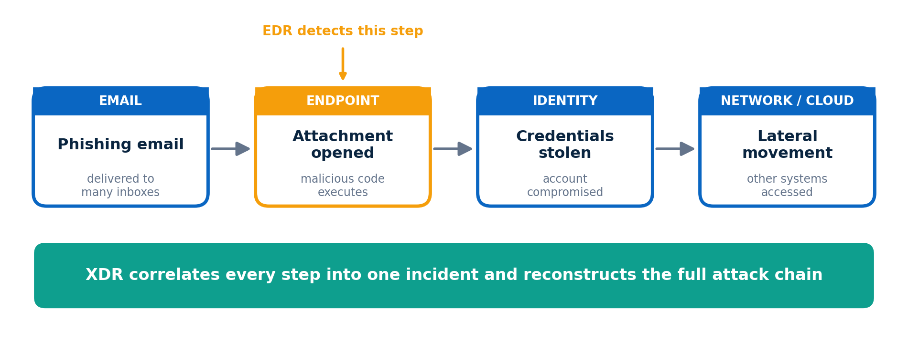

*Figure 4. A phishing attack chain: EDR sees one step, XDR sees the whole story*

With the right integrations and telemetry, XDR correlates email, endpoint, identity, and network events to **reconstruct the full attack chain**. This helps analysts understand the attack, prioritize investigations, and coordinate a response more effectively.

XDR visibility has limits. It depends on which data sources are connected, which integrations are available, and the capabilities of the specific product.

## 6. Key Benefits of XDR

## ▌ 1. Cross-Layer Visibility

XDR provides a unified view of security events across endpoints, networks, email, identities, and cloud environments, helping analysts see how seemingly unrelated events are connected.

## ▌ 2. Correlation of Logs and Events

By linking telemetry from different sources, XDR helps reconstruct attack sequences. Instead of investigating each alert independently, analysts can examine related activity as part of a single incident.

## ▌ 3. Automated Response and Containment

Depending on the platform and its integrations, XDR can automatically isolate an endpoint, disable a compromised account, or trigger other containment procedures.

Automation shortens response time, but it must be configured carefully to avoid business disruption caused by false positives or incorrect decisions.

## ▌ 4. Reduced Operational Complexity

A unified platform lets security teams monitor, investigate, and respond to incidents without constantly switching between separate consoles.

XDR does not, however, eliminate the need for every other security tool. Specialized solutions may still be required to meet specific security, compliance, or operational requirements.

## 7. Challenges and Disadvantages of XDR

## ▌ 1. Vendor Lock-In

Adopting a single vendor's integrated ecosystem can simplify integration and centralized management. Think of the Apple ecosystem: an iPhone, iPad, and Apple Watch work seamlessly together. Many organizations take a similar approach with security products.

The trade-off is dependence. Concentrating on one vendor does not by itself cause incidents such as supply chain attacks, but excessive reliance on one provider can amplify the impact of vendor-related risks and make future migrations more difficult.

Before committing to an ecosystem, organizations should evaluate interoperability, data portability, contractual terms, and exit strategies.

## ▌ 2. Limited Third-Party Integration

Integration between an XDR platform and third-party security tools is not always seamless. Some products offer limited APIs, restricted telemetry sharing, or incomplete response capabilities, leaving visibility and automation short of expectations.

Before selecting an XDR solution, verify compatibility with existing infrastructure and the specific integrations your security team requires.

## ▌ 3. Cost and Licensing Complexity

XDR platforms may involve subscription fees, multiple licensing tiers, data ingestion limits, and additional charges for certain features or integrations. Organizations should evaluate the total cost of ownership rather than the initial purchase price alone.

Managing cybersecurity spending responsibly is sound practice, provided the savings do not create unacceptable security gaps. Assuming that EDR alone can protect an entire organization, or that a firewall alone can secure every application, leads to incomplete protection when risks and requirements have not been properly assessed.

*A snail that tries to imitate a frog's leap may simply end up stranded in the pond.*

In other words, following cybersecurity trends without evaluating organizational needs rarely delivers the expected results.

Security decisions should be based on **risk assessments, business priorities, existing capabilities, and available resources**, not on which products are currently popular.

## 8. Conclusion

Cybersecurity cannot be achieved simply by purchasing and deploying security products.

EDR plays a critical role in endpoint protection, while XDR improves visibility, event correlation, and coordinated response across multiple security domains. Neither, however, is a complete solution on its own.

Organizations should build a Defense in Depth strategy that combines appropriate security controls, effective policies, continuous monitoring, incident response capabilities, and ongoing improvement.

Equally critical is the human element. Even the most advanced tools require skilled professionals who can configure them correctly, investigate alerts, understand attacker behavior, and respond effectively to incidents. Organizations should also clearly define the distinct but complementary responsibilities of Cybersecurity Engineers and Cybersecurity Analysts.

Security tools provide capabilities, but effective cybersecurity comes from combining **the right technology**, **skilled people**, and **a well-defined strategy**.

I hope this article is helpful both to those beginning their cybersecurity journey and to professionals looking to strengthen their understanding of EDR, XDR, and Defense in Depth.

## Slides

[Download the slides as PDF](../../assets/files/is-edr-alone-enough-why-do-we-need-xdr.pdf)

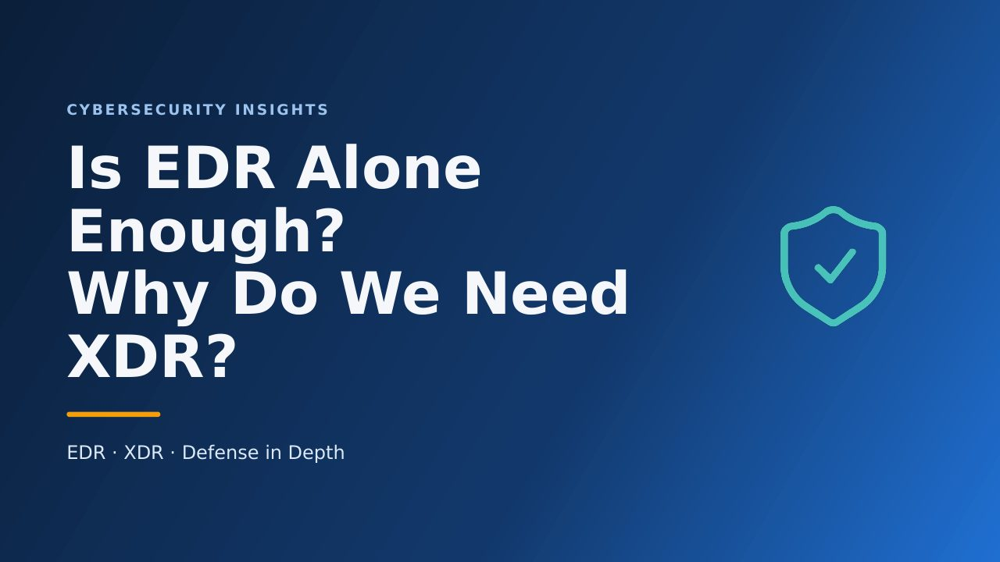

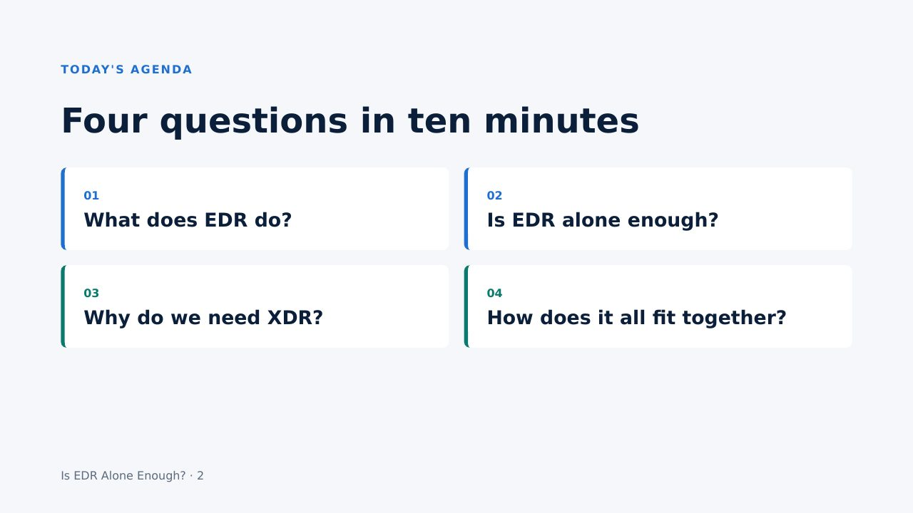

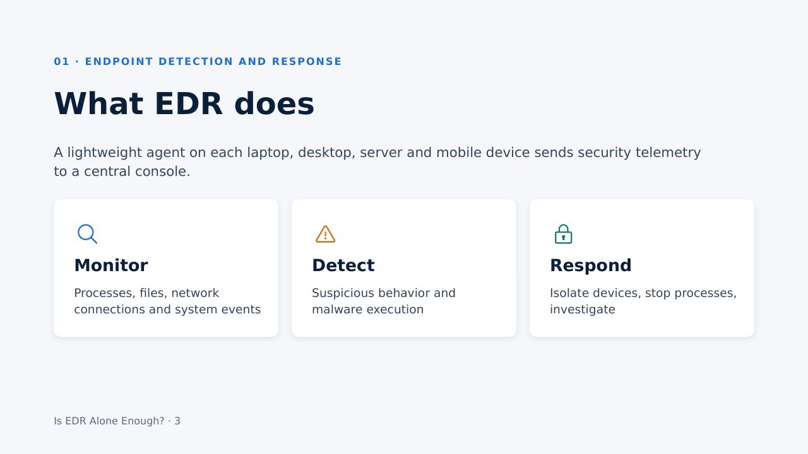

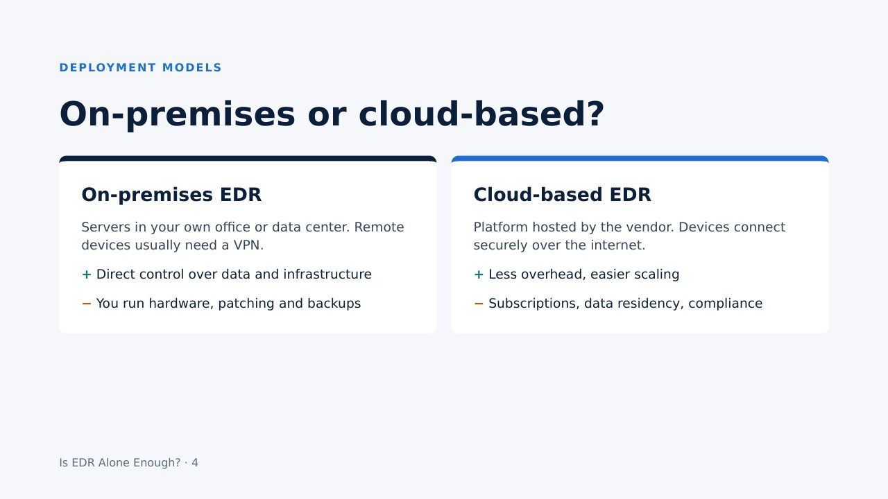

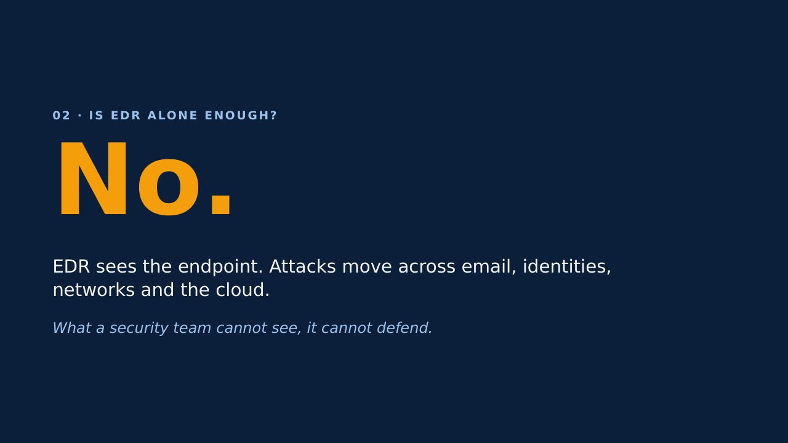

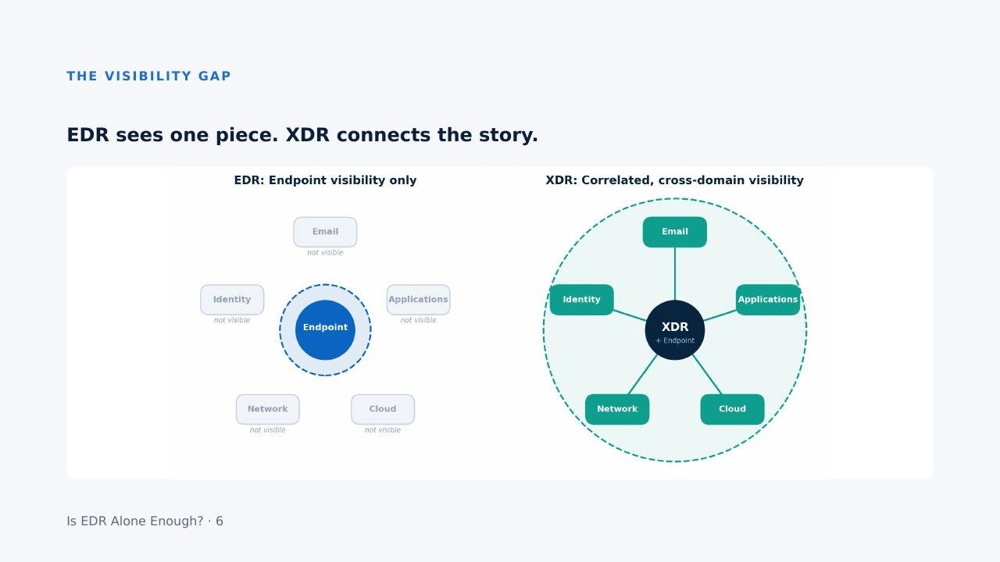

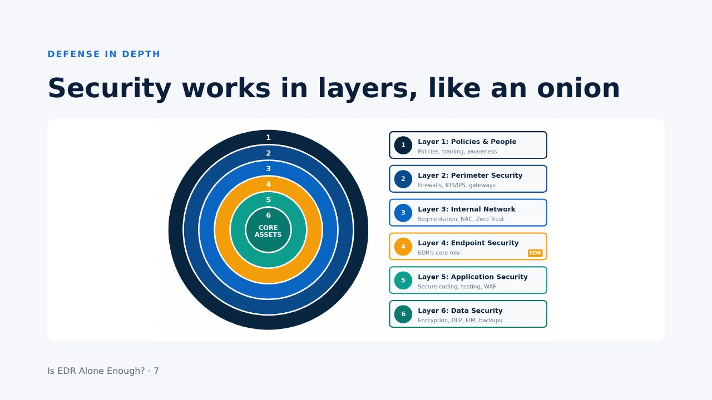

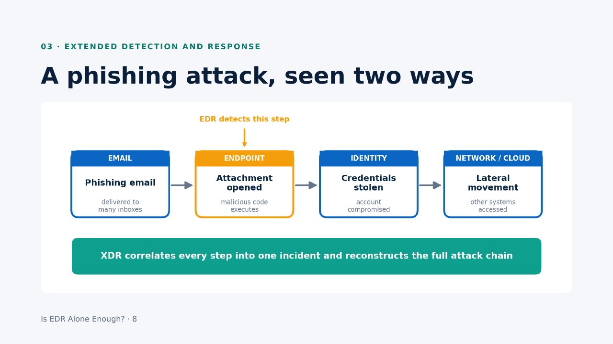

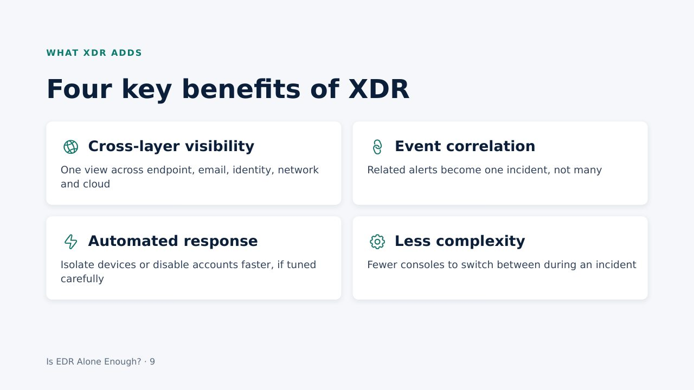

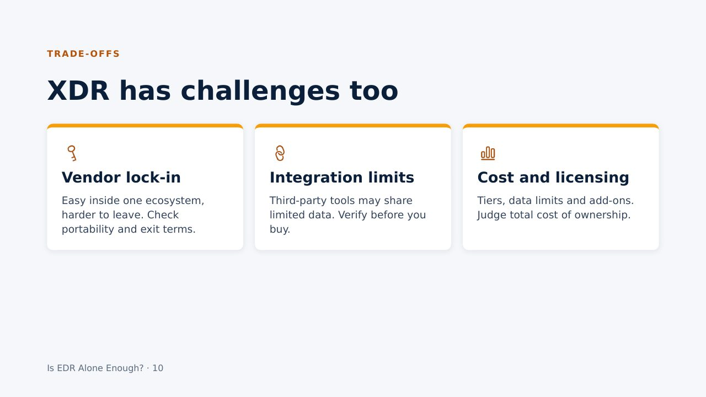

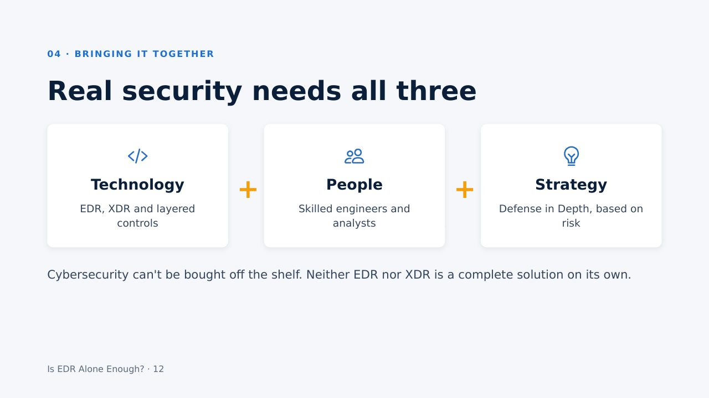

