## Key points

### What is Lumma Stealer?
- 01  ·  THREAT PROFILE
- A leading information stealer that targets browser data, crypto wallets and session cookies, often distributed via fake CAPTCHA and ClickFix pages.
- Malware-as-a-Service
- Rented to criminal affiliates since 2022
- Targets Windows PCs
- Built to harvest data from Windows devices
- Fast and evasive
- Starts stealing as soon as it runs, then hides
- TIMELINE
- 2022
- First seen on criminal forums
- 2024
- Widespread fake CAPTCHA and ClickFix campaigns
- May 2025
- Global takedown: about 2,300 domains seized
- 2025 – 2026
- Back with new infrastructure and loaders

[0:35 – 1:25] So what is Lumma? It's an information stealer: malware designed to quietly collect data from your computer and send it to criminals. It targets browser data, crypto wallets and session cookies, and it's often spread through fake CAPTCHA and ClickFix pages. Lumma is sold as malware-as-a-service, meaning criminals rent it, like a subscription, and run their own campaigns. It's been around since 2022 and targets Windows PCs. In May 2025, Microsoft, Europol and US authorities disrupted it and seized around 2,300 domains. But within weeks it was back, with new infrastructure, and it remains active through new delivery tools. So this is a current threat, not history.

### What Lumma steals
- 02  ·  WHAT IT TARGETS
- Browser data
- Saved passwords, autofill and card details
- Session cookies
- Let attackers skip passwords and MFA
- Crypto wallets
- Wallet extensions, files and keys
- 2FA, apps and system info
- Authenticator extensions and chat apps
- WHY IT MATTERS    Stolen data is bundled into “logs” and sold, fuelling account takeover and ransomware.

[1:25 – 2:15] Once Lumma is running, it goes after four things. First, browser data: saved passwords, autofill entries and stored card details. Second, session cookies. These are the most dangerous, because a stolen session cookie can let an attacker log in as you without your password, and without triggering MFA. Third, crypto wallets: browser wallet extensions and wallet files. And fourth, other valuable data such as authenticator extensions, messaging apps and details about your device. Everything is packaged into what criminals call 'logs' and sold online. Those logs are then used for account takeover, fraud, and as a starting point for ransomware attacks on organisations like ours.

### How Lumma reaches victims
- 03  ·  WAYS IN
- Fake CAPTCHA pages
- “Verify you’re human” tricks (ClickFix)
- Malicious ads
- Fake results at the top of search pages
- Cracked software
- “Free” versions of paid apps and tools
- Game mods and cheats
- Cheats and mods from unofficial sites
- Phishing messages
- Emails, chats and DMs with malicious links
- Fake updates
- Fake “browser out of date” pop-ups
- COMMON THREAD    You are tricked into running something yourself.

[2:15 – 3:00] Lumma doesn't rely on one method. Criminals who rent it spread it in many ways. Fake CAPTCHA pages, which we'll look at next. Malicious ads that appear at the top of search results, for example when you search for popular software. Cracked or 'free' versions of paid software. Game mods, cheats and automation scripts from unofficial sites. Phishing emails, chats and direct messages with malicious links. And fake pop-ups claiming your browser needs an urgent update. They all have one thing in common: you're tricked into downloading or running something yourself. That's why our awareness is such an important defence.

### The fake CAPTCHA / ClickFix trick
- 04  ·  THE CLICKFIX TRICK
- Verify you are human
- FAKE PAGE
- I'm not a robot
- To finish verification:
- 1
- Press  Windows + R
- 2
- Press  Ctrl + V
- 3
- Press  Enter
- Verify
- 1
- The lure
- A compromised site, malicious ad or fake download leads you to the page.
- 2
- Fake verification
- A “prove you’re human” box shows unusual keyboard steps.
- 3
- Hidden command
- The page has silently copied a malicious command to your clipboard.
- 4
- You run it
- Pasting and pressing Enter installs Lumma, which starts stealing.
- A real CAPTCHA never asks you to open Run, paste or type commands.

[3:00 – 4:00] Here's the trick that makes Lumma so effective, known as ClickFix or the fake CAPTCHA. It starts with a lure: you visit a compromised website, click a malicious ad, or try to download free software. You then see what looks like a normal 'I'm not a robot' check. But instead of clicking pictures, it gives you strange instructions: press Windows and R, press Control and V, then press Enter. Behind the scenes, the page has already copied a malicious command to your clipboard. When you paste it into the Run box and press Enter, you are the one who installs the malware, which also helps it slip past some security tools. Lumma then starts collecting your data straight away. Remember this line: a real CAPTCHA never asks you to open Run, paste or type commands.

### From one paste to a breach
- 05  ·  ATTACK CHAIN
- STEP 1
- Lure
- Fake page, ad or download
- STEP 2
- Execute
- Victim runs the command
- STEP 3
- Steal
- Passwords, cookies, wallets
- STEP 4
- Exfiltrate
- Data sent to attackers
- STEP 5
- Sell
- Logs sold on criminal markets
- STEP 6
- Exploit
- Account takeover, fraud, ransomware
- Steps 1 to 4
 Happen on your device, often within minutes.
- Steps 5 and 6
 Other criminals, including ransomware groups, buy access.

[4:00 – 4:45] Let's zoom out and look at the full attack chain. Step one, the lure: a fake page, ad or download. Step two, execute: the victim runs the command or file. Step three, steal: Lumma collects passwords, cookies and wallet data. Step four, exfiltrate: the data is sent to the attackers' servers. Those first four steps happen on your device, often within minutes. Then step five, sell: the stolen data is packaged as logs and sold on criminal markets. And step six, exploit: buyers use it for account takeover and fraud, and ransomware groups use it as their way into organisations. So one paste on one laptop can become a company-wide incident.

### Warning signs to watch for
- 06  ·  DETECTION
- WHAT YOU MIGHT NOTICE
- A web page asks you to press Windows + R or paste a command
- A command or PowerShell window flashes open
- Sudden logouts, or “new sign-in” alerts you don’t recognise
- MFA prompts or reset emails you didn’t request
- Missing crypto or unexpected account activity
- WHAT IT AND SECURITY CAN DETECT
- PowerShell or mshta launched from the Run dialog
- New Run history (RunMRU) entries containing web commands
- Unusual processes reading browser password and cookie files
- Connections to newly registered or known Lumma domains
- Sign-ins from new locations reusing valid sessions

[4:45 – 5:40] How can we spot Lumma? Here's what you might notice yourself: a web page asking you to press Windows and R or paste a command, which is the biggest red flag of all. A command or PowerShell window that briefly flashes open. Sudden logouts, or alerts about new sign-ins you don't recognise. MFA prompts or password-reset emails you didn't request. Or missing crypto and unexpected account activity. On the IT and security side, the team can detect PowerShell or mshta launched from the Run dialog, new entries in the Run history containing web commands, unusual processes reading browser password and cookie files, connections to newly registered or known Lumma domains, and sign-ins from new locations that reuse valid sessions.

### Six habits that stop Lumma
- 07  ·  PROTECT YOURSELF
- Never paste commands
- No real website asks you to run anything.
- Use official sources
- No cracks or unofficial downloads.
- Use a password manager
- Don’t save passwords in the browser.
- Use MFA and read alerts
- Report prompts you didn’t expect.
- Keep everything updated
- Browser, Windows and security tools.
- Keep crypto off work devices
- Never store personal wallets at work.
- If a page tells you to press Windows + R: close it and report it.

[5:40 – 6:40] Here are six habits that protect you. One: never paste commands. No real website, CAPTCHA or support page will ever ask you to run something. Two: use official sources only. No cracked software, unofficial game mods, or pop-up updates; get updates from the app itself or our IT team. Three: use our approved password manager, and don't save passwords in your browser, which is exactly where Lumma looks first. Four: use MFA and read your alerts, and report any prompt you didn't expect. Five: keep your browser, Windows and security tools updated. And six: keep personal crypto wallets off work devices. If you remember one rule: if a page tells you to press Windows and R, close it and report it.

### Layered controls for IT and security teams
- 08  ·  PREVENT
- Endpoint
- EDR in block mode and ASR rules; restrict the Run dialog, PowerShell and mshta for standard users (GPO, AppLocker or WDAC).
- Identity
- Phishing-resistant MFA, Conditional Access for compliant devices, short session lifetimes and token protection.
- Browser
- Disable built-in password saving by policy, allowlist extensions and keep browsers patched.
- Network
- DNS and web filtering; block newly registered domains, malvertising and known Lumma infrastructure.
- Monitoring
- Threat-intel IOC feeds, alerts on suspicious PowerShell, and stealer-log monitoring for our domains.

[6:40 – 7:50] For our IT and security teams, prevention works in layers. On the endpoint: run EDR in block mode with attack surface reduction rules, and restrict the Run dialog, PowerShell and mshta for standard users using Group Policy, AppLocker or WDAC. That alone breaks the ClickFix trick. On identity: phishing-resistant MFA, Conditional Access that requires compliant devices, short session lifetimes and token protection, so stolen cookies are less useful and expire quickly. On the browser: disable built-in password saving by policy, allowlist extensions and keep browsers patched. On the network: DNS and web filtering that blocks newly registered domains, malvertising and known Lumma infrastructure. And for monitoring: subscribe to threat-intelligence feeds, alert on suspicious PowerShell, and monitor stealer-log markets for our company domains, so we can act before stolen credentials are used.

### Ran a suspicious command? Act fast
- 09  ·  IF YOU RAN IT
- 1
- Disconnect:   Unplug the network cable or turn off Wi-Fi.
- 2
- Report immediately:   Contact IT / Security on [contact].
- 3
- Reset from a clean device:   Change passwords and sign out of all sessions.
- 4
- Protect crypto funds:   Move funds to a new wallet; watch accounts.
- 5
- Let IT rebuild:   IT investigates and reimages the device.
- WHY SPEED MATTERS
- Every minute counts: stolen cookies work until sessions are revoked.
- You will never be blamed for reporting.

[7:50 – 8:30] If you ever run a command like this, or suspect Lumma on your device, act fast. One: disconnect from the network straight away. Two: report it to IT and Security on [contact] immediately; you will never be blamed for reporting. Three: from a different, clean device, change your passwords and sign out of all active sessions, because stolen cookies keep working until those sessions end. Four: if you use crypto wallets on that computer, move your funds to a new wallet and watch your accounts. And five: let IT investigate and rebuild the device. Don't try to clean it yourself.

### Remediation playbook for IT
- 10  ·  REMEDIATION
- 1
- Contain
- Isolate the device with EDR; block the attacker’s domains.
- 2
- Scope
- Review the timeline: what ran, what was stolen, which accounts.
- 3
- Revoke
- Reset passwords, revoke all sessions and tokens, rotate keys and secrets.
- 4
- Eradicate
- Reimage the device; don’t just delete files.
- 5
- Recover
- Monitor accounts and check for persistence or lateral movement.
- 6
- Report and learn
- Meet reporting duties, update blocklists, share lessons.
- REMEMBER    A password reset alone is not enough: stolen session cookies work until revoked.

[8:30 – 9:30] For the IT and security team, here's the remediation playbook. One, contain: isolate the device using EDR and block the attacker's domains. Two, scope: use the EDR timeline to understand what ran, what data was accessed, and which accounts and services are affected. Three, revoke: reset passwords, revoke all active sessions and refresh tokens, re-register MFA if needed, and rotate any API keys or secrets stored on the device. Four, eradicate: reimage the device. Don't just delete the files, because loaders can leave other malware behind. Five, recover: monitor affected accounts closely and check for persistence or lateral movement. And six, report and learn: meet any regulatory reporting duties, add new indicators to blocklists, and share what we learned. The most important point: a password reset alone is not enough. Stolen session cookies keep working until the sessions are revoked.

### Stop before you paste
- 11  ·  KEY TAKEAWAYS
- No real website asks you to run commands
- Cookies are keys: revoke sessions, not just passwords
- Layered controls stop one paste becoming a breach
- Report fast: minutes matter
- Thank you

[9:30 – 10:00] To wrap up, four key takeaways. No real website will ever ask you to run commands. Cookies are keys, so after an infection we revoke sessions, not just passwords. Layered controls stop one paste from becoming a breach. And report fast, because minutes matter. Lumma steals what keeps you logged in, so stop before you paste. Thank you. I'm happy to take any questions.

## Slides

[Download the slides as PDF](../../assets/files/lumma-stealer-lummac2.pdf)

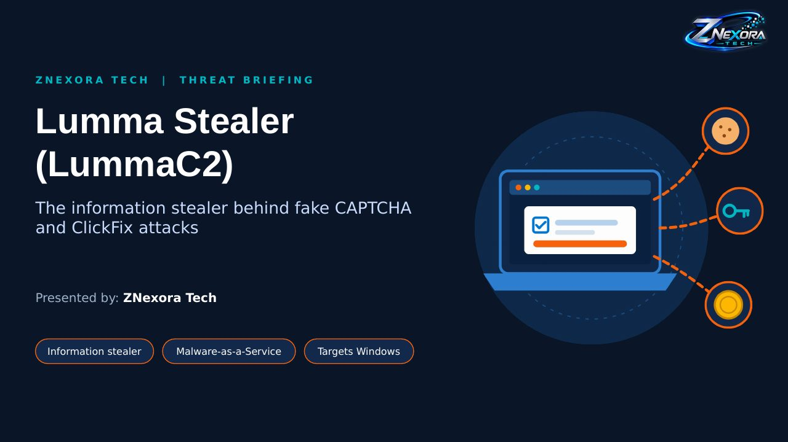

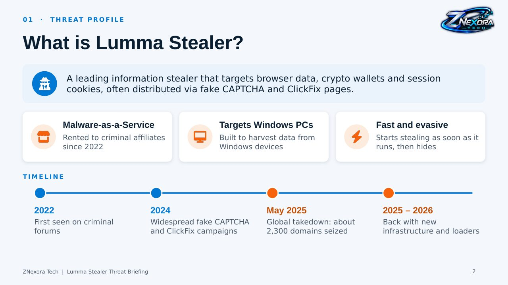

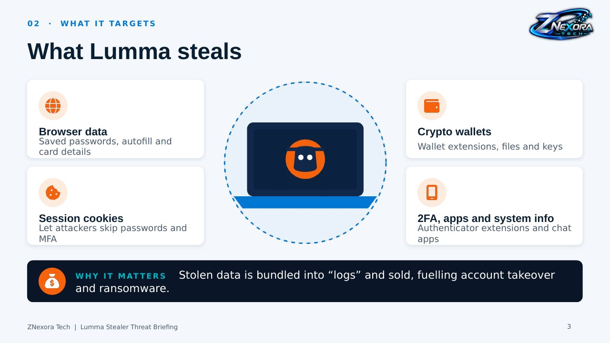

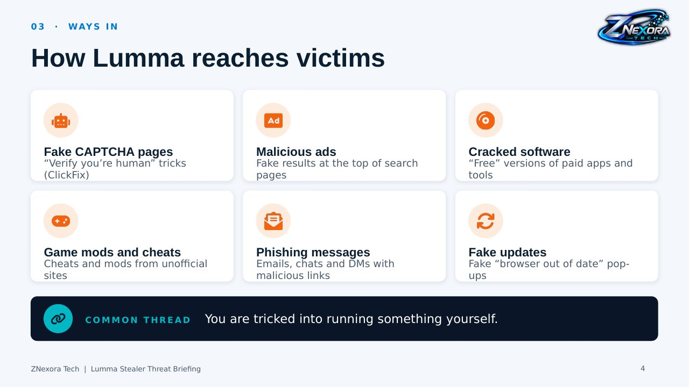

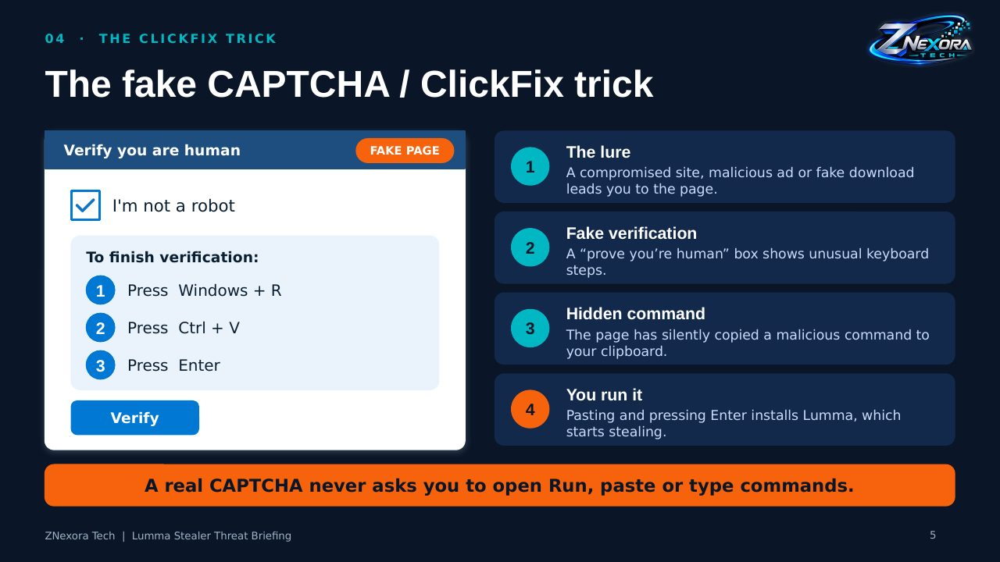

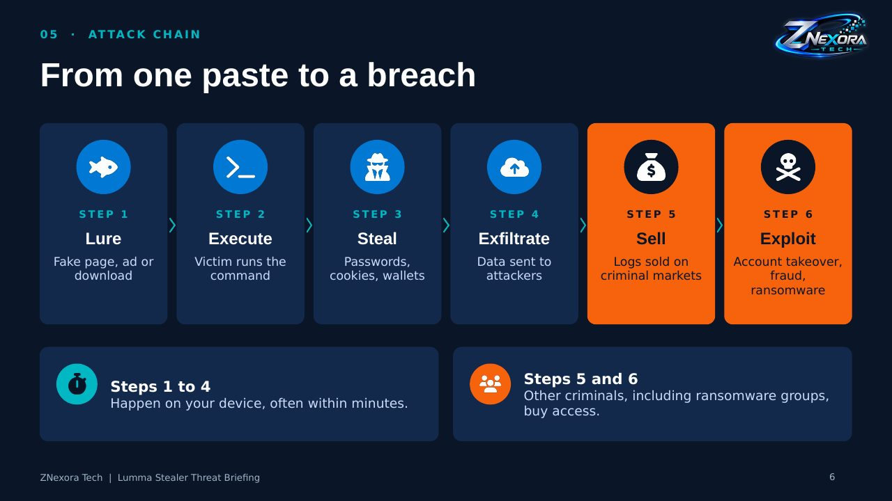

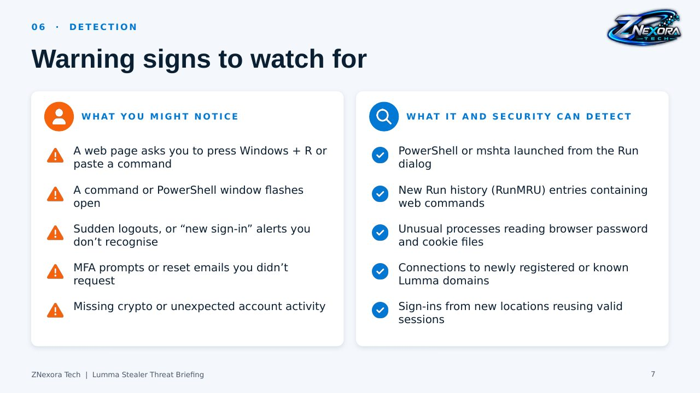

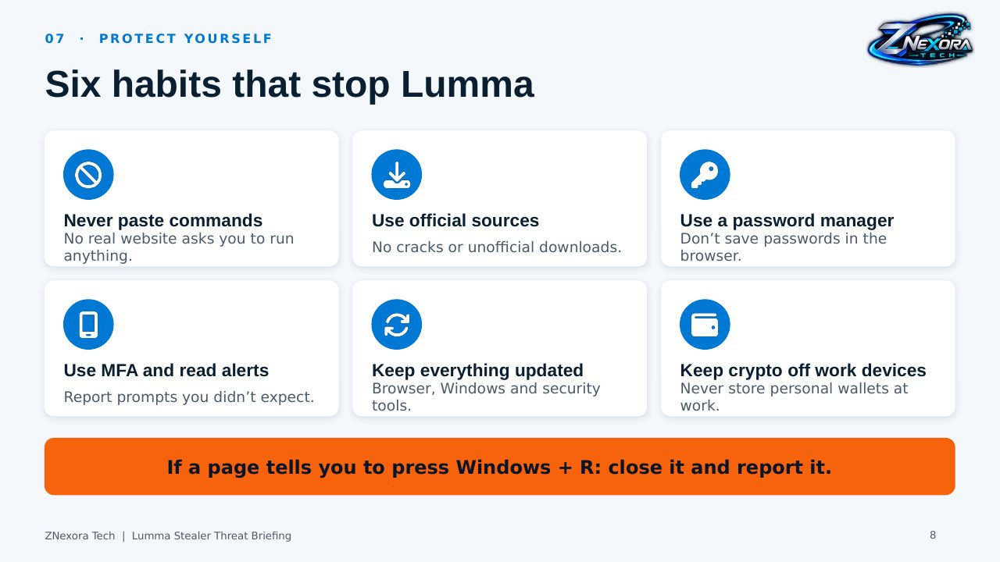

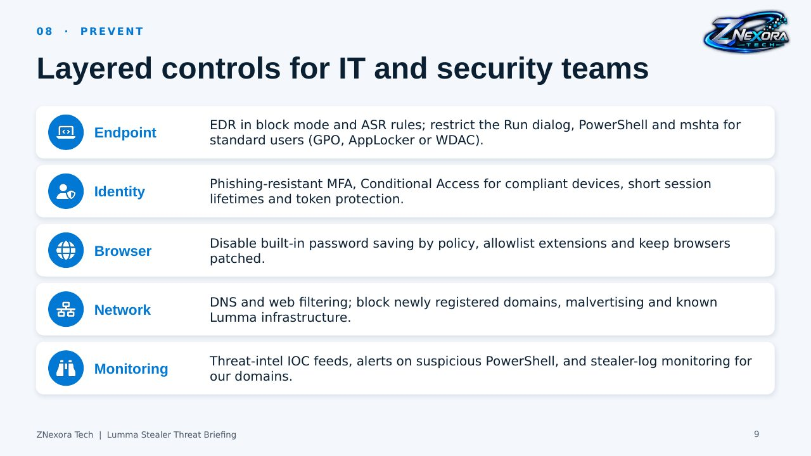

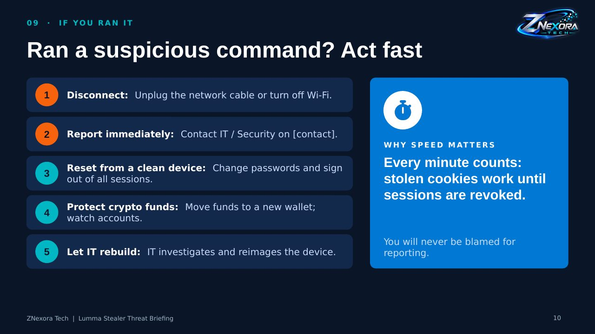

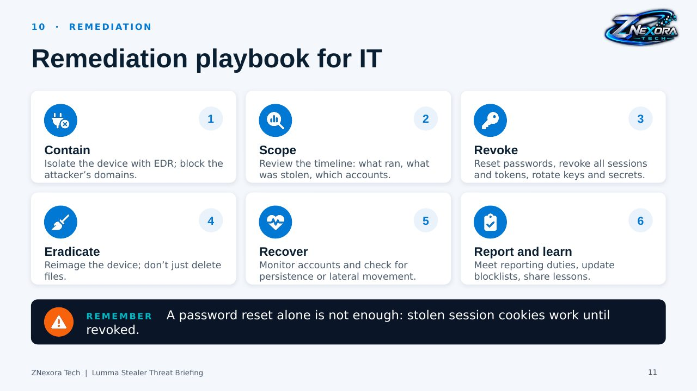

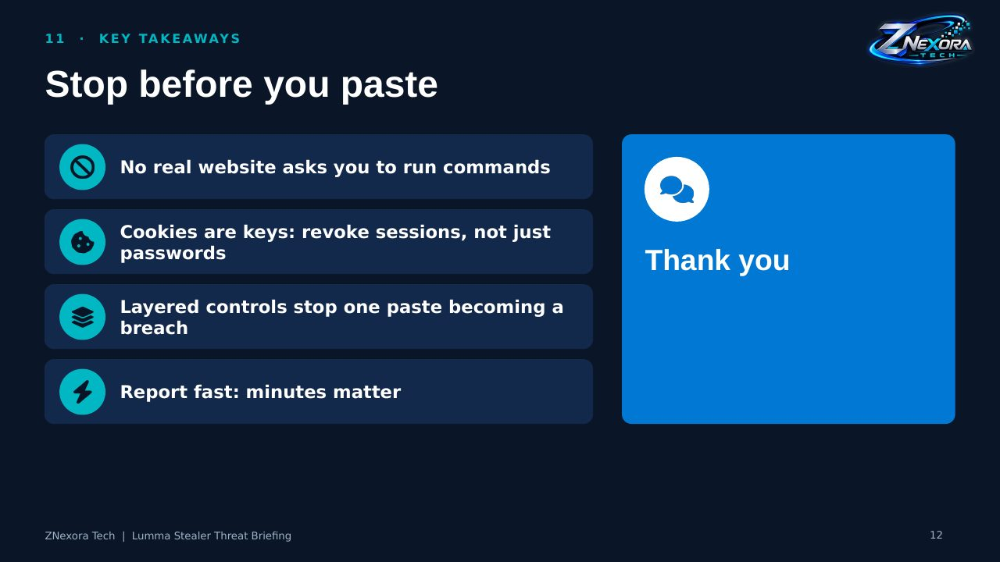
