## Key points

### “Macs don’t get malware” is a myth
- 01 · WHY HARDEN MACS
- Infostealers
- Atomic (AMOS) and similar stealers take Keychain items, browser cookies and crypto wallets.
- Fake apps and ads
- Malvertising and cracked apps deliver malware disguised as popular tools.
- Terminal paste tricks
- ClickFix-style pages ask Mac users to paste commands into Terminal.
- Fake password prompts
- Malicious scripts pop up a convincing dialog asking for the Mac password.
- Mac users are high-value targets:  executives, developers and finance teams  often use Macs.
- ZNexora Tech · see our Lumma and Top 10 Malware sessions
- ZNexora Tech · 2

[0:40 – 1:40] Let's start with a common myth: 'Macs don't get malware.' They do, and attackers are actively targeting them. Infostealers such as Atomic Stealer, also called AMOS, steal Keychain items, browser cookies and crypto wallets, just like Lumma does on Windows. Malvertising and cracked apps deliver malware disguised as popular tools. ClickFix-style pages now target Mac users too, asking them to paste commands into Terminal. And malicious scripts pop up convincing dialogs asking for the Mac password, which is often all an attacker needs. Mac users are also high-value targets, because executives, developers and finance teams often use them. So Macs need the same hardening discipline as Windows.

### macOS has strong security built in
- 02 · BUILT-IN SECURITY
- Hardware
- Apple silicon, Secure Enclave, Secure Boot
- System integrity
- System Integrity Protection, Signed System Volume
- App security
- Gatekeeper, notarization, XProtect, App Sandbox
- Data protection
- FileVault encryption, Keychain
- Privacy controls
- TCC: permission prompts for camera, files, screen
- THE CATCH
- These protections only help if they stay switched on and enforced.
- Source: Apple Platform Security Guide
- ZNexora Tech · 3

[1:40 – 2:30] The good news is that macOS has strong security built in, in layers. At the hardware level, Apple silicon, the Secure Enclave and Secure Boot protect keys and make sure only trusted software starts. System Integrity Protection and the Signed System Volume stop even admin users from tampering with the operating system. Gatekeeper, notarization, XProtect and the App Sandbox control which apps can run and what they can do. FileVault and the Keychain protect data. And TCC, the privacy framework, asks permission before apps use the camera, files or screen. But here's the catch: these protections only help if they stay switched on and are enforced. Users can turn some off, approve risky prompts, or run as admin. Hardening is about locking those settings in.

### macOS hardening framework
- 03 · DEFENSE IN DEPTH
- 01
- Device management
- Enroll every Mac in MDM
- 02
- Identity and accounts
- Standard users, strong auth
- 03
- Patching
- Enforced, on-time updates
- 04
- App control
- Only trusted software runs
- 05
- Data protection
- Encryption and backups
- 06
- Network
- Firewall and sharing off
- 07
- Monitoring
- Logging, EDR and alerts
- GOAL
- Every Mac managed, verified and monitored
- Aligned with CIS Benchmarks and NIST mSCP
- ZNexora Tech · 4

[2:30 – 3:10] We organise macOS hardening into seven areas, the same defense-in-depth approach we used for Windows. Device management: every Mac enrolled in MDM. Identity and accounts: standard users and strong authentication. Patching: enforced, on-time updates. App control: only trusted software runs. Data protection: encryption and backups. Network: firewall on and unnecessary sharing off. And monitoring: logging, EDR and alerts. The goal is simple: every Mac managed, verified and monitored. Let's go through each area.

### Start with MDM: you can’t harden what you don’t manage
- 04 · DEVICE MANAGEMENT
- Automated Device Enrollment
- Macs from Apple Business Manager enroll on first boot
- Non-removable MDM profile
- Users can't unenroll and escape policy
- Configuration profiles
- Push security settings centrally
- Declarative Device Management
- Devices enforce and report their own state
- Compliance checks
- Block access from non-compliant Macs
- Remote lock and wipe
- For lost, stolen or departing devices
- Apple Business Manager · MDM · Declarative Device Management
- ZNexora Tech · 5

[3:10 – 4:10] Everything starts with device management, because you can't harden what you don't manage. Use Automated Device Enrollment through Apple Business Manager, so new Macs enroll into MDM the first time they're switched on, before a user can change anything. Make the MDM profile non-removable, so users can't unenroll and escape policy. Push security settings centrally with configuration profiles, and use Declarative Device Management, where the Mac itself enforces settings and reports its status back. Connect MDM compliance to your identity provider, so non-compliant Macs can't reach company apps, which is Zero Trust in action. And make sure you can remotely lock and wipe lost, stolen or departing devices.

### Secure user and admin accounts
- 05 · IDENTITY AND ACCOUNTS
- Standard user accounts
- No everyday local admin rights
- Just-in-time admin
- Temporary elevation, approved and logged
- Platform SSO
- Sign in with the company identity and MFA
- Auto-lock and password policy
- Screen locks quickly; strong passwords
- Guest and auto-login off
- No anonymous or automatic access
- Touch ID and passkeys
- Phishing-resistant sign-in
- Aligned with CIS Benchmarks for macOS
- ZNexora Tech · 6

[4:10 – 5:00] Next, identity and accounts. Users should work as standard users, not local administrators. When someone genuinely needs admin rights, grant them just in time: temporary elevation that's approved and logged. Use Platform Single Sign-On, so users sign in to their Mac with their company identity and MFA, and passwords stay in sync. Enforce a password policy and a short screen auto-lock. Turn off the guest account and automatic login. And enable Touch ID and passkeys for phishing-resistant sign-in. Removing everyday admin rights is one of the most effective controls, because many Mac stealers rely on tricking the user into entering an admin password.

### Keep every Mac updated, on time
- 06 · PATCH MANAGEMENT
- Enforce OS updates
- Use DDM update deadlines, not just reminders
- Fast security responses
- Allow background security updates to apply automatically
- Keep XProtect current
- Automatic security data updates stay on
- Patch third-party apps
- Browsers, Office, Zoom, developer tools
- Retire unsupported Macs
- No security updates means no protection
- Apple software update management · CIS Benchmarks
- ZNexora Tech · 7

[5:00 – 5:50] Patching is the next layer. Enforce operating system updates with deadlines through Declarative Device Management, not just reminders users can dismiss forever. Allow Apple's background security updates to apply automatically, so urgent fixes reach Macs quickly. Keep automatic security data updates switched on, so XProtect, Apple's built-in malware protection, stays current. Don't forget third-party apps: browsers, Office, video conferencing and developer tools are frequent targets. And retire Macs that can no longer run a supported version of macOS, because a device with no security updates has no protection against new vulnerabilities.

### Keep the built-in protections on
- 07 · CORE PROTECTIONS
- CONTROL
- REQUIRED STATE
- VERIFY WITH
- System Integrity Protection
- Enabled
- csrutil status
- Gatekeeper
- App Store and identified developers
- spctl --status
- FileVault
- On, key escrowed to MDM
- fdesetup status
- Firewall
- On, with stealth mode
- socketfilterfw --getglobalstate
- Lockdown Mode
- For high-risk users
- System Settings, Privacy and Security
- Enforce these through MDM, so users  can't switch them off , and report their state centrally.
- Verification commands run in Terminal · Apple Platform Security Guide
- ZNexora Tech · 8

[5:50 – 6:50] Here are the core built-in protections to keep on, with how to verify each one. System Integrity Protection must be enabled; check it with csrutil status. Gatekeeper should allow only apps from the App Store and identified developers; check with spctl dash dash status. FileVault must be on, with the recovery key escrowed to MDM; check with fdesetup status. The application firewall should be on, with stealth mode; you can check it with socketfilterfw. And Lockdown Mode is an extreme protection option for high-risk users, such as executives or people targeted by advanced attackers. These commands are useful for spot checks, but the real control is enforcing these settings through MDM, so users can't switch them off, and reporting their state centrally.

### Control what runs, and what it can access
- 08 · APP CONTROL AND PRIVACY
- Gatekeeper and notarization
- Block unsigned and un-notarized apps
- App allowlisting
- Approve apps via MDM; tools like Santa block the rest
- PPPC privacy profiles
- Control Full Disk Access, screen recording and accessibility
- Managed app deployment
- Install approved apps through MDM or the App Store
- Watch scripts and Terminal
- Alert on osascript password prompts and curl-to-shell
- Train users
- Never paste commands or enter passwords into pop-ups
- Santa: open-source binary authorization for macOS · PPPC = Privacy Preferences Policy Control
- ZNexora Tech · 9

[6:50 – 7:50] Application control is next. Keep Gatekeeper and notarization enforced, so unsigned and un-notarized apps are blocked. Go further with app allowlisting: approve apps through MDM, and consider tools like Santa, an open-source binary authorization tool for macOS, to block everything else. Use Privacy Preferences Policy Control profiles to decide centrally which apps can have Full Disk Access, screen recording or accessibility permissions, because malware loves those. Deploy approved apps through MDM or the App Store, so users don't download installers from the web. Watch for suspicious scripts, like osascript popping up password prompts or commands that download and run code from the internet. And train users never to paste commands into Terminal or type their password into unexpected pop-ups.

### Reduce the network attack surface
- 09 · NETWORK HARDENING
- Firewall and stealth mode
- Block unsolicited inbound connections
- Disable unused sharing
- Screen Sharing, Remote Login, File Sharing
- Secure Wi-Fi profiles
- 802.1X and certificate-based networks
- DNS and web filtering
- Block malicious and newly registered domains
- VPN or Zero Trust access
- No direct exposure of internal apps
- AirDrop for contacts only
- Or off on managed Macs
- Aligned with CIS Benchmarks for macOS
- ZNexora Tech · 10

[7:50 – 8:40] On the network side, the aim is to reduce the attack surface. Turn on the firewall with stealth mode, so the Mac doesn't respond to unsolicited connections. Disable sharing services that aren't needed, such as Screen Sharing, Remote Login over SSH and File Sharing; where they're needed, restrict them to specific admins. Deploy secure Wi-Fi profiles using 802.1X and certificates. Use DNS and web filtering to block malicious and newly registered domains. Give access to internal apps through a VPN or Zero Trust access, never by exposing them directly. And set AirDrop to contacts only, or turn it off on managed Macs.

### You can’t defend what you can’t see
- 10 · LOGGING AND DETECTION
- EDR on every Mac
- Built on Apple's Endpoint Security framework
- Unified logging to SIEM
- Forward key events centrally
- New launch agents and daemons
- The most common Mac persistence method
- Privacy permission changes
- New Full Disk Access or screen recording grants
- Admin group changes
- New or unexpected administrators
- Gatekeeper overrides
- Users bypassing app security warnings
- Mac stealers often add a  LaunchAgent  for persistence. Alert on it.
- Apple Endpoint Security framework · Unified Logging
- ZNexora Tech · 11

[8:40 – 9:30] Monitoring and detection come next. Deploy an EDR built on Apple's Endpoint Security framework on every Mac. Forward key events from macOS unified logging to your SIEM. Then watch for these signals: new launch agents and daemons, which are the most common way Mac malware survives a reboot; changes to privacy permissions, such as an app suddenly granted Full Disk Access or screen recording; changes to the admin group; and users overriding Gatekeeper warnings to open blocked apps. In particular, Mac stealers often add a LaunchAgent to keep running. A new LaunchAgent in a user's Library folder is a strong signal worth an alert.

### Protect the data, even if the Mac is lost
- 11 · DATA PROTECTION
- FileVault everywhere
- Full-disk encryption, recovery key escrowed in MDM
- Activation Lock managed
- Bypass codes stored in MDM for company Macs
- Tested backups
- Encrypted Time Machine or approved cloud backup
- Removable media control
- Restrict or block USB storage via MDM
- Managed iCloud settings
- Limit personal iCloud sync of company data
- Secure decommissioning
- Erase All Content and Settings before reuse
- Apple Platform Security Guide
- ZNexora Tech · 12

[9:30 – 10:20] Data protection makes sure a lost or stolen Mac doesn't become a data breach. Turn on FileVault everywhere, with the recovery key escrowed in MDM, so IT can always recover the device. Manage Activation Lock, storing bypass codes in MDM, so company Macs aren't locked to a personal Apple account. Keep tested backups, using encrypted Time Machine or an approved cloud backup. Restrict or block USB storage through MDM where appropriate. Manage iCloud settings to limit personal iCloud syncing of company data. And when a Mac is reassigned or retired, use Erase All Content and Settings so no data is left behind.

### macOS hardening checklist
- 12 · ESSENTIAL BASELINE
- 01
- Enrolled in MDM
- 02
- macOS fully patched
- 03
- Standard user account
- 04
- SIP enabled
- 05
- Gatekeeper enforced
- 06
- FileVault on, key escrowed
- 07
- Firewall and stealth mode on
- 08
- Unused sharing disabled
- 09
- EDR installed and reporting
- 10
- Backups tested
- Automate checks with the  NIST macOS Security Compliance Project  and review after every major macOS release.
- NIST mSCP · CIS Benchmarks for macOS
- ZNexora Tech · 13

[10:20 – 11:00] Here's the essential baseline as a checklist. Every Mac should be enrolled in MDM, fully patched, and used with a standard user account. System Integrity Protection enabled, Gatekeeper enforced, FileVault on with the key escrowed. Firewall and stealth mode on, unused sharing disabled. EDR installed and reporting. And backups tested. Rather than checking these by hand, use the NIST macOS Security Compliance Project, which can generate baselines, configuration profiles and compliance scripts mapped to CIS and NIST controls. And review the baseline after every major macOS release, because settings and defaults change.

### Secure by default, only if it stays that way.
- KEY TAKEAWAYS
- Manage every Mac
- Remove everyday admin rights
- Enforce updates
- Keep protections on and verified
- Monitor for persistence
- Thank you · Questions and discussion · Presented by ZNexora Tech

[11:00 – 11:40] To wrap up: macOS is secure by default, but only if it stays that way. Five takeaways. Manage every Mac through MDM. Remove everyday admin rights. Enforce updates with deadlines. Keep the built-in protections on, and verify them centrally. And monitor for persistence, especially new launch agents. Do these consistently, and our Macs will be as well protected as any device in the organisation. Thank you. I'm happy to take any questions.

## Slides

[Download the slides as PDF](../../assets/files/macos-security-hardening.pdf)

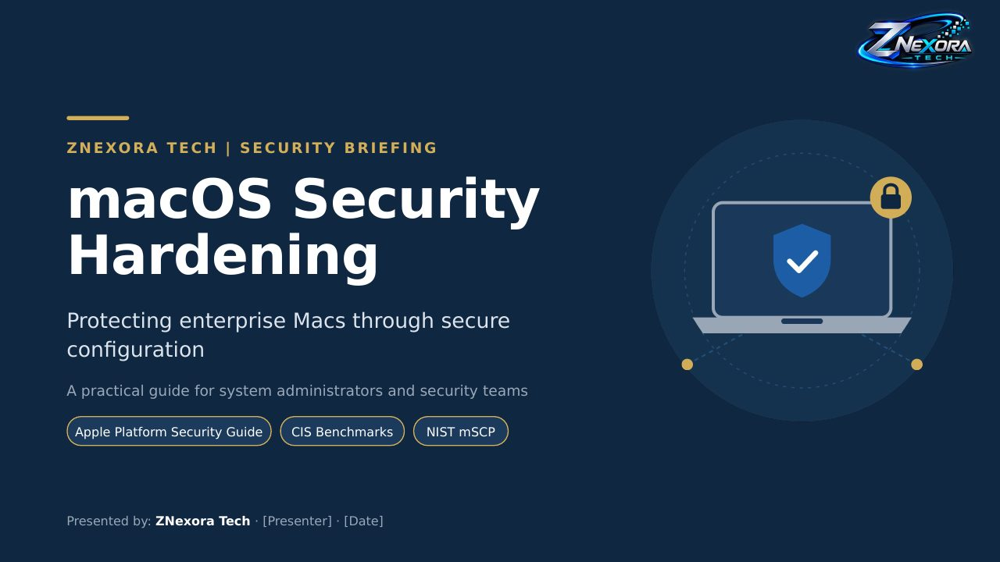

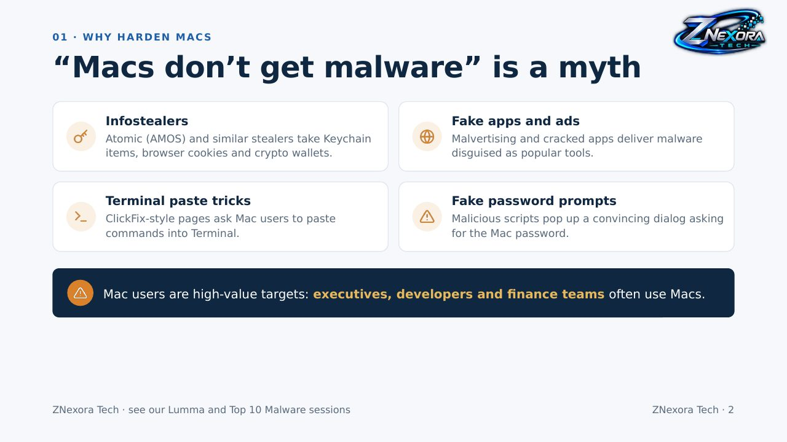

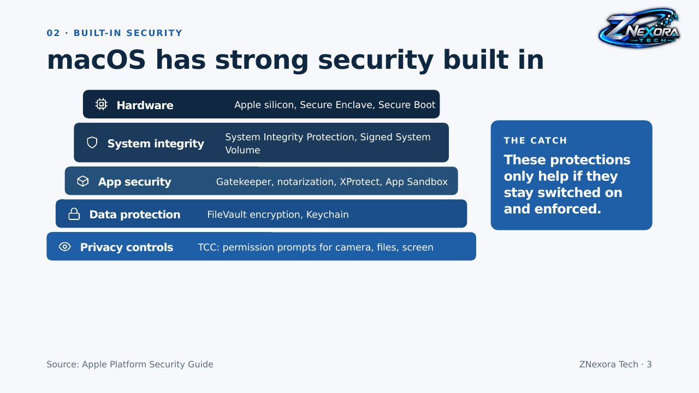

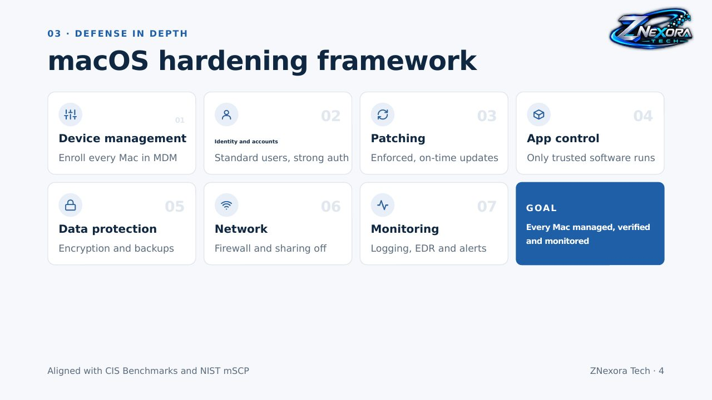

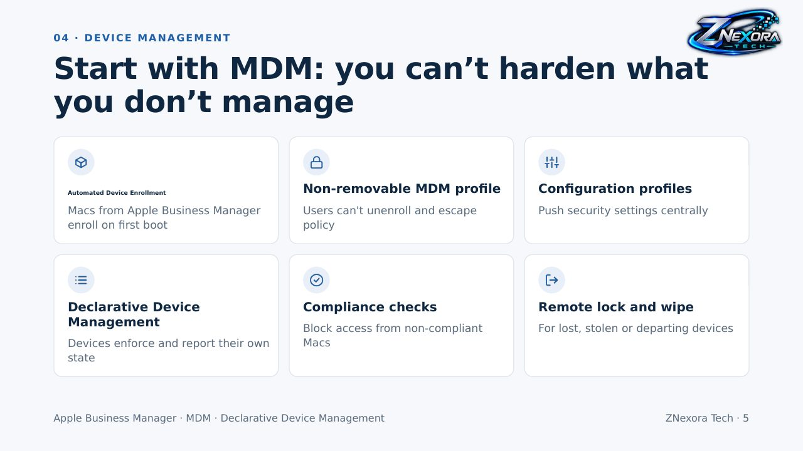

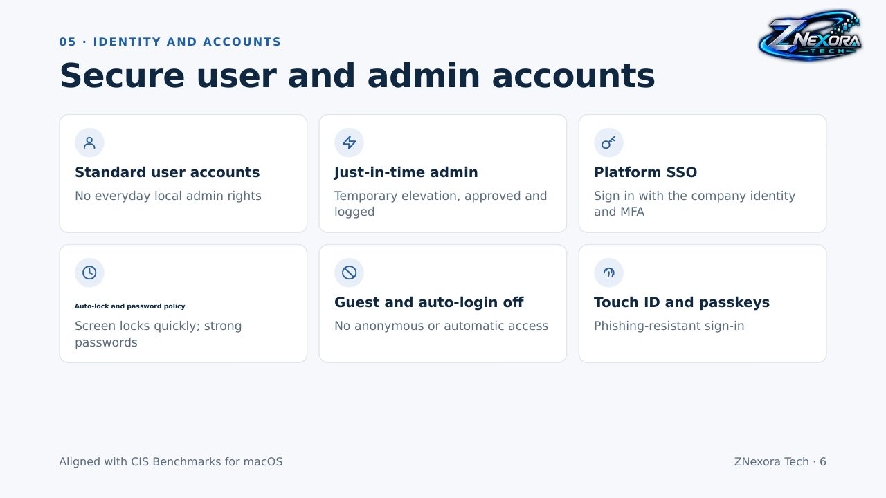

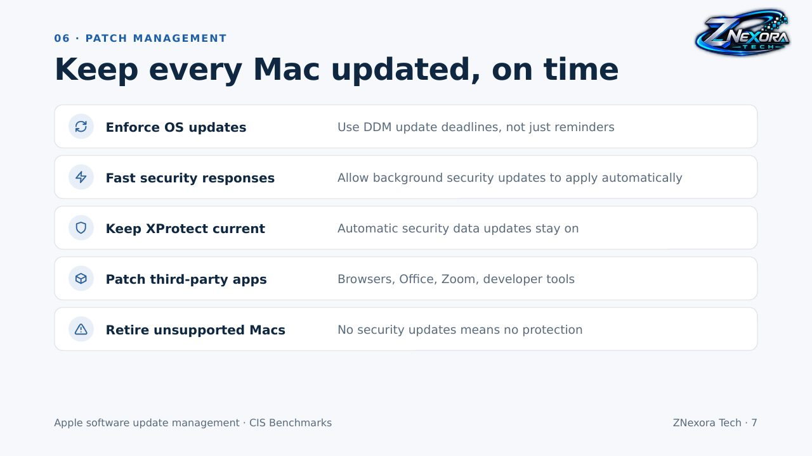

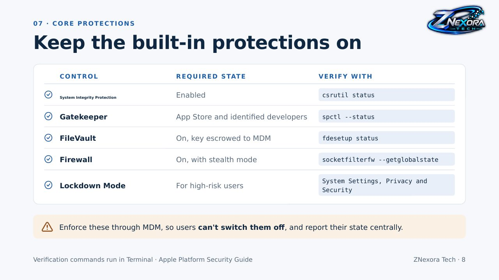

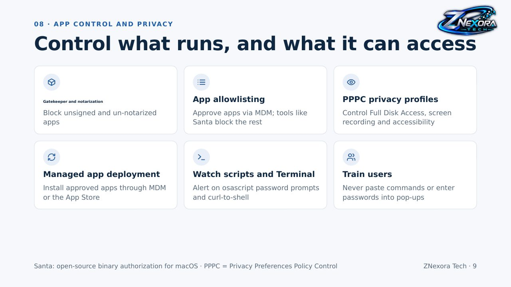

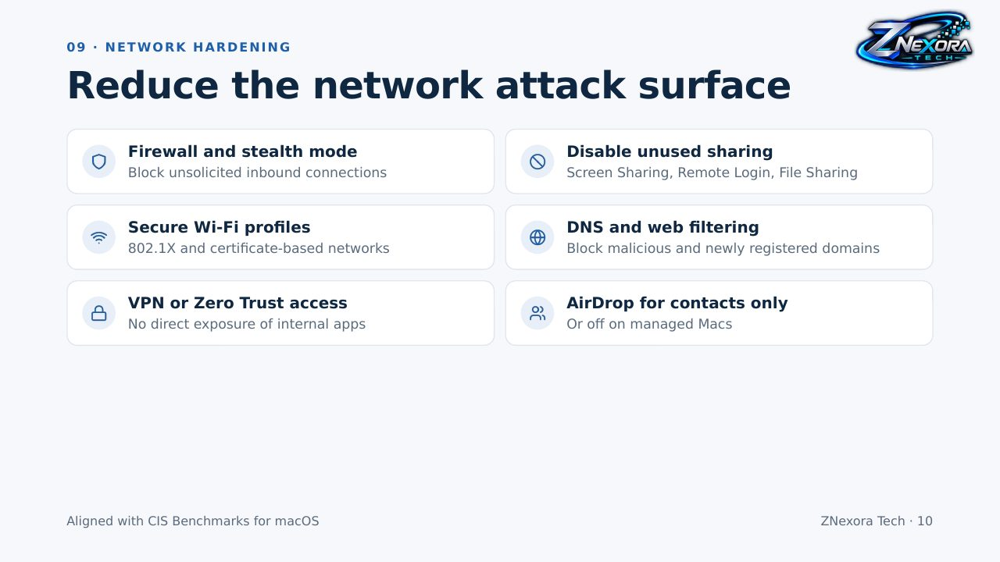

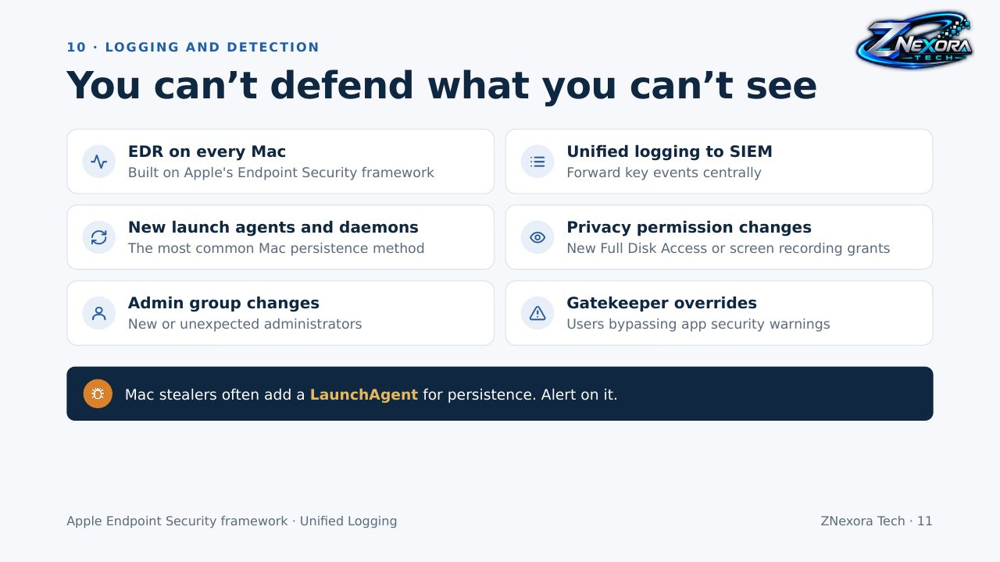

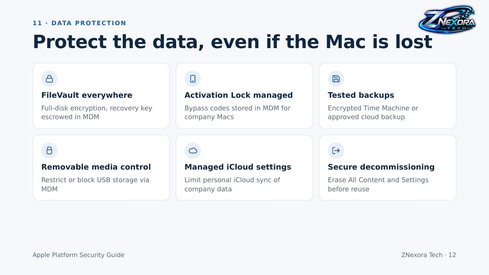

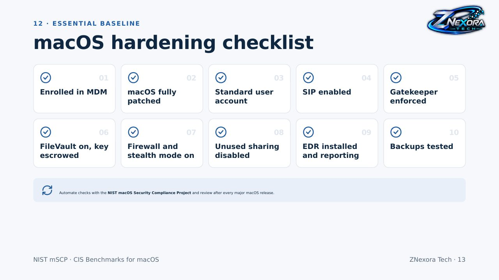

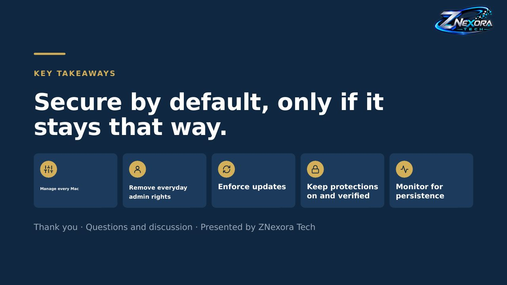
