## Key points

### What is mobile money fraud?
- Any trick that gets you to  send money  or  reveal your PIN or code  to someone who should never have it.
- It usually arrives as a  call, SMS, WhatsApp message or link .
- The fraudster relies on  you  taking the action, not on hacking.
- Online Fraud: Mobile Money · 2

Most mobile money fraud is not high-tech hacking. It is social engineering: a fraudster persuades you to do something yourself, like sending money, approving a transaction, or reading out a code. That's good news, because it means awareness is the best defence.

### Why fraudsters target mobile money
- 01
- It's instant
- Money moves in seconds, often before you realise something is wrong.
- 02
- It's hard to reverse
- Once cashed out, stolen funds are rarely recovered.
- 03
- It runs on trust
- Scammers pose as agents, relatives, banks or officials.
- Online Fraud: Mobile Money · 3

Three things make mobile money attractive to criminals: speed, finality, and trust. Transfers are instant, they are difficult to undo once the money is withdrawn, and the whole system depends on people trusting phone numbers and names that can easily be faked.

### Six common scams
- "Wrong transfer"
- "I sent money to you by mistake, please send it back."
- Fake prizes
- "You've won! Pay a small fee to claim your reward."
- Fake customer care
- Callers posing as your provider asking for your PIN.
- SIM swap
- Criminals take over your number to reach your wallet.
- Phishing links
- Fake websites or apps that steal your login details.
- Loan & investment
- Promises of quick loans or huge returns after a "fee".
- Online Fraud: Mobile Money · 4

Walk through each scam briefly and ask the audience if they have seen any of them. The "wrong transfer" scam often comes with a fake SMS that looks like a real deposit notice: always check your actual balance, not the message. Real promotions never ask you to pay to receive a prize. Your provider will never call asking for your PIN.

### How a typical scam unfolds
- STEP 1
- Contact
- A call, SMS or message out of the blue.
- STEP 2
- Pressure
- Urgency, fear or a reward too good to miss.
- STEP 3
- The ask
- Send money, or share your PIN or code.
- STEP 4
- Gone
- Wallet emptied, number blocked.
- Break the chain at  any  step: hang up, wait, and verify through official channels.
- Online Fraud: Mobile Money · 5

Almost every scam follows this pattern. The key is step 2: pressure. Fraudsters want you to act before you think. If you slow down and verify by calling the official number yourself, the scam usually falls apart.

### Red flags to watch for
- [icon: alert-triangle]
- Anyone asking for your  PIN or OTP
- [icon: alert-triangle]
- "Act now or your account is  blocked "
- [icon: alert-triangle]
- Paying a  fee  to receive a prize or loan
- [icon: alert-triangle]
- Messages from  personal numbers  claiming to be official
- [icon: alert-triangle]
- Links asking you to  log in or verify
- [icon: alert-triangle]
- A deposit SMS your  balance doesn't show
- Online Fraud: Mobile Money · 6

If you notice even one of these signs, stop and verify. Official messages from your provider come from registered short codes or sender names, not ordinary personal phone numbers. And a deposit message means nothing until you confirm the money in your actual balance.

### Never share your PIN or OTP.
- THE GOLDEN RULE
- Not with "customer care". Not with an agent. Not with family.

If you remember only one thing from today, remember this. Your PIN and one-time codes are like the key to your house. No genuine provider, agent or bank employee will ever ask for them. Anyone who asks is a fraudster.

### Six habits that protect you
- Keep your PIN secret
- Cover the keypad; avoid birth years.
- Check your balance
- Confirm deposits in the app, not by SMS.
- Call back officially
- Hang up and dial the official number.
- Use official apps
- Only trusted app stores, no unknown links.
- Lock your phone
- Use a screen lock and wallet security.
- Talk about it
- Warn family, especially older relatives.
- Online Fraud: Mobile Money · 8

These are simple, everyday habits. Avoid obvious PINs like birth years or 1234. The most powerful habit is calling back on an official number: it defeats almost every impersonation scam. Use only official apps from trusted stores, lock your phone, and share what you learn today with relatives who may be more vulnerable.

### SIM swap fraud
- SPOTLIGHT
- A criminal convinces your mobile operator to move your number to their SIM card. Your calls, SMS codes and mobile money now go to them.
- Warning signs
- Your phone suddenly shows  No Service
- You stop receiving calls or SMS
- Alerts about a SIM change you didn't request
- Contact your operator immediately from another phone.
- Online Fraud: Mobile Money · 9

SIM swap is especially dangerous because it bypasses SMS codes. Fraudsters often gather personal details first through social media or phishing. If your phone loses service unexpectedly in an area where it normally works, treat it as an emergency and call your operator from another phone.

### Scammed? Act fast
- 1
- Call your provider immediately  to report and try to block the transaction.
- 2
- Change your PIN  and secure your SIM and phone.
- 3
- Keep the evidence:  screenshots, numbers, messages and transaction IDs.
- 4
- Report to the police  or cybercrime unit.
- 5
- Warn your contacts  in case the scammer targets them next.
- Online Fraud: Mobile Money · 10

Speed matters. The sooner the provider knows, the better the chance of freezing funds before they are withdrawn. Remind people there is no shame in being scammed: these criminals are professionals, and reporting helps protect others.

### Where to report fraud
- Mobile money provider
- Free from your mobile line
- Police / cybercrime unit
- [Website or email]
- Report scam SMS
- Forward suspicious messages
- [icon: bookmark]
- Save these numbers in your phone today, before you need them.
- Online Fraud: Mobile Money · 11

Fill in the local helpline numbers for your country and provider before presenting. Encourage the audience to save them right now during the session.

### Stop.  Think.  Verify.
- If it feels urgent, too good to be true, or asks for your PIN, it's a scam.
- Thank you!

Close with the three-word summary and invite questions. Consider asking the audience to share a scam message they have received, and walk through the red flags together.

## Slides

[Download the slides as PDF](../../assets/files/online-fraud.pdf)

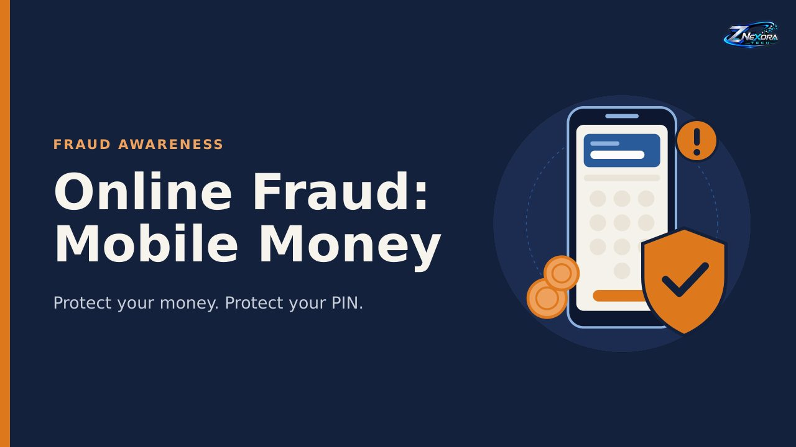

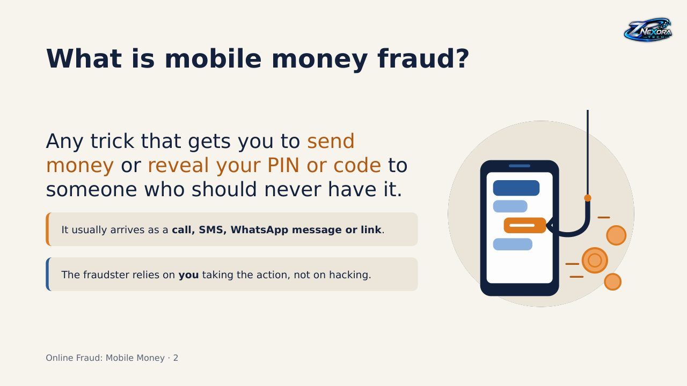

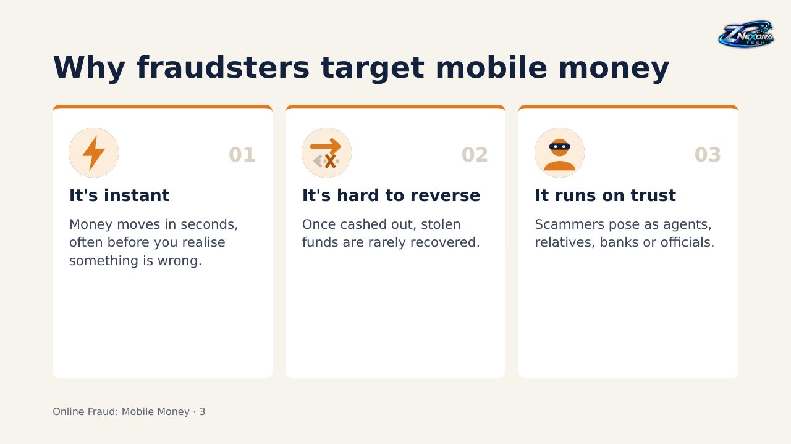

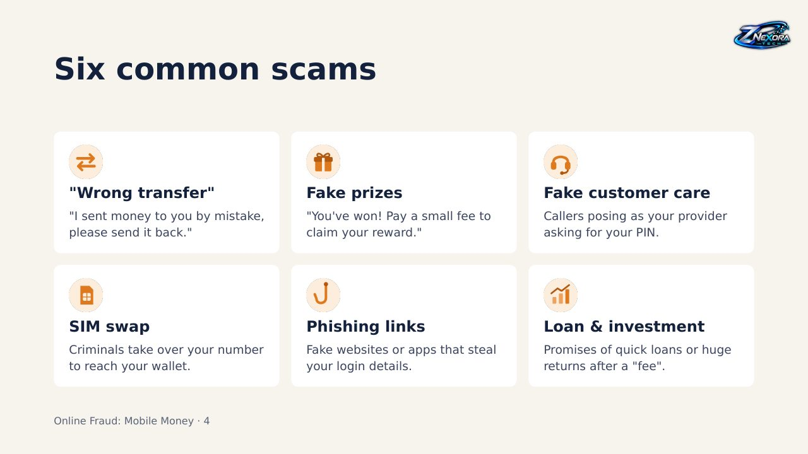

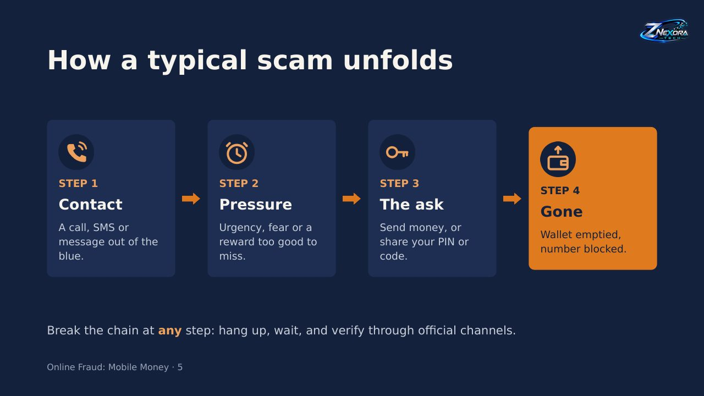

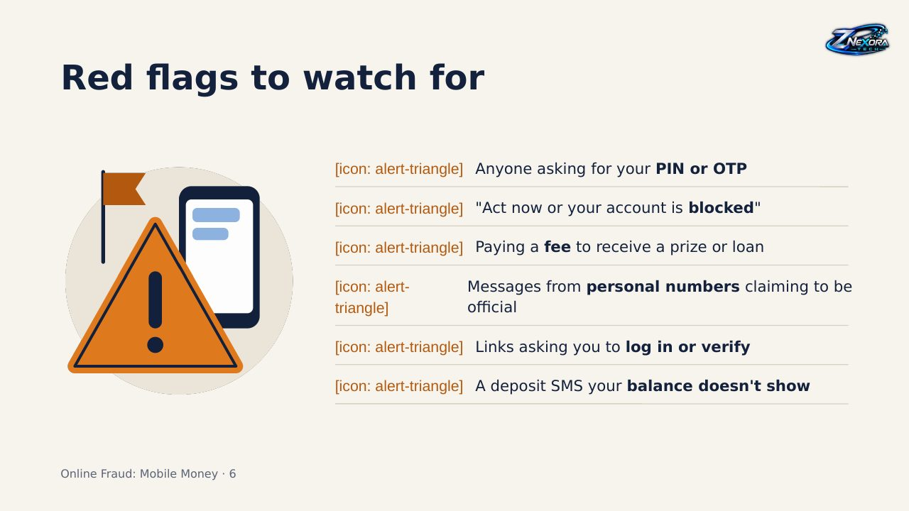

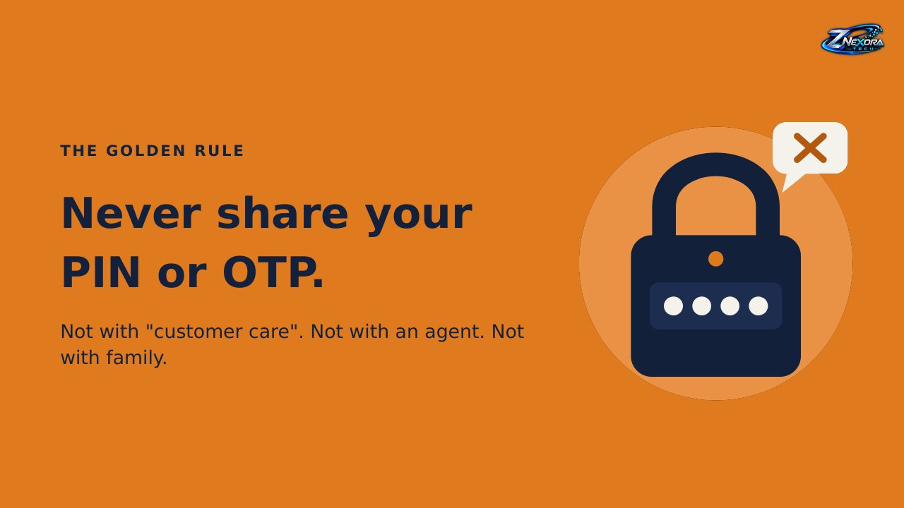

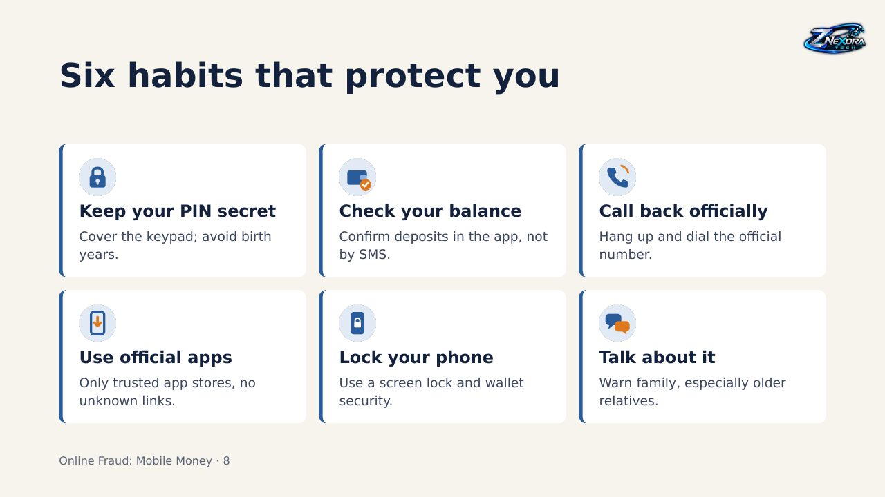

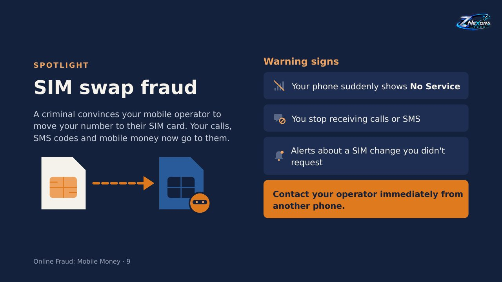

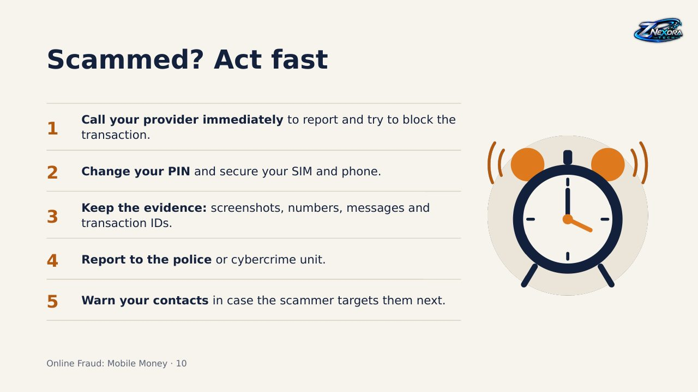

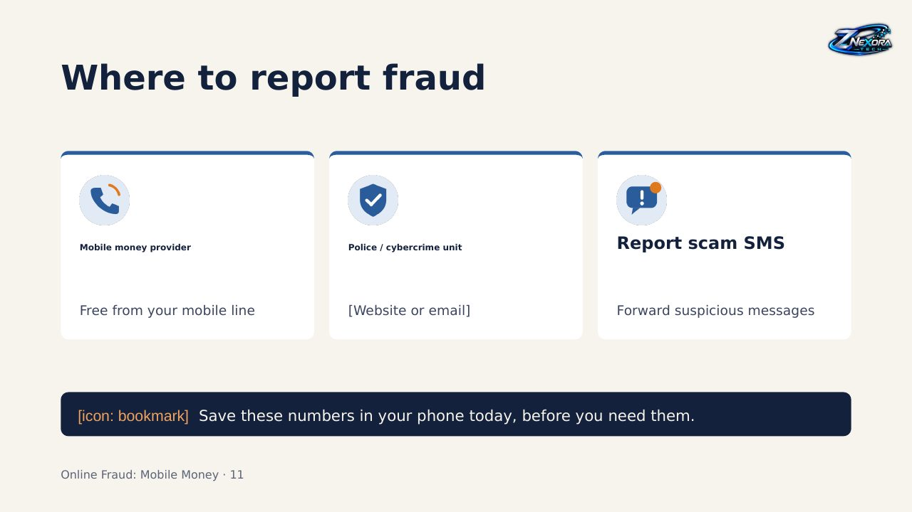

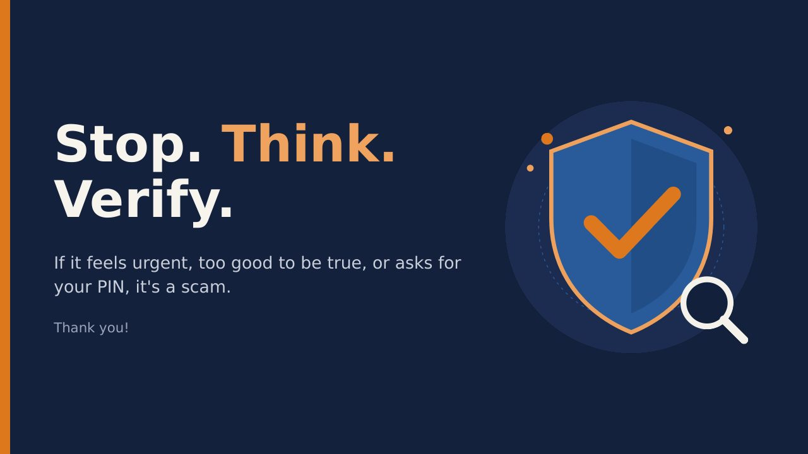
