## Key points

### What is phishing?
- 01 · UNDERSTANDING THE THREAT
- A message that  pretends to be someone you trust  to trick you into acting.
- Clicking a link, opening a file,  sharing a password  or  sending money .
- It targets  people , not technology, so anyone can be fooled.
- ZNexora Tech | Phishing Awareness
- 2

[0:40 – 1:30] So what exactly is phishing? Phishing is a message that pretends to come from someone you trust, like your bank, a colleague, a delivery company or even our own IT team, to trick you into taking an action. That action might be clicking a link, opening an attachment, entering your password on a fake login page, or sending money. The image here shows a typical fake login page. It looks just like the real thing, but the web address is slightly different. The important thing to understand is that phishing targets people, not technology. It plays on our trust, our curiosity and our desire to be helpful. That means anyone can be fooled, no matter how experienced they are.

### Phishing comes in many forms
- 02 · KNOW THE TACTICS
- Email phishing
- Mass emails posing as trusted brands.
- Spear phishing
- Tailored messages aimed at you by name.
- Smishing
- Fake text messages, like parcel or bank alerts.
- Vishing
- Phone calls pretending to be IT, banks or officials.
- QR code phishing
- Codes on posters or emails leading to fake sites.
- Business email compromise
- Fake "boss" or supplier asking for payments.
- ZNexora Tech | Phishing Awareness
- 3

[1:30 – 2:40] Phishing comes in many forms. The most familiar is email phishing: mass emails pretending to be from well-known brands, banks or delivery services. Spear phishing is more dangerous because it's tailored. The attacker researches you, uses your name, your role, even real projects or colleagues, to make the message believable. Smishing is phishing by SMS or messaging apps, such as a text saying a parcel is held or your bank account is locked. Vishing is voice phishing: a phone call from someone pretending to be IT support, your bank, or an official. QR code phishing uses codes on posters, flyers or emails that take you to a fake website. And business email compromise is when an attacker pretends to be a manager, executive or supplier and asks for an urgent payment or a change to bank details. Different channels, same trick.

### What attackers want from you
- 03 · THE ATTACKER'S GOALS
- Your login details
- Usernames, passwords and MFA codes give them access to email, files and systems.
- Money
- Fake invoices, changed bank details, gift cards and urgent transfers.
- A way in
- Malware or ransomware installed through an attachment or download.
- ZNexora Tech | Phishing Awareness
- 4

[2:40 – 3:20] Why do attackers bother? There are three main things they want from you. First, your login details: usernames, passwords and even the one-time MFA codes sent to your phone. With those, they can read your email, access our files and systems, and launch further attacks from your account. Second, money: fake invoices, changed supplier bank details, requests to buy gift cards, or urgent transfers. And third, a way in. One malicious attachment or download can install malware or ransomware that spreads across our whole network. Keep these three goals in mind. If a message is asking for your credentials, money, or for you to open something unexpected, that's your cue to slow down.

### Anatomy of a phishing email
- 04 · SPOT THE RED FLAGS
- Inbox · 1 new message
- 1
- From:  Microsoft 365 Team <alerts@micr0soft-support.co>
- 2
- FINAL NOTICE: Mailbox will be deleted in 24 hours
- 3
- Dear Valued User,
- Your mailbox storage is full. Confirm your account now to avoid losing all your emails.
- 4
- Confirm account
- mail-verify.xyz/login
- 5
- Storage_Report.html
- 1
- Look-alike sender
- A zero for an "o", or an outside domain.
- 2
- Urgency or threats
- "Final notice", "24 hours", "suspended".
- 3
- Generic greeting
- Real services usually use your name.
- 4
- Mismatched link
- Hover: the real address is somewhere else.
- 5
- Unexpected attachment
- HTML, zip or macro files you didn't expect.
- ZNexora Tech | Phishing Awareness
- 5

[3:20 – 4:40] Let's dissect a real-looking phishing email. Number one: the sender. The display name says Microsoft 365 Team, but look at the actual address: micr0soft with a zero, on a domain that has nothing to do with Microsoft. Always check the address, not just the name. Number two: urgency and threats. Final notice, mailbox deleted in 24 hours. Pressure is the attacker's favourite tool, because it stops us thinking. Number three: a generic greeting. Dear Valued User. Services you actually use normally know your name. Number four: the link. The button says Confirm account, but when you hover your mouse over it, the real destination appears, and it's a completely different website. And number five: an unexpected attachment. HTML files, zip files and documents asking you to enable macros are common traps. One of these signs is enough to stop and report.

### Check the link before you click
- 05 · INSPECT BEFORE YOU CLICK
- https://www. yourbank.com /login
- Real: the domain is yourbank.com
- https://www.yourbank.com. secure-login.net /verify
- Fake: the real domain is secure-login.net
- https://www. y0urbank.com /login
- Fake: a zero replaces the letter "o"
- https:// yourbank-support.co /account
- Fake: extra words and a different ending
- Read the domain  just before the first single "/" . Hover on a computer, long-press on a phone.
- ZNexora Tech | Phishing Awareness
- 6

[4:40 – 5:40] Links are where most phishing succeeds, so let's learn to read them. The trick is to find the real domain: the part just before the first single slash. In the first example, the domain is yourbank.com, so this is genuine. The second one is sneaky. It starts with yourbank.com, but keep reading. The real domain is secure-login.net. Everything before it is just decoration the attacker controls. The third example replaces the letter o with a zero, which is easy to miss at a glance. And the fourth adds extra words and uses a different ending, dot co instead of dot com. Before you click, hover your mouse over the link on a computer, or press and hold on a phone, to see where it really goes. If in doubt, don't click. Type the address you know yourself, or use the official app.

### Beyond email: texts, calls, QR codes
- 06 · SMISHING, VISHING & QR CODE SCAMS
- ParcelDelivery
- Your parcel could not be delivered. Pay the 1.99 redelivery fee today:
- parcel-redeliver.info
- Reply STOP to opt out.
- Unknown sender, odd link
- Texts (smishing)
- Don't tap links in unexpected texts. Open the official app or website yourself.
- Calls (vishing)
- Hang up and call back on a number you trust. IT will never ask for your password.
- QR codes
- Check the address before entering details. Watch for stickers over real codes.
- ZNexora Tech | Phishing Awareness
- 7

[5:40 – 6:30] Phishing isn't limited to email. Here's a typical smishing text: a parcel couldn't be delivered, pay a small fee at this link. It's cheap, it's urgent, and the link goes to a fake site that steals your card details. With texts, don't tap links you weren't expecting. Open the official app or type the website yourself. With phone calls, attackers may pretend to be IT support, your bank or even a senior manager. If a caller asks for your password, an MFA code, or remote access to your computer, hang up and call back on a number you already trust. Our IT team will never ask for your password. And with QR codes, check the web address that appears before you enter any information, and watch out for stickers placed over genuine codes on posters or parking meters.

### Stop.
- THE GOLDEN RULE
- Check.
- Report.
- If something feels off, it probably is.

[6:30 – 7:00] If you remember only one thing today, make it this: Stop. Check. Report. Stop before you click, reply, or pay. Check the sender, the link and the request, ideally through a separate channel, like calling the person on a number you already know. And report anything suspicious to IT. If something feels off, it probably is, and trusting that instinct is exactly what we want.

### Clicked by mistake? Act fast
- 07 · INCIDENT RESPONSE
- 1
- Stop  and don't enter any more information.
- 2
- Report it to IT immediately  on [contact]. Minutes matter.
- 3
- Change your password  from a trusted device, and anywhere you reused it.
- 4
- Follow IT's advice  if you opened an attachment, such as disconnecting.
- 5
- Watch for warning signs:  MFA prompts or sent emails you don't recognise.
- ZNexora Tech | Phishing Awareness
- 9

[7:00 – 8:00] Mistakes happen, even to security professionals. What matters is what you do next. One: stop. Don't enter any more information, and close the page. Two: report it to IT immediately on [contact]. The faster we know, the faster we can lock the account, block the site, and protect everyone else. Three: change your password, from a device you trust, and change it anywhere else you used the same password. Four: if you opened an attachment, follow IT's advice. They may ask you to disconnect from the network while they check your device. And five: watch for warning signs, like MFA prompts you didn't request or sent emails you don't recognise. Please remember: you will never be blamed for reporting. The only real mistake is staying silent.

### Six habits that beat phishing
- 08 · EVERYDAY PROTECTION
- Pause on urgency
- Pressure is a red flag. Take a moment.
- Verify another way
- Call the sender on a number you know.
- Hover before you click
- Check where every link really goes.
- Use MFA
- Never share or approve codes you didn't request.
- Unique passwords
- A password manager makes this easy.
- Report, don't delete
- Reporting protects your colleagues too.
- ZNexora Tech | Phishing Awareness
- 10

[8:00 – 9:00] Here are six simple habits that beat phishing. One: pause on urgency. Whenever a message pressures you to act now, that's your signal to slow down. Two: verify another way. If your manager emails asking for an urgent payment, call them on a number you already know. Don't reply to the email. Three: hover before you click, and check where every link really goes. Four: use multi-factor authentication, and never share or approve a code or login prompt you didn't request yourself. Five: use unique passwords for every account. A password manager makes this easy, and it won't autofill on a fake site. And six: report, don't just delete. When you report a phishing email, IT can remove it from everyone's inbox and block the sender. Your report protects your colleagues too.

### How to report phishing
- 09 · REPORTING
- Email toolbar
- Reply
- Delete
- Report Phishing
- Reported. IT removes it for everyone.
- Report Phishing button
- [Button name]
- Forward suspicious emails
- [security@...]
- Call IT if you clicked
- [Extension]
- ZNexora Tech | Phishing Awareness
- 11

[9:00 – 9:35] So how do you report? The easiest way is the Report Phishing button in your email toolbar, called [button name] in our system. One click sends it to the security team, and they can remove it from everyone's inbox. You can also forward suspicious emails to [security@...]. And if you've already clicked a link or entered details, don't just report the email. Call IT straight away on [extension]. Please report even when you're not sure. A false alarm costs us nothing. A missed attack can cost us a great deal.

### Think before you click.
- REMEMBER
- Stop. Check. Report. You are our best defence.
- Thank you · Questions?

[9:35 – 10:00] To wrap up: phishing works by rushing us and exploiting our trust. Our best defence is a few seconds of thought. Think before you click. Stop, check, and report. Every report helps protect all of us, and nobody will ever be blamed for reporting something suspicious. Thank you for your time. I'm happy to take any questions.

## Slides

[Download the slides as PDF](../../assets/files/phishing.pdf)

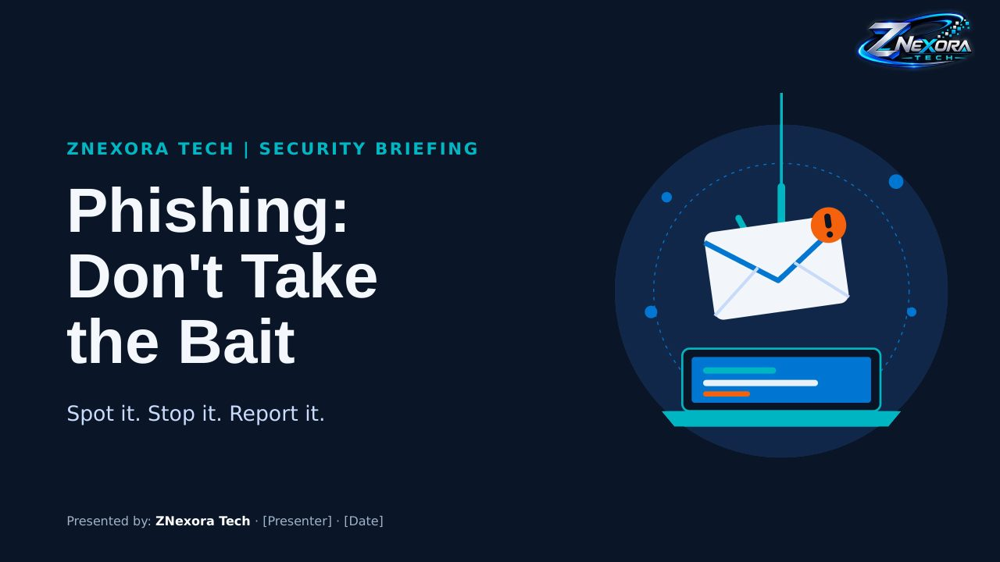

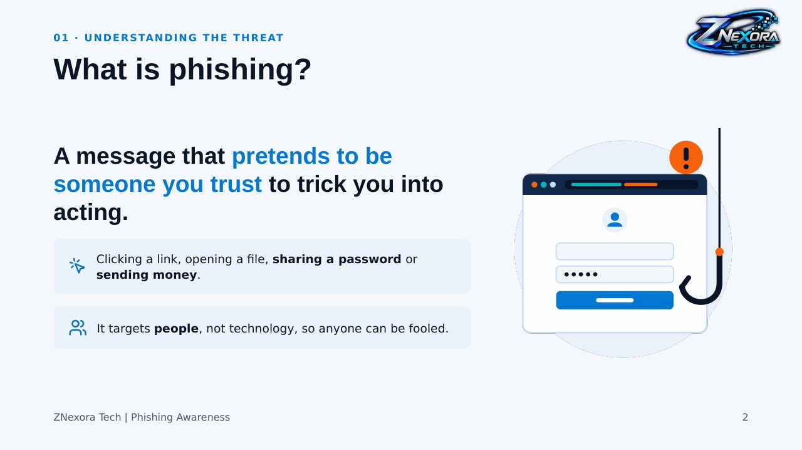

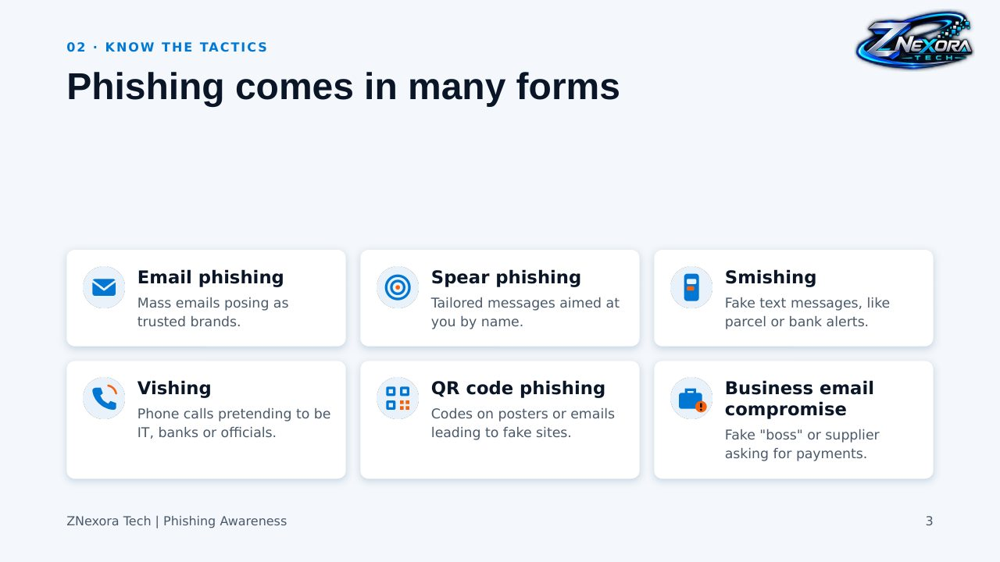

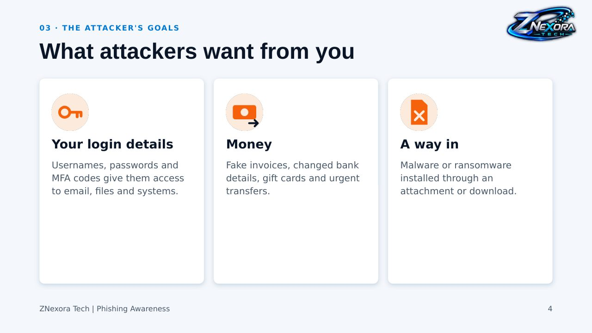

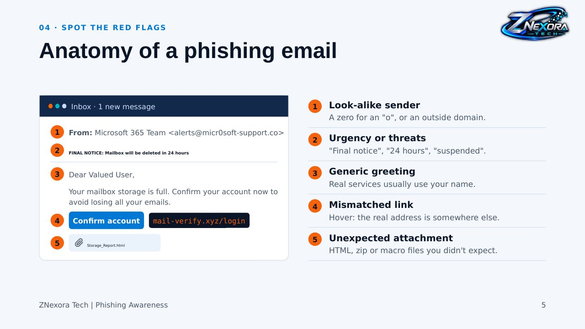

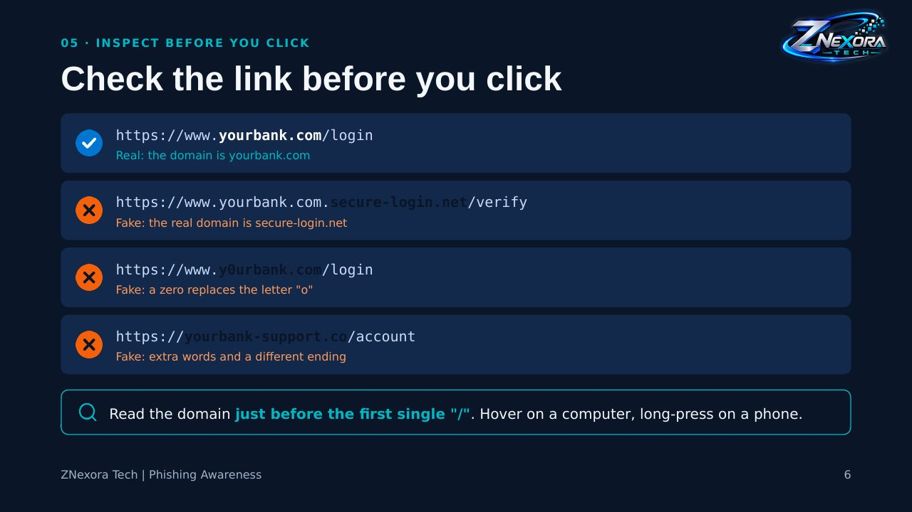

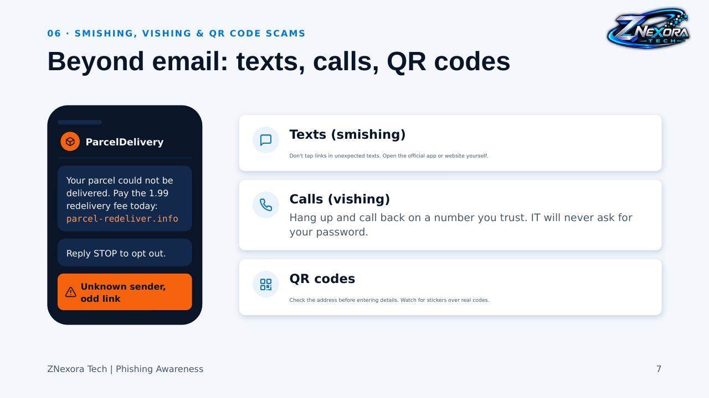

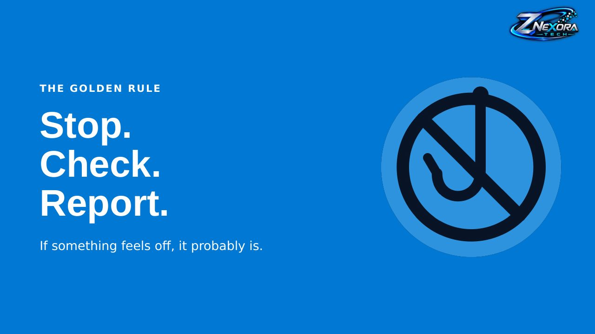

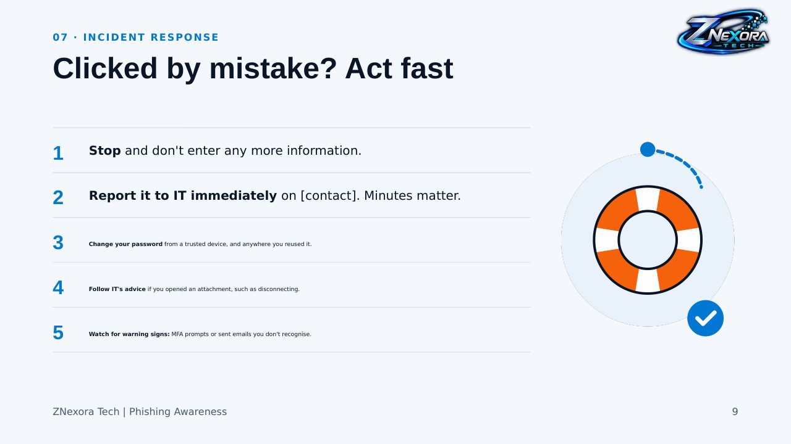

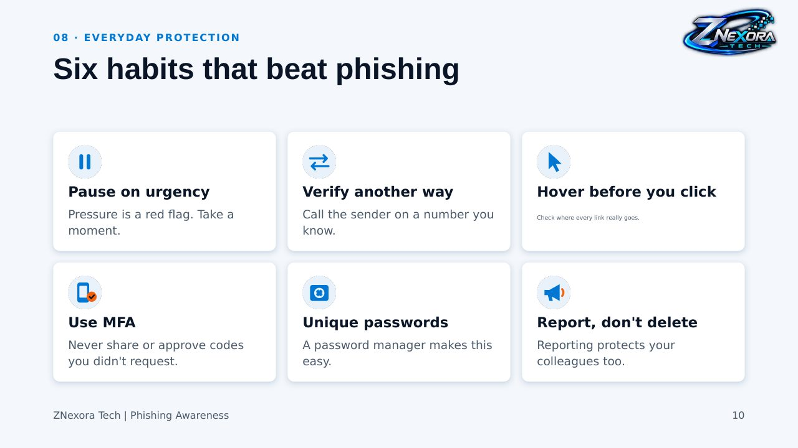

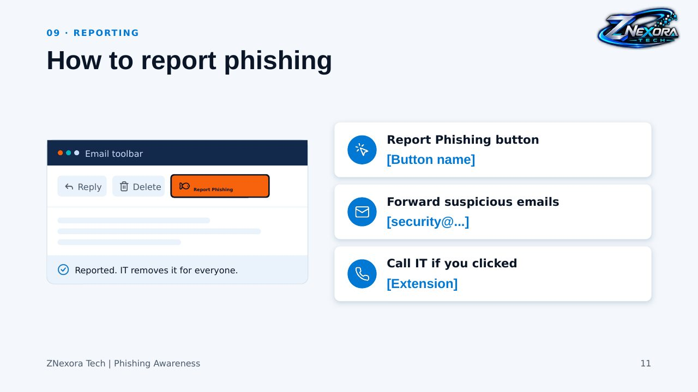

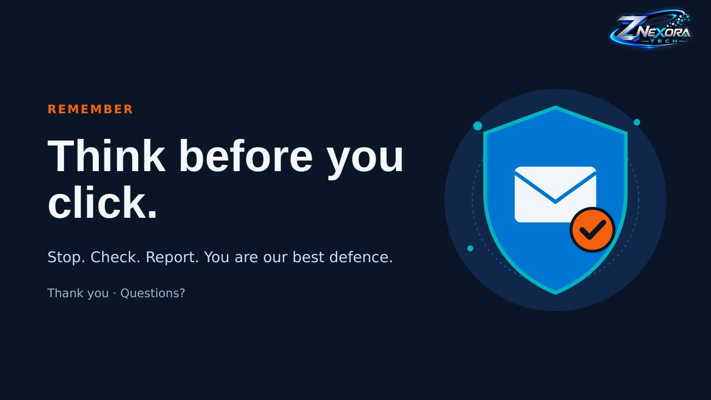
