## Key points

### What is ransomware?
- Malicious software that  locks your files  and demands a  ransom  to unlock them.
- Files are  encrypted : scrambled so no one can open them without a key.
- Many attackers also  steal data  and threaten to publish it.
- Ransomware Security Awareness · 2

[0:40 – 1:30] So, what is ransomware? It's a type of malicious software that locks your files and then demands a ransom, usually in cryptocurrency, to unlock them. It does this by encrypting the files, which means scrambling them so they can't be opened without a special key that only the attacker has. Suddenly, documents, spreadsheets, databases, even entire systems become unusable. And it's become worse: many attackers now also steal a copy of the data before locking it, then threaten to publish it if the ransom isn't paid. So it's not only about losing access to our files. It can also mean sensitive information about our customers, colleagues and organisation being exposed.

### Why it matters to all of us
- Work stops
- Systems go offline. We can't serve customers or do our jobs, sometimes for weeks.
- Data is exposed
- Personal and confidential information can be stolen and leaked.
- Costs and trust
- Recovery is expensive, and our reputation can take years to rebuild.
- Ransomware Security Awareness · 3

[1:30 – 2:20] Why does this matter to every one of us, not just the IT team? First, work stops. When ransomware hits, systems go offline. We may not be able to serve customers, process payments or even send email, and that disruption can last days or weeks. Second, data is exposed. Personal information about customers and colleagues, financial records and confidential plans can be stolen and leaked online. That can also bring legal and regulatory consequences. And third, cost and trust. Recovery is expensive, and paying a ransom gives no guarantee you get your data back. Worst of all, customers lose trust in us, and that can take years to rebuild.

### How ransomware gets in
- Phishing emails
- Infected attachments or links in convincing messages.
- Unsafe downloads
- Fake updates, pirated software and infected USB drives.
- Unpatched systems
- Skipped updates leave known security holes open.
- Weak or stolen passwords
- Attackers log in remotely using reused or guessed passwords.
- Ransomware Security Awareness · 4

[2:20 – 3:20] So how does ransomware actually get in? There are four common doors. The biggest one is phishing email: a convincing message with an infected attachment or a link to a malicious website. One click can be enough. The second is unsafe downloads: fake software updates, pirated programs, browser pop-ups, or even a USB drive someone found in the car park. Third, unpatched systems. When we postpone updates, we leave known security holes open, and attackers actively scan for them. And fourth, weak or stolen passwords. If you reuse a password that was leaked somewhere else, or use something easy to guess, attackers can simply log in, often through remote access tools, as if they were you. Notice that most of these doors are opened by everyday actions. That's why awareness matters so much.

### Anatomy of an attack
- STEP 1
- Entry
- A click, a download or a stolen password.
- STEP 2
- Spread
- Quietly moves across the network.
- STEP 3
- Steal
- Copies sensitive data out.
- STEP 4
- Encrypt
- Locks files and backups it can reach.
- STEP 5
- Extort
- Demands payment, threatens leaks.
- Attackers may wait  days or weeks  between entry and encryption. Early reporting can stop them.
- Ransomware Security Awareness · 5

[3:20 – 4:10] Let's look at how a typical attack unfolds, because it's rarely instant. Step one is entry: someone clicks a link, opens an attachment, or the attacker uses a stolen password. Step two, spread: the attacker quietly moves across the network, looking for important servers and accounts. Step three, steal: they copy sensitive data out of the organisation. Step four, encrypt: they lock files, and they deliberately target backups too. And step five, extort: a ransom note appears demanding payment, often with a threat to publish the stolen data. The key point is this: there can be days or even weeks between entry and encryption. If someone reports a suspicious email or odd behaviour early, our security team has a real chance to stop the attack before step four.

### Spotting a phishing email
- Inbox
- 1
- From:  IT Support <helpdesk@secure-l0gin.co>
- 2
- URGENT: Your account will be suspended today
- Dear user,
- We detected unusual activity. Verify your password within 1 hour to avoid losing access.
- 3
- Verify now
- 4
- [icon: paperclip]
- Invoice_0921.zip
- 1
- Odd sender address
- Misspelled or look-alike domains.
- 2
- Urgency or threats
- Pressure to act before you think.
- 3
- Suspicious links
- Hover first: does the address match?
- 4
- Unexpected attachments
- Zip files, macros or "invoices".
- Ransomware Security Awareness · 6

[4:10 – 5:20] Since phishing is the most common way in, let's practise spotting one. Look at this example. Number one: the sender. It says IT Support, but look closely at the address. The domain uses a zero instead of the letter o, and it isn't our company domain. Number two: urgency. 'Your account will be suspended today.' Pressure is designed to make you act before you think. Number three: the link. Before clicking any button or link, hover your mouse over it and check where it really goes. If it doesn't match the real website, don't click. And number four: unexpected attachments, especially zip files, files asking you to enable macros, or invoices you weren't expecting. These are classic ransomware carriers. If an email ticks even one of these boxes, don't click, don't reply, and report it using [the Report Phishing button / forwarding to security@company].

### Warning signs of an infection
- Strange file names
- Files renamed with unfamiliar extensions.
- Files won't open
- Documents show errors or scrambled content.
- A ransom message
- A pop-up or text file demanding payment.
- Unusual behaviour
- Very slow PC, or antivirus suddenly off.
- [icon: alert-triangle]
- Notice any of these?  Act immediately : every minute counts.
- Ransomware Security Awareness · 7

[5:20 – 6:00] How would you know if ransomware is already on your computer? Watch for these warning signs. Files suddenly have strange names or unfamiliar extensions added to the end. Documents won't open, show errors, or display scrambled content. A message appears on your screen, or a new text file appears in your folders, demanding payment. Or your computer behaves unusually: it becomes extremely slow, the hard drive is working constantly, or your antivirus has been switched off without you doing it. If you notice any of these, act immediately. Every minute counts, because ransomware keeps spreading while it runs.

### Disconnect.
- IF YOU SUSPECT RANSOMWARE
- Report.
- Don't pay.
- Speed matters more than anything else.

[6:00 – 6:30] If you remember only one thing from today, remember these three words: Disconnect. Report. Don't pay. Disconnect your device from the network to stop the spread. Report it to IT immediately, no matter how small or embarrassing it seems. And never pay, reply to, or negotiate with the attackers yourself. Those decisions belong to the organisation's leadership and security experts. Speed matters more than anything else.

### What to do, step by step
- 1
- Disconnect from the network:  unplug the cable and turn off Wi-Fi.
- 2
- Leave the device powered on  unless IT tells you otherwise.
- 3
- Call the IT helpdesk immediately  on [extension / number].
- 4
- Note what you saw:  take a photo of the screen with your phone.
- 5
- Don't pay, reply or try to fix it  yourself.
- Ransomware Security Awareness · 9

[6:30 – 7:40] Here's exactly what to do, step by step. One: disconnect from the network. Unplug the network cable and turn off Wi-Fi. This stops the ransomware from spreading to shared drives and other computers. Two: leave the device powered on, unless IT tells you otherwise. Shutting it down can destroy evidence that investigators need. Three: call the IT helpdesk immediately on [extension / number]. Call rather than email, because email may be affected. Four: note what you saw. Take a photo of the screen with your phone, and write down what you clicked or opened and when. And five: don't pay, don't reply to the attackers, and don't try to fix it yourself. Please remember, you will not get in trouble for reporting. Reporting quickly is exactly the right thing to do, even if it turns out to be a false alarm.

### Six habits that stop ransomware
- Think before you click
- Pause on links and attachments.
- Install updates
- Restart when prompted; don't delay.
- Strong passwords + MFA
- Unique passwords and two-step login.
- Save to approved storage
- Keep work where it's backed up.
- Approved software only
- No pirated apps or unknown USBs.
- Report early
- Suspicious? Tell IT straight away.
- Ransomware Security Awareness · 10

[7:40 – 8:50] Prevention is always better than recovery, so here are six habits that stop ransomware. One: think before you click. Pause on any link or attachment you weren't expecting. Two: install updates. When your computer asks to restart for updates, don't keep postponing it. Updates close the holes attackers use. Three: use strong, unique passwords and turn on multi-factor authentication wherever it's offered. Even if a password is stolen, the second step blocks the attacker. Four: save your work to approved storage, such as [company drive / OneDrive / SharePoint], where it's backed up, not only on your desktop. Five: use approved software only. No pirated programs, browser extensions from unknown sources, or USB drives you found. And six: report early. A suspicious email reported today can prevent a disaster next week.

### Who to contact
- IT helpdesk
- [Extension]
- Call first for any suspected incident
- Report phishing
- [security@...]
- [Or the Report Phishing button]
- Out of hours
- [Number]
- [On-call security contact]
- [icon: bookmark]
- Save these contacts now, on your phone as well as your computer.
- Ransomware Security Awareness · 11

[8:50 – 9:25] Here are the contacts you need. For any suspected incident, call the IT helpdesk first on [extension]. To report a suspicious email, use [the Report Phishing button / forward it to security@...]. And outside office hours, contact [on-call security contact] on [number]. Please save these contacts now, and save them on your phone too, because if ransomware hits, your computer and email may not be available.

### You are the human firewall.
- REMEMBER
- Think before you click. Report anything suspicious.
- Thank you · Questions?

[9:25 – 10:00] To wrap up: technology can block a lot of attacks, but not all of them. Each of us is the human firewall, the last line of defence. Think before you click, keep your devices updated, and if something looks wrong, disconnect, report, and don't pay. Nobody will ever be blamed for reporting something suspicious. Thank you for your time. I'm happy to take any questions.

## Slides

[Download the slides as PDF](../../assets/files/ransomware.pdf)

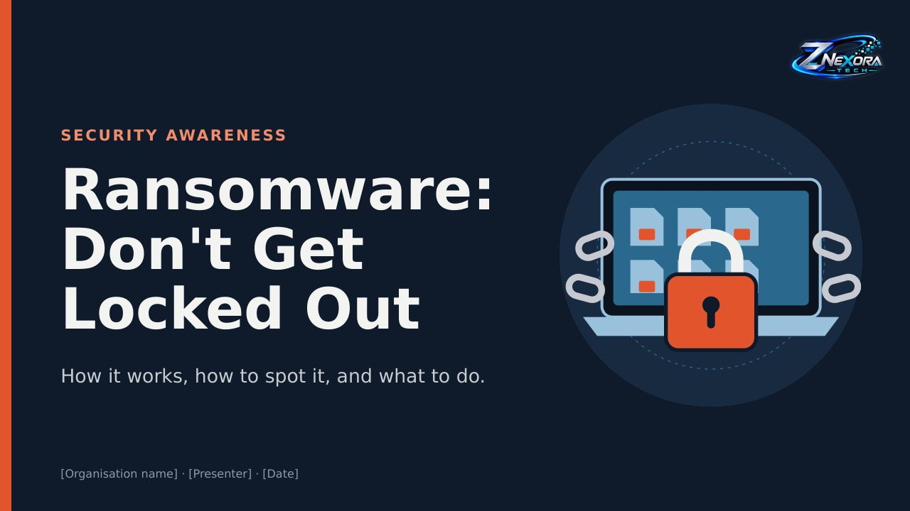

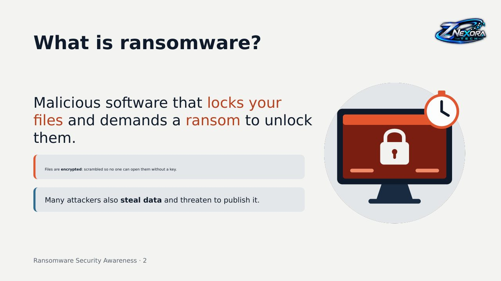

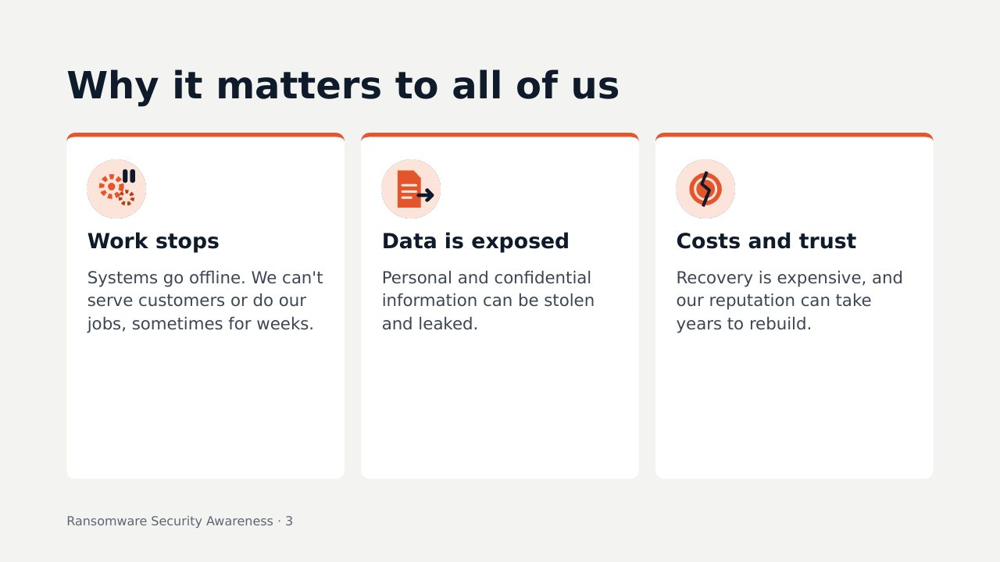

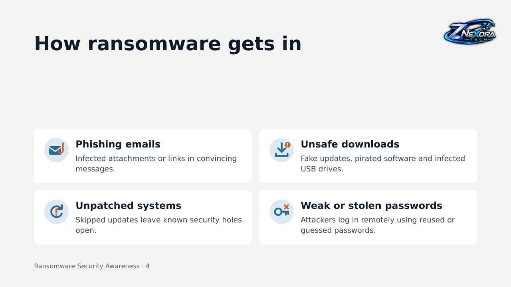

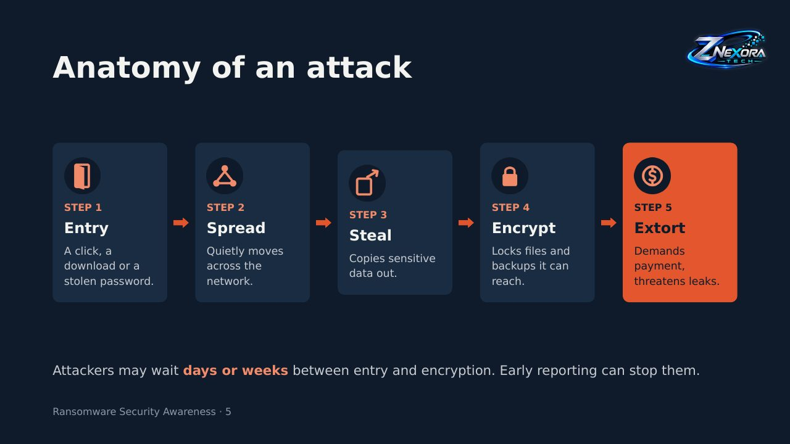

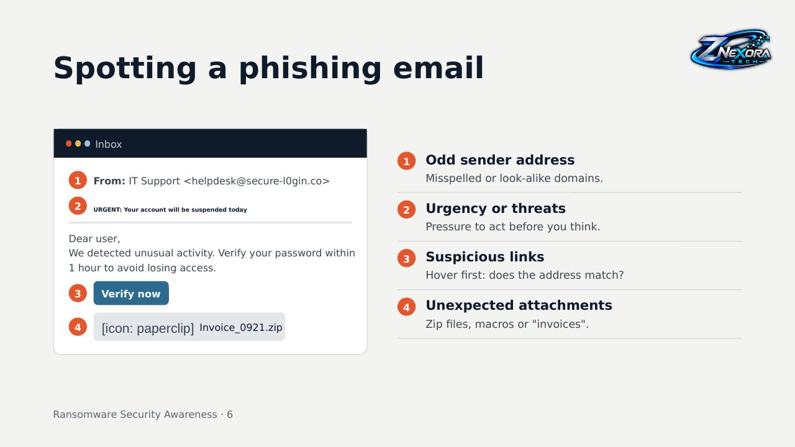

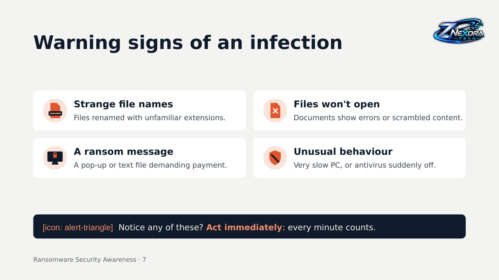

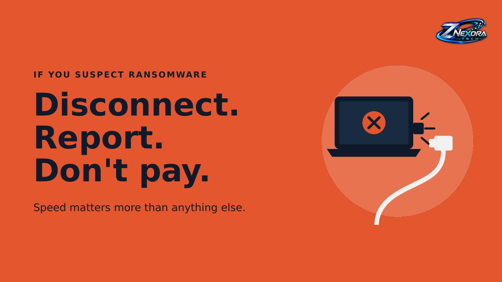

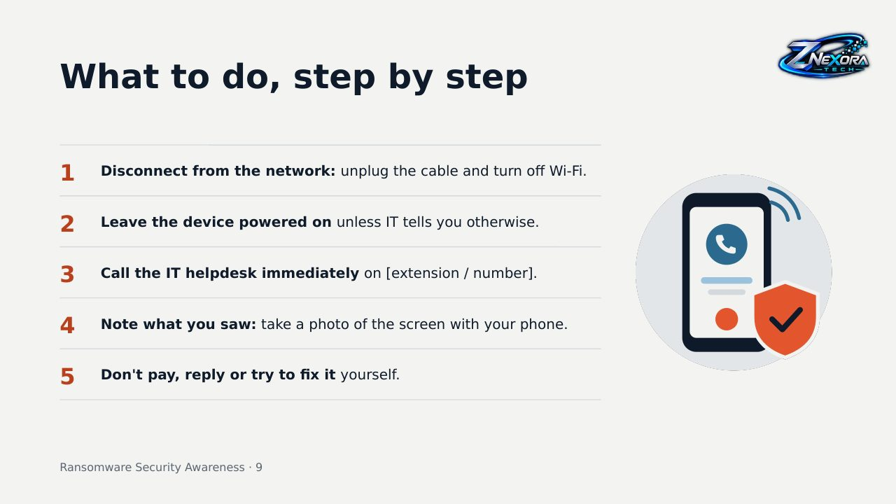

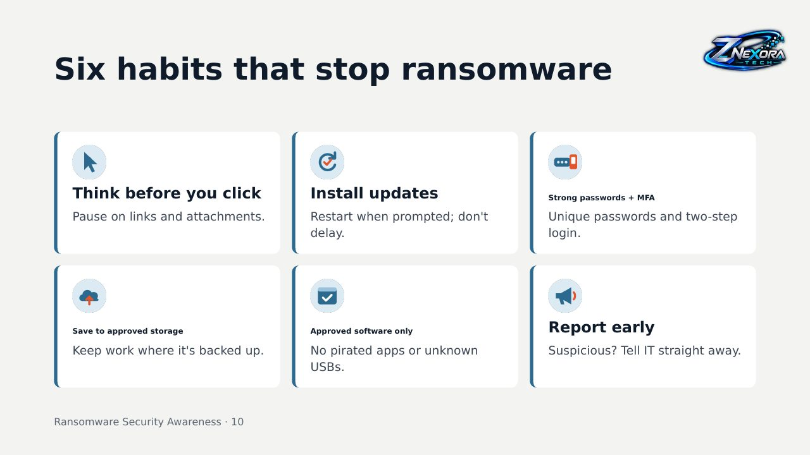

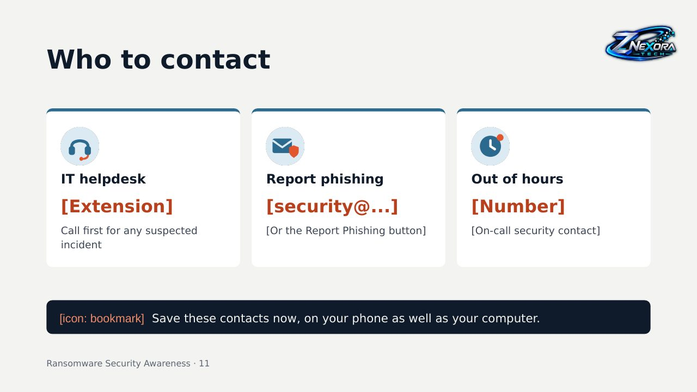

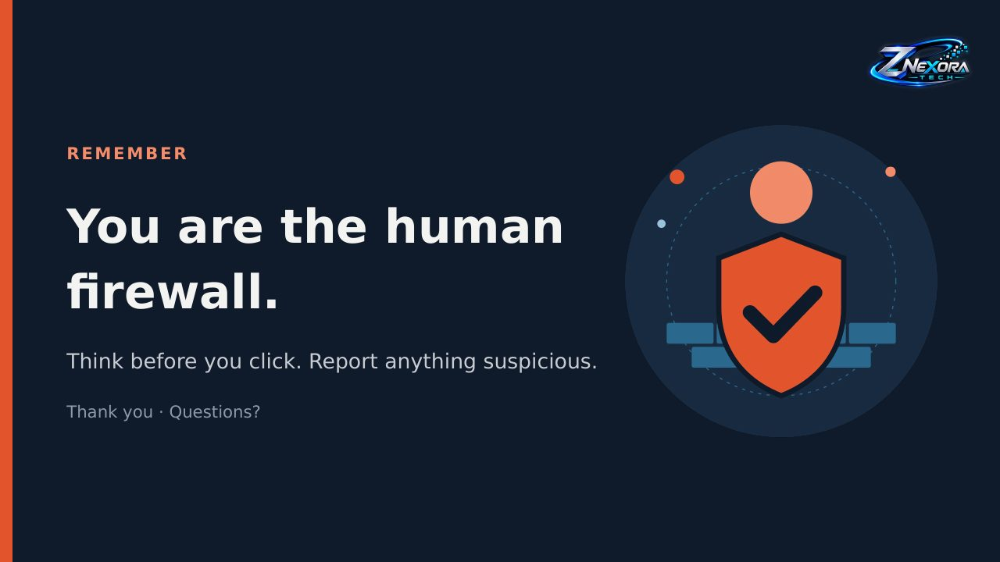
