## Key points

### The top 10 in 2026
- 01 · AT A GLANCE
- SANDBOX UPLOADS, WEEK OF 20–26 JULY 2026
- Infostealer
- Remote access trojan
- Loader
- 1
- Vidar
- 235
- Infostealer
- 2
- AsyncRAT
- 214
- Remote access trojan
- 3
- XWorm
- 205
- Remote access trojan
- 4
- Remcos
- 158
- RAT and surveillanceware
- 5
- StealC
- 126
- Infostealer
- 6
- Lumma
- 121
- Infostealer
- 7
- Formbook
- 113
- Infostealer and form grabber
- 8
- Quasar
- 109
- Remote access trojan
- 9
- Agent Tesla
- 108
- Infostealer and keylogger
- 10
- DonutLoader
- 99
- Loader
- Source: ANY.RUN sandbox telemetry, via Cyber Security News (July 2026)
- ZNexora Tech · 2

[0:40 – 1:40] Here's our top 10. This ranking comes from ANY.RUN's sandbox telemetry, which shows the malware samples that security analysts uploaded most often for investigation during the week of 20 to 26 July 2026. Vidar, AsyncRAT and XWorm lead, followed by Remcos, StealC, Lumma, Formbook, Quasar, Agent Tesla and DonutLoader. Rankings shift week to week, but other 2026 reports, such as Recorded Future's H1 2026 review and AhnLab's monthly trend reports, name the same families again and again. Notice the pattern: half of this list are infostealers that steal our logins and data, four are remote access trojans that give attackers control of a device, and one is a loader that delivers the others.

### Five common delivery routes
- 02 · HOW THEY GET IN
- Phishing emails
- Fake invoices, quotes and shipping notices
- Fake software
- Cracks, keygens and fake installers
- Malvertising
- Poisoned ads and search results
- Fake CAPTCHA pages
- ClickFix tricks to paste and run commands
- Loaders
- One infection quietly installs another
- Infostealers feed ransomware: stolen logins and session tokens are  sold to access brokers and ransomware crews .
- Sources: ANY.RUN 2026 · Microsoft Digital Defense Report 2025
- ZNexora Tech · 3

[1:40 – 2:30] Before we look at each family, let's see how they get in, because the routes are shared. Phishing emails with fake invoices, quotes and shipping notices. Fake software: cracks, key generators and fake installers. Malvertising: poisoned ads and search results. Fake CAPTCHA pages, the ClickFix trick. And loaders, where one infection quietly installs another. One important point: these aren't isolated threats. Microsoft describes a specialised criminal supply chain where infostealer operators harvest logins and session tokens and sell them to access brokers, who sell them on to ransomware crews. So a 'small' infostealer infection today can become a ransomware attack tomorrow.

### Vidar
- TOP 10 · #1 OF 10
- 1
- Infostealer
- A long-running stealer that also downloads more malware
- BEHAVIOUR
- Steals browser passwords, cookies and autofill
- Grabs crypto wallets, 2FA apps and screenshots
- Can download and run extra malware
- IMPACT
- Account takeover through stolen sessions
- Stolen logs sold to ransomware groups
- Crypto and financial theft
- REMEDIATION
- Isolate the device and reimage it
- Reset passwords and revoke all sessions
- Check for follow-on malware it installed
- PREVENTION
- Block cracked software and fake installers
- Don't save passwords in the browser
- EDR plus phishing-resistant MFA
- Sources: ANY.RUN 2026 · vendor threat research
- ZNexora Tech · 4

[2:30 – 3:35] Number one is Vidar, an infostealer sold as a service since 2018. It steals saved browser passwords, cookies and autofill data, grabs crypto wallets, authenticator data and screenshots, and it can also download and run additional malware, so it often acts as the first stage of a bigger attack. The impact is account takeover through stolen sessions, and stolen data being sold on to other criminals, including ransomware groups. To remediate: isolate and reimage the device, reset passwords and revoke all sessions from a clean device, and check for any other malware it installed. To prevent it: block cracked software and fake installers, don't save passwords in your browser, and combine EDR with phishing-resistant MFA.

### AsyncRAT
- TOP 10 · #2 OF 10
- 2
- Remote access trojan
- Freely available remote-control malware, heavily abused
- BEHAVIOUR
- Gives attackers full remote control of the PC
- Logs keystrokes and captures the screen
- Persists through startup entries and tasks
- IMPACT
- Attackers watch and steal everything
- Launch point for ransomware and lateral movement
- Data and credential theft
- REMEDIATION
- Isolate the host and block its C2 addresses
- Remove persistence, or reimage the device
- Reset credentials used on the machine
- PREVENTION
- Block script attachments (VBS, JS, HTA, LNK)
- Restrict PowerShell and script hosts
- Monitor unusual outbound connections
- Sources: ANY.RUN 2026 · vendor threat research
- ZNexora Tech · 5

[3:35 – 4:40] Number two is AsyncRAT, a remote access trojan whose source code is freely available online, which is why it's so widely abused. Once installed, it gives attackers full remote control of the computer: they can log keystrokes, capture the screen, transfer files and run commands, and it survives reboots using startup entries and scheduled tasks. The impact is serious, because the attacker can watch and steal everything, and use the machine as a launch point for ransomware or to move across the network. Remediation: isolate the host, block its command-and-control addresses, remove persistence or reimage, and reset credentials used on the machine. Prevention: block script attachments like VBS, JavaScript, HTA and shortcut files, restrict PowerShell and script hosts, and monitor for unusual outbound connections.

### XWorm
- TOP 10 · #3 OF 10
- 3
- Remote access trojan
- A modular RAT with spying, theft and ransomware add-ons
- BEHAVIOUR
- Remote control, keylogging and webcam access
- Swaps copied crypto addresses (clipboard hijack)
- Spreads through USB drives; plugins add features
- IMPACT
- Crypto theft and credential loss
- Can deploy ransomware or DDoS modules
- Infection spreads to other devices
- REMEDIATION
- Isolate and reimage infected devices
- Scan USB drives connected to the PC
- Reset passwords; check wallets and accounts
- PREVENTION
- Disable autorun and control USB devices
- Block archive and script attachments
- Keep EDR behaviour rules up to date
- Sources: ANY.RUN 2026 · vendor threat research
- ZNexora Tech · 6

[4:40 – 5:45] Number three is XWorm, a modular remote access trojan sold on criminal forums. Beyond remote control, keylogging and webcam access, it can hijack your clipboard: when you copy a crypto wallet address, it silently swaps in the attacker's address. It can also spread through USB drives, and plugins add extras such as ransomware and DDoS modules. The impact ranges from crypto theft and credential loss to ransomware and infections spreading to other devices. Remediation: isolate and reimage infected devices, scan any USB drives that were connected, reset passwords and check wallets and accounts. Prevention: disable autorun and control USB devices, block archive and script attachments, and keep EDR behaviour rules up to date.

### Remcos
- TOP 10 · #4 OF 10
- 4
- RAT and surveillanceware
- Commercial remote-access software abused for spying
- BEHAVIOUR
- Records keystrokes, screen, webcam and mic
- Steals saved credentials
- Hides inside legitimate processes
- IMPACT
- Full surveillance of the victim
- Business email and data compromise
- Foothold for further attacks
- REMEDIATION
- Isolate the device and collect EDR evidence
- Reimage and reset credentials
- Block known Remcos C2 infrastructure
- PREVENTION
- Block Office macros in files from the internet
- Sandbox email attachments
- Allow only approved remote-access tools
- Sources: ANY.RUN 2026 · vendor threat research
- ZNexora Tech · 7

[5:45 – 6:50] Number four is Remcos. It's marketed as legitimate remote administration software, but criminals widely abuse it as a spying tool. It records keystrokes, the screen, the webcam and the microphone, steals saved credentials, and hides inside legitimate Windows processes to avoid detection. It usually arrives through phishing emails with malicious Office documents or archives. The impact is full surveillance of the victim, business email and data compromise, and a foothold for further attacks. Remediation: isolate the device, collect EDR evidence, reimage, reset credentials and block known Remcos infrastructure. Prevention: block Office macros in files from the internet, sandbox email attachments, and only allow approved remote-access tools in our environment.

### StealC
- TOP 10 · #5 OF 10
- 5
- Infostealer
- A fast, modular stealer spread through fake software
- BEHAVIOUR
- Steals from browsers, email and messaging apps
- Targets crypto wallets and gaming accounts
- Encrypts stolen data before sending it (v2)
- IMPACT
- Account takeover and fraud
- Corporate credentials sold to access brokers
- Loss of crypto and game assets
- REMEDIATION
- Reimage; reset passwords from a clean device
- Revoke sessions and API tokens
- Monitor for leaked credentials
- PREVENTION
- Get software only from official sources
- Block malvertising and newly registered domains
- Use a password manager with MFA
- Sources: ANY.RUN 2026 · vendor threat research
- ZNexora Tech · 8

[6:50 – 7:55] Number five is StealC, a modular infostealer sold as a service since 2023. It targets browsers, email clients, messaging apps, gaming platforms and crypto wallets, and its version 2 encrypts the stolen data before sending it, making it harder to spot on the network. It's mostly spread through fake software, cracks and loaders. The impact is account takeover and fraud, corporate credentials sold to initial access brokers, and loss of crypto and gaming assets. Remediation: reimage the device, reset passwords from a clean device, revoke sessions and API tokens, and monitor for leaked credentials. Prevention: get software only from official sources, block malvertising and newly registered domains, and use a password manager with MFA.

### Lumma
- TOP 10 · #6 OF 10
- 6
- Infostealer
- The ClickFix favourite that survived a global takedown
- BEHAVIOUR
- Spreads through fake CAPTCHA (ClickFix) pages
- Steals passwords, cookies and crypto wallets
- Runs in memory through loaders like CastleLoader
- IMPACT
- MFA bypass with stolen session cookies
- Data sold as “logs” for account takeover
- Initial access for ransomware
- REMEDIATION
- Disconnect and report immediately
- Revoke all sessions, not just passwords
- Reimage the device
- PREVENTION
- Never paste commands a website gives you
- Restrict the Run dialog and PowerShell
- Short session lifetimes and token protection
- Sources: ANY.RUN 2026 · vendor threat research
- ZNexora Tech · 9

[7:55 – 9:00] Number six is Lumma, which we covered in detail in a previous briefing. It's famous for the ClickFix trick: a fake CAPTCHA page that tells you to press Windows and R, paste and press Enter, which installs the malware. It steals passwords, session cookies and crypto wallets, and now runs in memory through loaders like CastleLoader. Despite a global takedown in 2025, it's still active. The impact: stolen session cookies can bypass MFA, and the data is sold as logs for account takeover and ransomware access. Remediation: disconnect and report immediately, revoke all sessions, not just passwords, and reimage. Prevention: never paste commands a website gives you, restrict the Run dialog and PowerShell, and use short session lifetimes with token protection.

### Formbook
- TOP 10 · #7 OF 10
- 7
- Infostealer and form grabber
- A veteran stealer that captures what you type into forms
- BEHAVIOUR
- Grabs data typed into web forms
- Logs keystrokes, clipboard and screenshots
- Arrives as email attachments (archives, documents)
- IMPACT
- Stolen logins for banking and business apps
- Business email compromise
- Can download and run other malware
- REMEDIATION
- Isolate and reimage the device
- Reset passwords used on the device
- Search mailboxes for the same phishing email
- PREVENTION
- Filter archive and Office attachments
- Train staff on invoice-themed lures
- Keep Office and email security updated
- Sources: ANY.RUN 2026 · vendor threat research
- ZNexora Tech · 10

[9:00 – 10:05] Number seven is Formbook, a veteran infostealer sold as a service since 2016. As the name suggests, it grabs data typed into web forms, such as logins and payment details, and also logs keystrokes, clipboard contents and screenshots. It usually arrives as an email attachment, often an archive or document disguised as an invoice or order. The impact: stolen logins for banking and business apps, business email compromise, and it can download other malware. Remediation: isolate and reimage, reset passwords used on the device, and search mailboxes for the same phishing email so other recipients are protected. Prevention: filter archive and Office attachments, train staff on invoice-themed lures, and keep Office and email security updated.

### Quasar
- TOP 10 · #8 OF 10
- 8
- Remote access trojan
- Open-source RAT used by criminals and state actors alike
- BEHAVIOUR
- Remote shell, file manager and keylogger
- Recovers saved passwords from apps
- 2026 variant steals Git, npm and PyPI credentials
- IMPACT
- Full device compromise
- Supply chain risk through stolen developer tokens
- Espionage and data exfiltration
- REMEDIATION
- Isolate and reimage the device
- Rotate Git, npm, PyPI and cloud tokens
- Review repositories for unauthorised changes
- PREVENTION
- Block double-extension files (e.g. .pdf.exe)
- Show file extensions in Windows
- Protect developer tokens with MFA
- Sources: ANY.RUN 2026 · vendor threat research
- ZNexora Tech · 11

[10:05 – 11:10] Number eight is Quasar, an open-source remote access trojan used by both criminals and state-backed groups. It provides a remote shell, file manager and keylogger, and recovers saved passwords from applications. A 2026 variant has been reported stealing developer credentials for Git, npm and PyPI, which creates supply chain risk: attackers could tamper with software that others depend on. It's often delivered as files with double extensions, like invoice.pdf.exe. Remediation: isolate and reimage, rotate Git, package-registry and cloud tokens, and review repositories for unauthorised changes. Prevention: block double-extension files, turn on 'show file extensions' in Windows, and protect developer tokens with MFA.

### Agent Tesla
- TOP 10 · #9 OF 10
- 9
- Infostealer and keylogger
- A long-running keylogger hidden in fake business emails
- BEHAVIOUR
- Logs keystrokes and captures screenshots
- Steals logins from browsers, email, FTP and VPN
- Sends data out by email, FTP or Telegram
- IMPACT
- Email account takeover and BEC fraud
- Stolen VPN logins give network access
- Sensitive documents exposed
- REMEDIATION
- Isolate and reimage the device
- Reset email, VPN and app passwords
- Check mailbox rules for hidden forwarding
- PREVENTION
- Treat unexpected invoices and quotes with care
- Block risky attachment types at the gateway
- Monitor unusual outbound SMTP and Telegram
- Sources: ANY.RUN 2026 · vendor threat research
- ZNexora Tech · 12

[11:10 – 12:15] Number nine is Agent Tesla, a keylogger and infostealer that has been active since 2014. It logs keystrokes, takes screenshots and steals logins from browsers, email clients, FTP and VPN applications, then sends the data out by email, FTP or Telegram. It's almost always delivered through fake business emails, such as invoices, quotes or shipping notices. The impact: email account takeover and business email compromise fraud, stolen VPN logins giving attackers network access, and sensitive documents exposed. Remediation: isolate and reimage, reset email, VPN and app passwords, and check mailbox rules for hidden forwarding the attacker may have set up. Prevention: treat unexpected invoices and quotes with care, block risky attachment types, and monitor unusual outbound email and Telegram traffic.

### DonutLoader
- TOP 10 · #10 OF 10
- 10
- Loader
- A loader that runs other malware directly in memory
- BEHAVIOUR
- Built on the open-source Donut shellcode tool
- Loads RATs and stealers straight into memory
- Leaves few files on disk to scan
- IMPACT
- Delivers other malware on this list
- Evades file-based antivirus
- Often the first stage of a larger attack
- REMEDIATION
- Use EDR memory and behaviour telemetry
- Find and remove the final payload too
- Reimage when in doubt
- PREVENTION
- EDR with memory scanning and AMSI
- Application control (AppLocker or WDAC)
- Block script and shortcut attachments
- Sources: ANY.RUN 2026 · vendor threat research
- ZNexora Tech · 13

[12:15 – 13:20] And number ten is DonutLoader. Rather than stealing data itself, it's a delivery tool. It's built on an open-source tool called Donut that turns programs into shellcode, which lets attackers run RATs and stealers, like the ones we've just covered, directly in memory, leaving very few files on disk for antivirus to scan. The impact is that it delivers other malware, evades traditional file-based antivirus, and is often the first stage of a larger attack. Remediation: rely on EDR memory and behaviour telemetry, make sure you find and remove the final payload it delivered, and reimage when in doubt. Prevention: use EDR with memory scanning and AMSI, application control with AppLocker or WDAC, and block script and shortcut attachments.

### Common remediation playbook
- 03 · IF WE ARE INFECTED
- 01
- Isolate
- Disconnect the device; isolate it with EDR.
- 02
- Report
- Tell IT and Security on [contact] at once.
- 03
- Scope
- Find what ran, what was stolen and who is affected.
- 04
- Revoke
- Reset passwords, revoke sessions, rotate tokens.
- 05
- Rebuild
- Reimage the device; remove all payloads.
- 06
- Monitor
- Watch accounts; update blocklists; learn.
- A password reset alone is not enough:  revoke sessions  and  reimage .
- ZNexora Tech incident guidance
- ZNexora Tech · 14

[13:20 – 14:10] Whichever of these ten we face, the remediation playbook is similar. One, isolate: disconnect the device and isolate it with EDR. Two, report: tell IT and Security on [contact] at once. Three, scope: find out what ran, what was stolen, and which accounts and systems are affected. Four, revoke: reset passwords, revoke active sessions and rotate tokens and API keys. Five, rebuild: reimage the device and make sure every payload is removed, remembering that loaders and stealers often install other malware. And six, monitor: watch affected accounts, add new indicators to blocklists, and share the lessons. The key point: a password reset alone is not enough. Stolen sessions must be revoked and the device rebuilt.

### Shared defences that stop all ten
- 04 · PREVENTION
- EVERYONE
- Pause before opening unexpected attachments and links
- Never paste commands a website gives you
- Get software only from official sources
- Use a password manager and MFA, not the browser
- Report anything suspicious straight away
- IT AND SECURITY TEAMS
- EDR with behaviour and memory scanning
- Block risky attachments: scripts, LNK, archives, macros
- Application control: AppLocker or WDAC
- Restrict PowerShell and the Run dialog for users
- Short session lifetimes and phishing-resistant MFA
- ZNexora Tech security guidance
- ZNexora Tech · 15

[14:10 – 15:00] The good news is that the same defences stop all ten. For everyone: pause before opening unexpected attachments and links, never paste commands a website gives you, get software only from official sources, use a password manager and MFA instead of saving passwords in your browser, and report anything suspicious straight away. For IT and security teams: EDR with behaviour and memory scanning, blocking risky attachments like scripts, shortcut files, archives and macros, application control with AppLocker or WDAC, restricting PowerShell and the Run dialog for standard users, and short session lifetimes with phishing-resistant MFA.

### Sources
- 05 · REFERENCES
- ANY.RUN
- Weekly sandbox telemetry, 20–26 July 2026 (via Cyber Security News)
- Recorded Future
- Insikt Group, H1 2026 Malware and Vulnerability Trends
- AhnLab ASEC
- Infostealer trend reports, 2026
- Microsoft
- Digital Defense Report 2025
- IBM
- X-Force Threat Intelligence Index 2026
- Rankings change weekly. Behaviour details summarise public threat research on each family.
- Top 10 Malware of 2026
- ZNexora Tech · 16

[15:00 – 15:20] Here are the sources for today's briefing: ANY.RUN's weekly sandbox telemetry, Recorded Future's H1 2026 malware trends, AhnLab's 2026 infostealer reports, Microsoft's Digital Defense Report, and IBM's X-Force Threat Intelligence Index. Rankings change week to week, but the same families keep appearing across all of them.

### Ten threats. One habit.
- QUESTIONS AND DISCUSSION
- Think before you click, protect your logins, report fast.
- Thank you · Presented by ZNexora Tech

[15:20 – 15:40] To wrap up: ten different malware families, but most of them rely on the same thing, a person opening, clicking or running something. So the habit that protects us is the same: think before you click, protect your logins, and report fast. Thank you. I'm happy to take any questions.

## Slides

[Download the slides as PDF](../../assets/files/top-10-malware-of-2026.pdf)

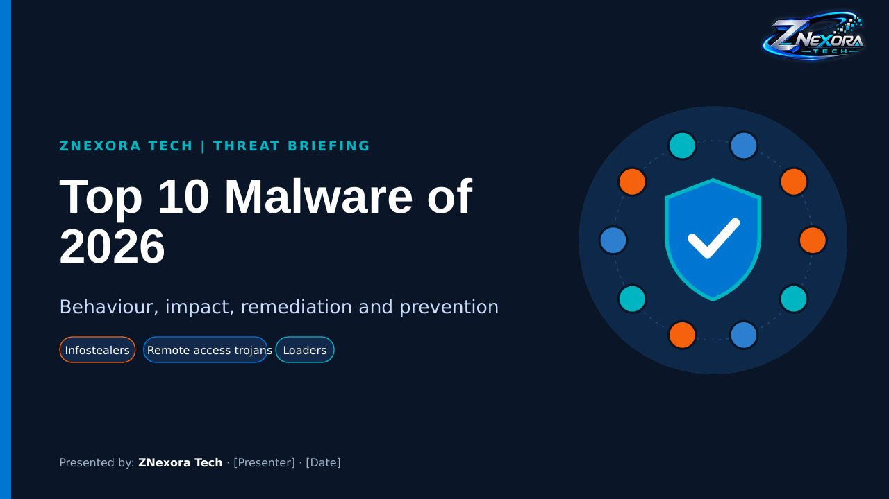

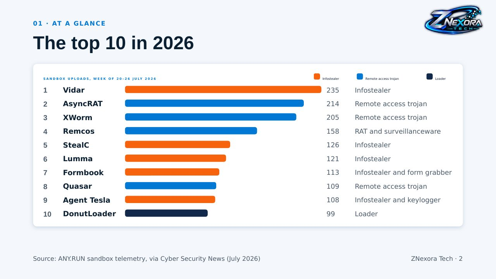

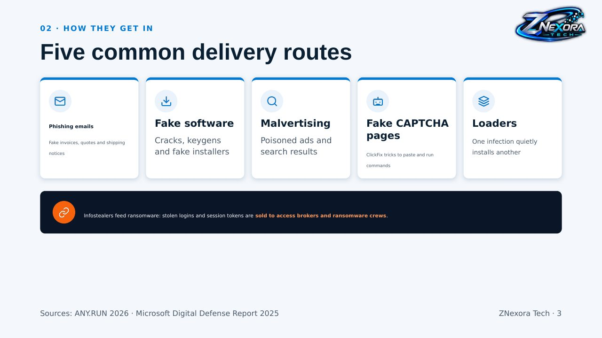

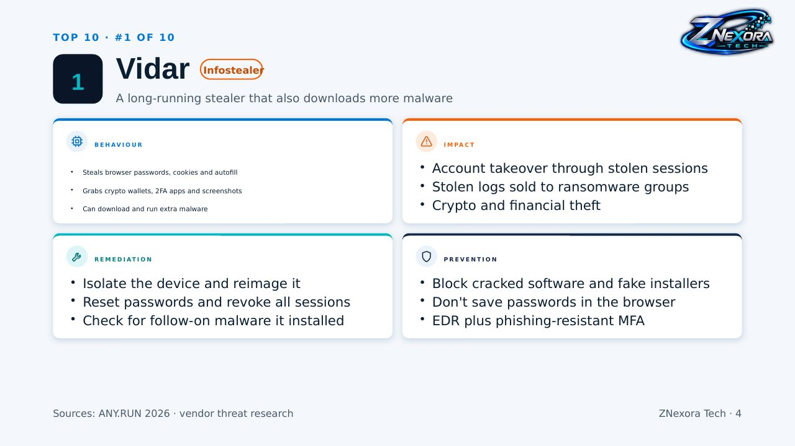

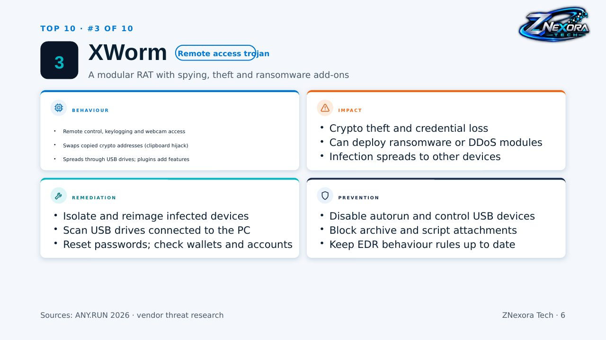

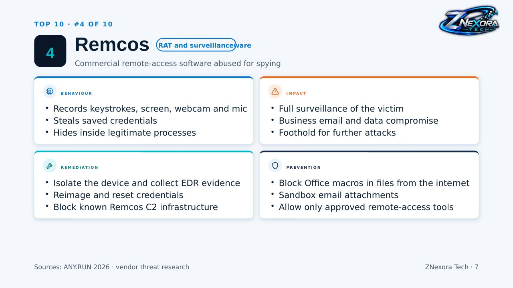

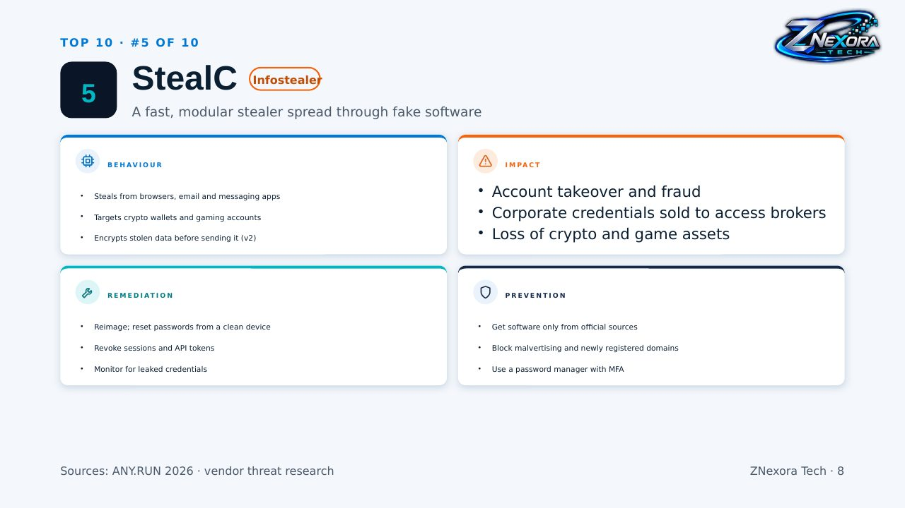

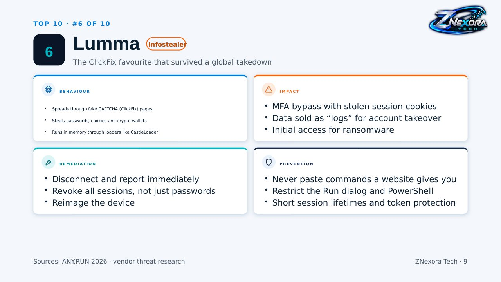

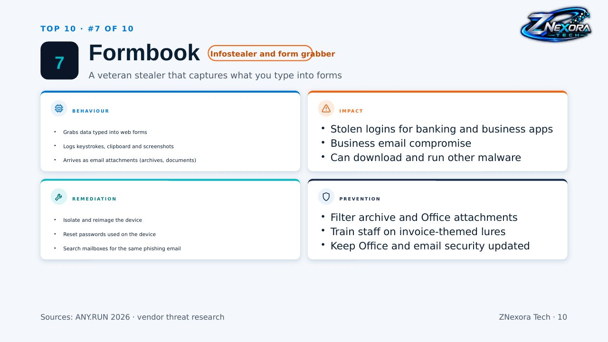

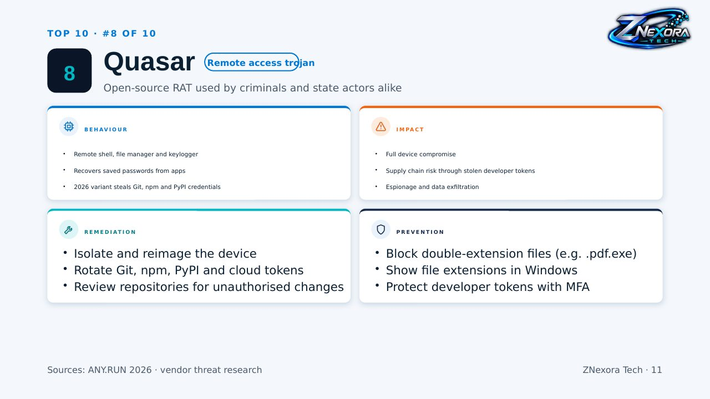

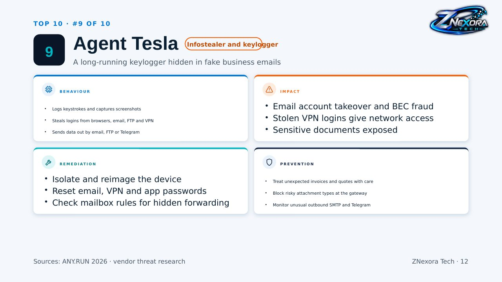

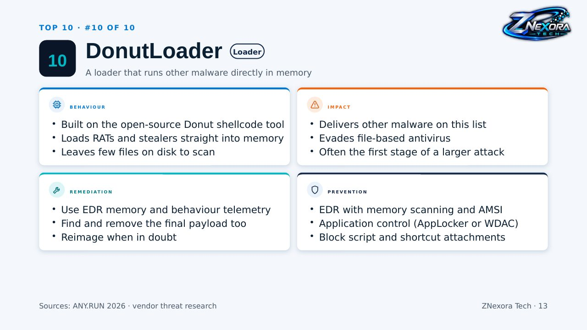

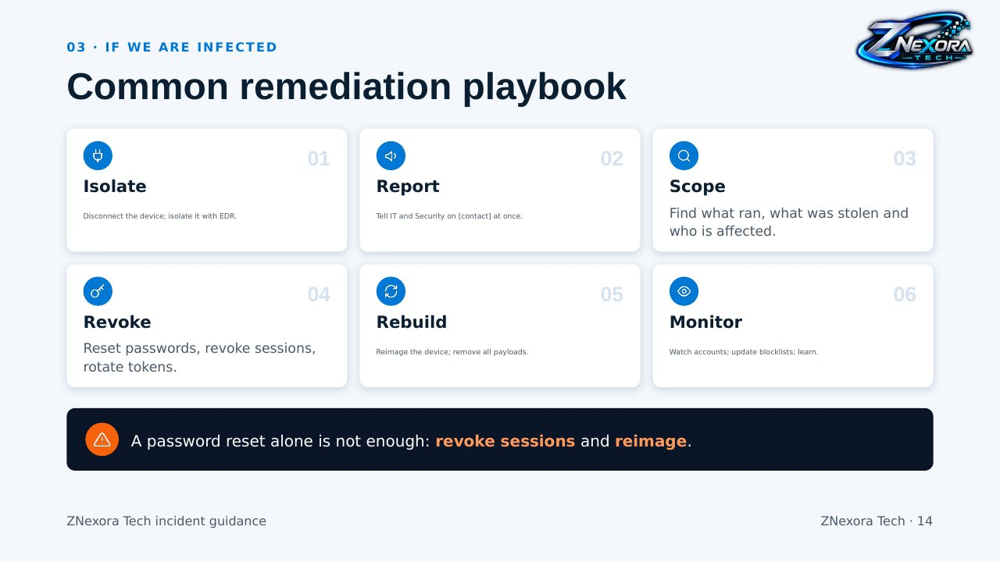

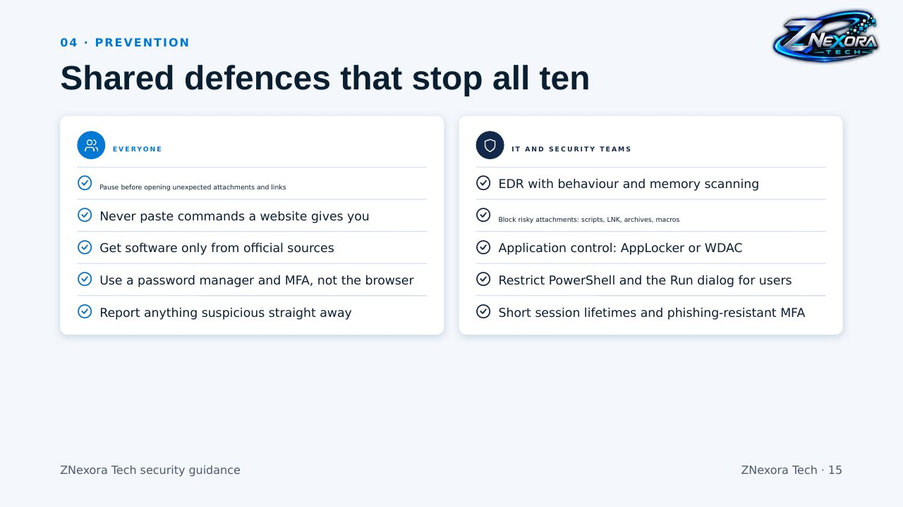

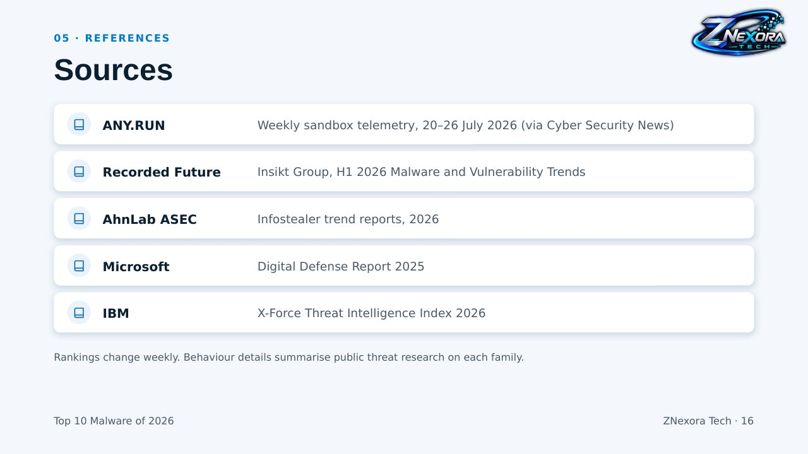

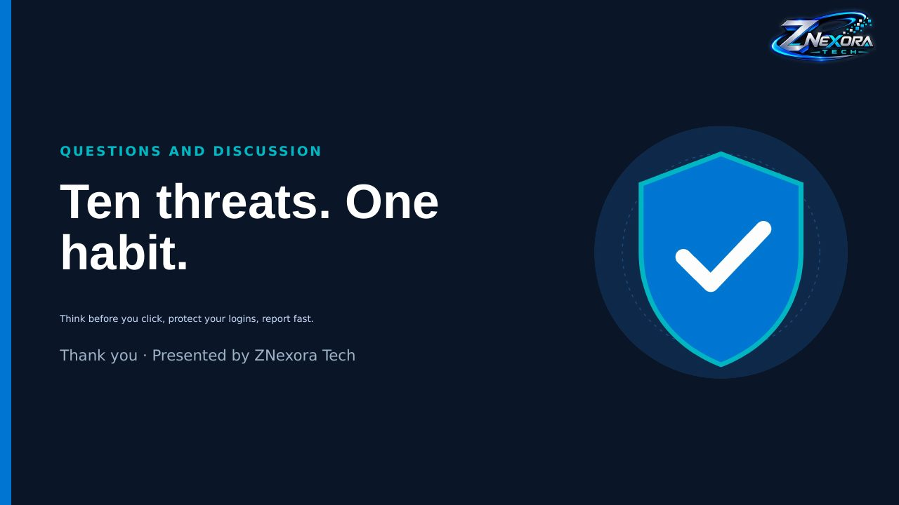
