## Key points

### Castle and moat security
- 01 · THE OLD WAY
- Once inside, trusted everywhere
- Anyone past the gate can reach almost anything.
- One stolen key opens the castle
- A single stolen login lets attackers walk straight in.
- The walls have disappeared
- Home working, cloud apps and phones live outside the castle.
- Traditional perimeter security
- ZNexora Tech · 2

[0:35 – 1:30] For decades, security worked like a castle with a moat. The firewall was the wall, and the network was the inside of the castle. If you were inside, at a desk in the office, connected to the company network, you were trusted. That made sense when everyone worked in one building. But it has three big problems today. First, once someone is inside, they're trusted almost everywhere, including an attacker. Second, one stolen key, a single username and password, can open the whole castle. And third, the walls have disappeared. We work from home, use cloud apps, and carry company data on our phones. Much of our work now happens outside the castle.

### Attackers don't break in. They log in.
- 02 · WHY IT HAD TO CHANGE
- 82%
- of detections were malware-free: attackers log in with stolen credentials instead of breaking in
- CrowdStrike 2026
- 29 min
- average time for an attacker to spread once inside
- CrowdStrike 2026
- Everywhere
- we now work: home, office, cloud apps and mobile phones
- Source: CrowdStrike 2026 Global Threat Report
- ZNexora Tech · 3

[1:30 – 2:15] Why did security have to change? Look at how attacks happen today. CrowdStrike's 2026 Global Threat Report found that 82 percent of detections were malware-free. In other words, attackers aren't breaking down the walls; they're simply logging in with stolen usernames and passwords. Once inside, the average attacker spreads to other systems in just 29 minutes. And we work everywhere: at home, in the office, in cloud apps and on our phones. When attackers can log in like a normal employee, being 'inside the castle' can't be enough to trust someone.

### Never trust. Always verify. Every person, every device, every time.
- THE ZERO TRUST IDEA
- The term was coined in 2010 by Forrester analyst John Kindervag, and is now defined in NIST standard SP 800-207.

[2:15 – 2:50] So here's the Zero Trust idea in one sentence: never trust, always verify. Every person, every device, every time. No one is trusted automatically just because they're in the office or on the company network. Every request to access something is checked. The term was coined back in 2010 by a Forrester analyst named John Kindervag, and today it's a formal security model defined by the US standards body NIST. But you don't need any of that to understand it, because you already use it.

### Zero Trust is a hotel key card
- 03 · YOU ALREADY USE IT
- Check-in at the desk
- Prove who you are
- Verify identity, with MFA
- Your room only
- Not every room in the hotel
- Least-privilege access
- Expires at checkout
- Access stops when you leave
- Time-limited sessions
- Every swipe is logged
- Unusual use is noticed
- Continuous monitoring
- A simple way to remember Zero Trust
- ZNexora Tech · 5

[2:50 – 3:50] Think about staying in a hotel. At check-in, you prove who you are at the desk. That's verifying your identity. Your key card opens your room, but not every room in the hotel. That's least privilege: you only get access to what you need. Your card stops working at checkout. That's time-limited access. And every swipe is logged, so if a card is used strangely, say on every door at 3 a.m., the hotel notices. That's continuous monitoring. Nobody finds this offensive. It doesn't mean the hotel thinks you're a criminal. It just means a lost key card can't open the whole building. Zero Trust is exactly the same idea, applied to our systems and data.

### Three simple rules behind Zero Trust
- 04 · THE THREE PRINCIPLES
- 1
- Verify explicitly
- Always check who you are, your device and the situation, before granting access.
- Like an MFA code when you sign in
- 2
- Least privilege
- Give each person only the access they need, only for as long as they need it.
- Like a key card for one room, not the whole hotel
- 3
- Assume breach
- Design as if an attacker may already be inside, so one problem can't spread.
- Like fire doors that stop a fire from spreading
- Based on NIST SP 800-207 Zero Trust Architecture
- ZNexora Tech · 6

[3:50 – 4:50] Zero Trust comes down to three simple rules. One: verify explicitly. Before granting access, always check who you are, which device you're using and the situation, for example where you're signing in from. It's like the MFA code you enter when you sign in. Two: least privilege. Each person gets only the access they need for their job, only for as long as they need it. Like a key card for your room, not the whole hotel. Three: assume breach. We design our systems as if an attacker might already be inside, so that one problem can't spread everywhere. Like fire doors in a building: they don't stop a fire from starting, but they stop it from spreading.

### Five checks before access is granted
- 05 · BEHIND EVERY LOGIN
- Who are you?
- Identity and MFA
- Is your device healthy?
- Updated, encrypted, managed
- Where and when?
- Location, time and risk
- What do you need?
- Only the access required
- Anything unusual?
- Behaviour is monitored
- All checks pass:  access granted , for now
- Something looks wrong:  extra check or blocked
- How Zero Trust decides, every time you sign in
- ZNexora Tech · 7

[4:50 – 5:50] So what actually happens when you sign in to a system under Zero Trust? Behind the scenes, five quick checks happen, usually in under a second. Who are you? Your identity and MFA. Is your device healthy? Is it updated, encrypted and managed by the company? Where and when? Are you signing in from a usual location, at a usual time? What do you need? You only get the access your role requires. And is anything unusual? Your behaviour is monitored for anything out of place. If all checks pass, you're in, but only for now, because checks repeat. If something looks wrong, you might get an extra check like an MFA prompt, or be blocked completely.

### Zero Trust in your working day
- 06 · WHAT YOU WILL NOTICE
- MFA prompts
- when you sign in from a new place
- Device checks
- blocking unmanaged or outdated devices
- Access to only what you need
- not every shared folder
- Re-login requests
- sessions that expire after a while
- Blocked unapproved apps
- and USB drives
- Unusual sign-in alerts
- that ask you to confirm it was you
- These aren't IT being difficult.  That's Zero Trust protecting you.
- ZNexora Tech security guidance
- ZNexora Tech · 8

[5:50 – 6:50] So what will you actually notice in your working day? MFA prompts, especially when you sign in from a new place. Device checks that block unmanaged or outdated devices. Access to only what you need, rather than every shared folder. Requests to sign in again after a while, because sessions expire. Unapproved apps and USB drives being blocked. And alerts about unusual sign-ins that ask you to confirm it was really you. I know some of these can feel annoying. But they're not IT being difficult. Each one is a check that stops an attacker who has stolen a password from walking straight in. That's Zero Trust protecting you.

### The old way vs Zero Trust
- 07 · SIDE BY SIDE
- CASTLE AND MOAT
- ZERO TRUST
- Who is trusted?
- Anyone inside the network
- No one by default
- How often is it checked?
- Once, at the door
- Every request, continuously
- How much access?
- Broad, often everything
- Only what you need
- Stolen password?
- Attacker walks in
- MFA and device checks stop them
- One device infected?
- Spreads across the network
- Contained to a small area
- ZNexora Tech
- ZNexora Tech · 9

[6:50 – 7:40] Here's the difference side by side. Who is trusted? In the old model, anyone inside the network. With Zero Trust, no one by default. How often are you checked? The old way checks you once at the door; Zero Trust checks every request, continuously. How much access do you get? The old way often gave broad access to almost everything; Zero Trust gives only what you need. If a password is stolen, the old way lets the attacker walk in, while Zero Trust's MFA and device checks stop them. And if one device is infected, in the old model it can spread across the network, while Zero Trust contains it to a small area.

### Six ways you make Zero Trust work
- 08 · YOUR ROLE
- Approve only your own MFA
- Never accept a prompt you didn't start
- Keep devices updated
- Healthy devices pass the checks
- Use approved apps only
- No personal cloud or unknown tools
- Ask only for what you need
- And give back access you no longer use
- Lock your screen
- Every time you step away
- Report anything odd
- Strange prompts, alerts or access
- ZNexora Tech security guidance
- ZNexora Tech · 10

[7:40 – 8:40] Zero Trust isn't just technology. It only works if we all play our part. Here are six ways you make it work. One, the most important: approve only your own MFA prompts. If you get a prompt you didn't start, never accept it; that's an attacker with your password. Report it. Two: keep your devices updated, so they pass the health checks. Three: use approved apps only, not personal cloud storage or unknown tools. Four: ask only for the access you need, and give back access you no longer use. Five: lock your screen every time you step away. And six: report anything odd, whether it's a strange prompt, an alert, or access you shouldn't have.

### Trust is earned, every time.
- QUESTIONS AND DISCUSSION
- Never trust. Always verify. Report anything odd.
- Thank you · Presented by ZNexora Tech

[8:40 – 9:10] To wrap up: Zero Trust doesn't mean we don't trust our colleagues. It means trust is earned every time, through quick checks that keep a stolen password or one infected laptop from becoming a company-wide breach. Remember the hotel key card, and remember: never trust, always verify, and report anything odd. Thank you. I'm happy to take any questions.

## Slides

[Download the slides as PDF](../../assets/files/trust-nobody-verify-everything.pdf)

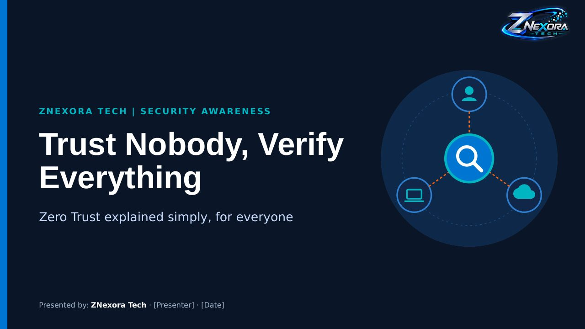

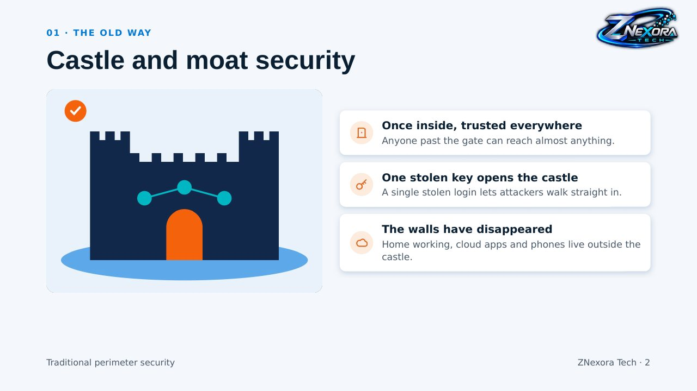

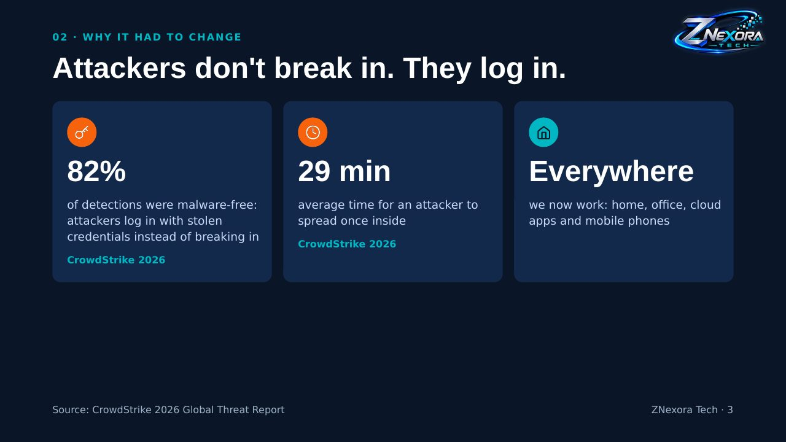

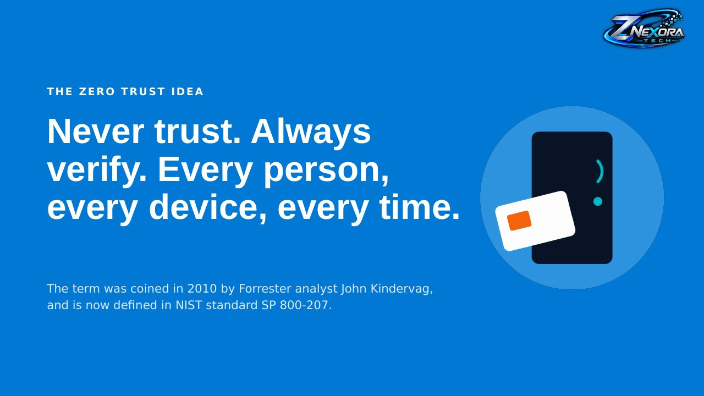

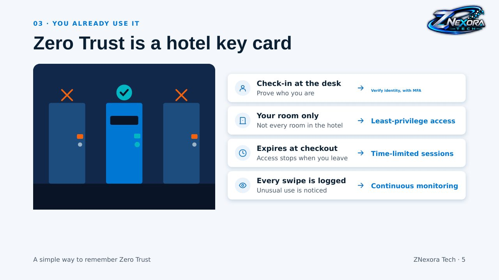

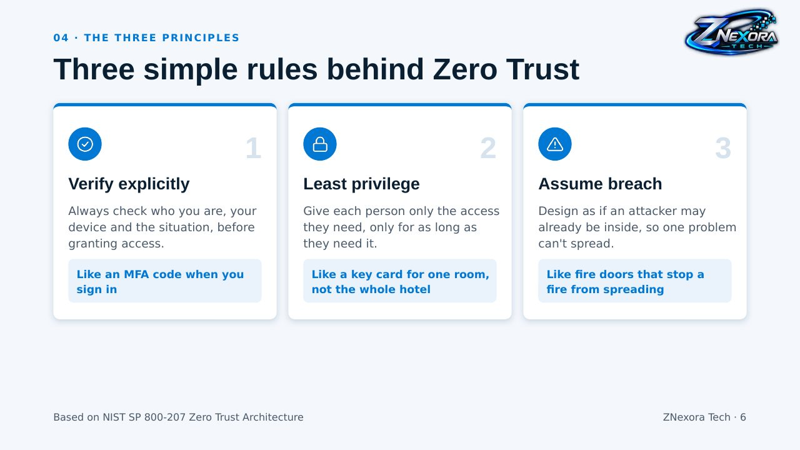

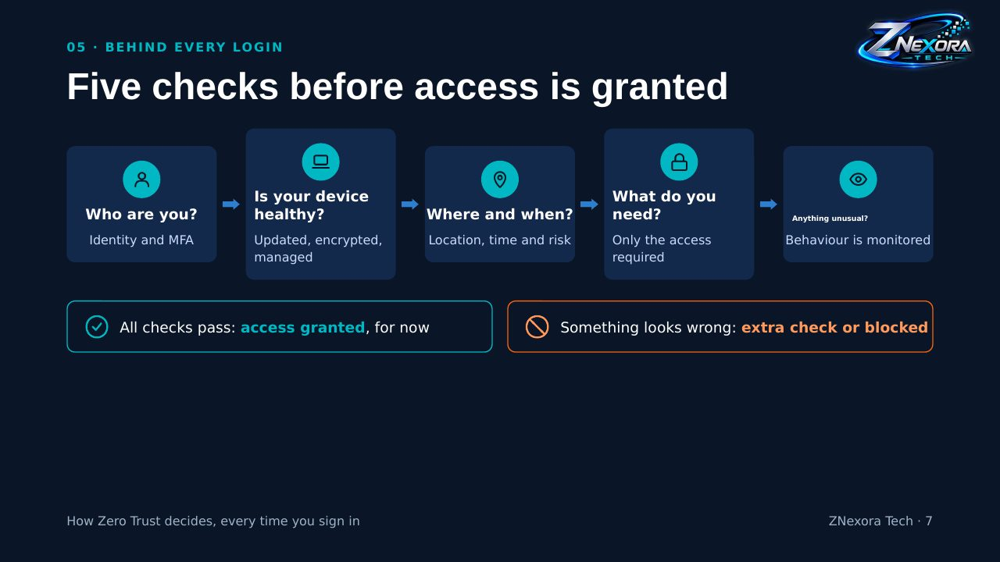

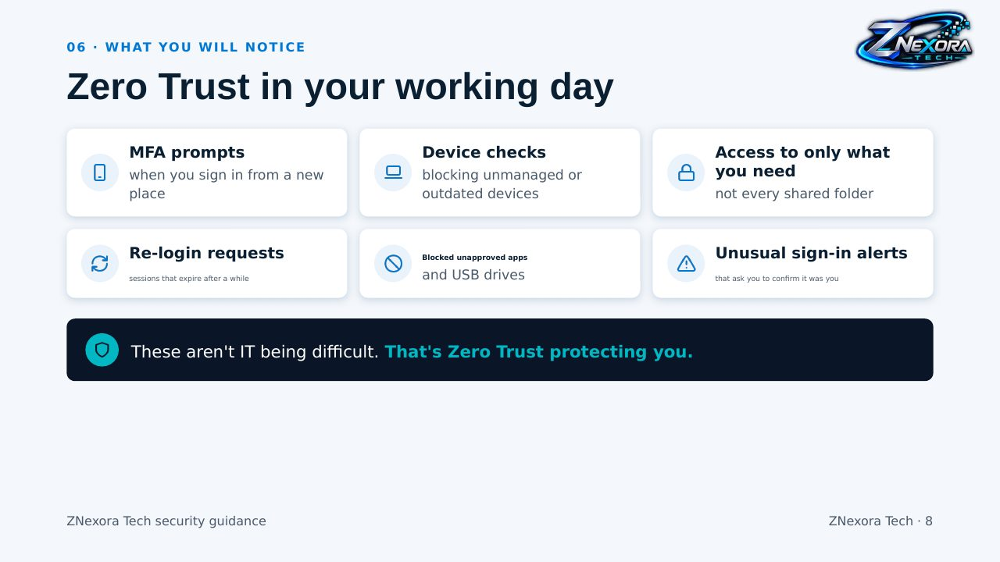

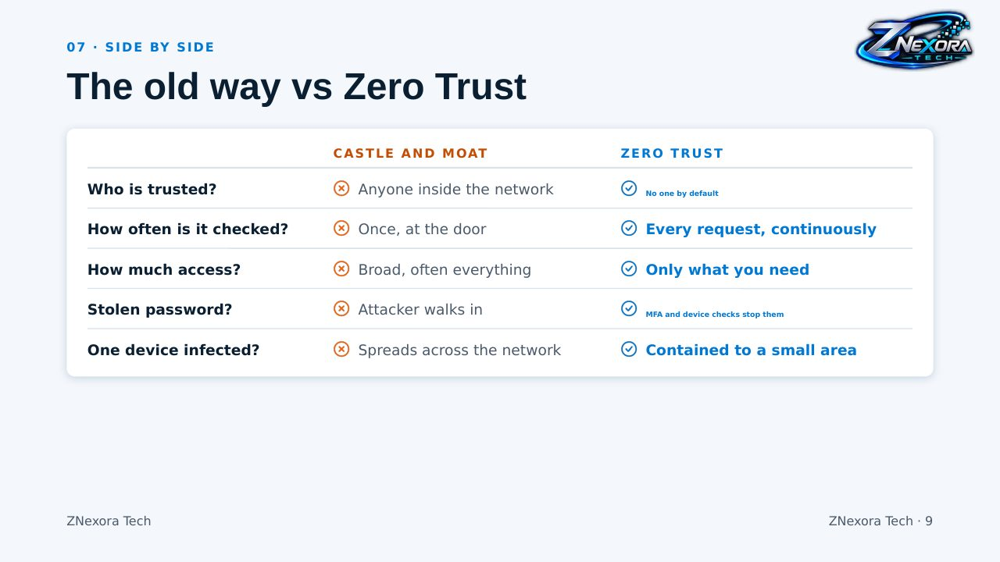

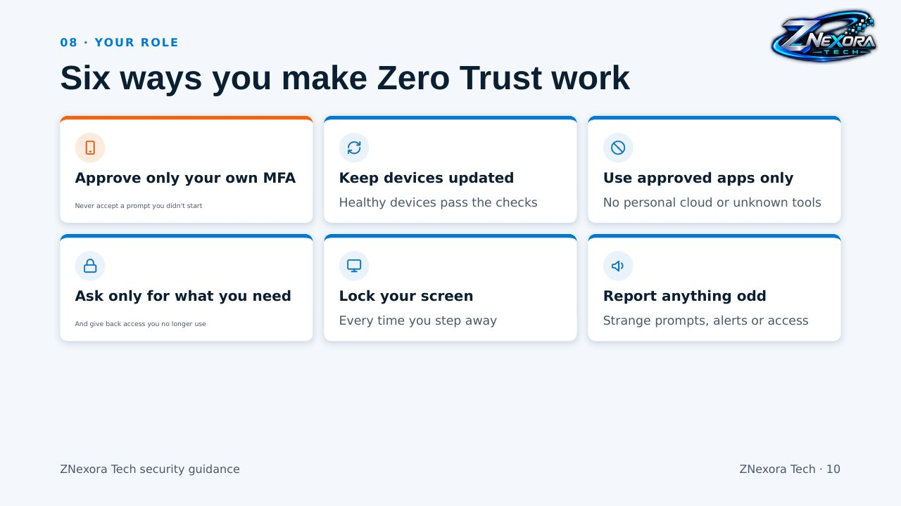

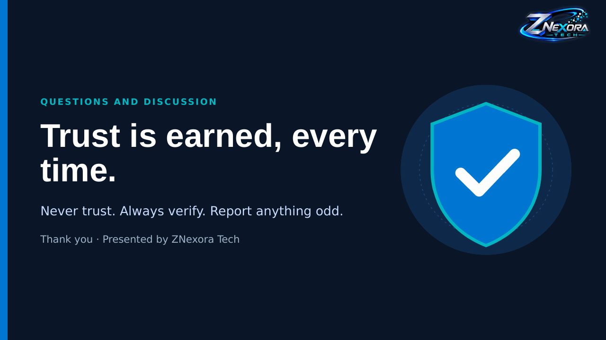
