## Key points

### What is web defacement?
- 01 · UNDERSTANDING THE THREAT
- An attack where someone gains access to a website and  changes what visitors see .
- Pages may be replaced with  messages, images or political slogans , or quietly altered with  fake links and hidden code .
- It is the  visible symptom  of a security breach.
- ZNexora Tech | Web Defacement Awareness
- 2

[0:40 – 1:30] So what is web defacement? It's an attack where someone gains unauthorised access to a website and changes what visitors see. Sometimes it's obvious: the homepage is replaced with a message, an image, a political slogan, or a hacker's signature. Other times it's subtle: a few links are changed to point to scam sites, or hidden code is added that infects visitors' devices. The image shows a normal page on top, and the same page after a defacement below. The key point is this: defacement is the visible symptom of a security breach. If someone could change our website, they had access to our systems, and that's what we need to worry about most.

### Why web defacement matters
- 02 · THE BUSINESS IMPACT
- Reputation and trust
- Customers and partners lose confidence in our security.
- Service disruption
- The site may need to go offline while we investigate and recover.
- A deeper breach
- Attackers may also have stolen data or planted malware.
- Legal exposure
- Possible regulatory reporting duties if personal data is affected.
- ZNexora Tech | Web Defacement Awareness
- 3

[1:30 – 2:30] Why does web defacement matter? First, reputation and trust. Our website is our public face. When it's defaced, customers, partners and the media see it immediately, and they start asking whether we can protect their information. Second, service disruption. We may need to take the site offline while we investigate and clean it up, which affects anyone relying on it. Third, and most importantly, it's often a sign of a deeper breach. The attacker who changed the homepage may also have stolen data, created hidden accounts, or planted malware that infects visitors. And fourth, legal exposure. If personal data is involved, we may have regulatory reporting obligations, and potential penalties. So a defacement is never just a cosmetic problem.

### Who defaces websites, and why
- 03 · KNOW YOUR ADVERSARY
- Hacktivists
- Spread political or social messages to a wide audience.
- Opportunists
- Scan the internet for easy targets, often for bragging rights.
- Cybercriminals
- Hide malware, scam pages or spam links on trusted sites.
- Most attacks are  automated and opportunistic : no website is too small to be a target.
- ZNexora Tech | Web Defacement Awareness
- 4

[2:30 – 3:15] Who defaces websites, and why? There are three main groups. Hacktivists want to spread a political or social message, and a defaced website gives them a large, public audience. Opportunists scan the internet looking for any site with a known weakness, often just to show off or build a reputation in hacker communities. And cybercriminals often don't want you to notice at all. They quietly hide malware, scam pages or spam links on a trusted site to make money. The important lesson is at the bottom of the slide: most attacks are automated and opportunistic. Attackers don't need to pick us specifically. Their tools find any vulnerable site, so no website is too small to be a target.

### How attackers get in
- 04 · ATTACK VECTORS
- Outdated CMS and plug-ins
- Known flaws in WordPress, themes or plug-ins left unpatched.
- Weak or stolen passwords
- Admin logins guessed, reused, or phished from staff.
- Injection flaws
- Insecure forms or code let attackers run commands.
- Insecure file uploads
- Malicious files uploaded through forms or media tools.
- Misconfigured servers
- Default settings, open admin panels, loose permissions.
- Third parties
- Compromised hosting, DNS accounts or web agencies.
- ZNexora Tech | Web Defacement Awareness
- 5

[3:15 – 4:25] So how do attackers actually get in? Here are the six most common doors. One: outdated content management systems and plug-ins. Platforms like WordPress are safe when updated, but old versions and plug-ins have publicly known flaws that automated tools exploit within days. Two: weak or stolen passwords. Admin logins that are guessable, reused from another site, or stolen through phishing give attackers the keys. Three: injection flaws, where insecure forms or code let an attacker send commands to our website or database. Four: insecure file uploads, where a contact form or media tool accepts a malicious file. Five: misconfigured servers, such as default settings, exposed admin panels or overly broad permissions. And six: third parties. If our hosting provider, DNS account or web agency is compromised, our site can be too.

### How a defacement attack unfolds
- 05 · ATTACK LIFECYCLE
- STEP 1
- Scan
- Automated tools hunt for weak sites.
- STEP 2
- Exploit
- A flaw or stolen password is used.
- STEP 3
- Access
- Attacker gains admin control.
- STEP 4
- Deface
- Pages are changed or replaced.
- STEP 5
- Persist
- Backdoors left to return later.
- Restoring the page is not enough:  find and close the way in , or they will be back.
- ZNexora Tech | Web Defacement Awareness
- 6

[4:25 – 5:10] Let's look at how a typical defacement unfolds. Step one: scan. Automated tools crawl the internet looking for websites with known weaknesses. Step two: exploit. The attacker uses an unpatched flaw, or a stolen or guessed password. Step three: access. They gain administrator control of the website or the server behind it. Step four: deface. They change or replace pages, sometimes publicly, sometimes quietly. And step five, which people often forget: persist. Attackers frequently leave hidden backdoors so they can come back. That's why simply restoring the old homepage is never enough. We have to find and close the way in, or the attackers will simply return.

### Warning signs of a defacement
- 06 · DETECTION
- Pages, images or text  changed without approval
- Unknown pages , pop-ups or redirects to other sites
- Browser or search engine  security warnings
- New admin accounts  or unexpected file changes
- Visitors or customers  reporting something odd
- ZNexora Tech | Web Defacement Awareness
- 7

[5:10 – 6:00] How would we know our site has been defaced? Watch for these warning signs. Pages, images or text that have changed without anyone approving the change. Unknown pages, unexpected pop-ups, or links that redirect visitors to other websites. Browser or search engine security warnings, such as a red warning page saying the site may be harmful, or search results showing strange titles. New administrator accounts or unexpected file changes, which the web team may notice. And very often, the first sign comes from outside: a customer, partner or colleague reporting that something looks odd. Every one of us visits our website, so every one of us can be the first to notice.

### Capture it.
- IF YOU SEE IT
- Report it.
- Don't touch it.
- Fast reporting limits the damage.

[6:00 – 6:30] If you remember one thing today, remember this: if you see it, capture it, report it, and don't touch it. Capture it by taking a screenshot and noting the web address and time. Report it immediately to [IT / Security contact]. And don't try to fix it yourself, or share it on social media. Editing or deleting content can destroy the evidence the investigators need. Fast reporting limits the damage.

### Responding to a defacement
- 07 · INCIDENT RESPONSE
- EVERYONE
- 1
- Report immediately  to [IT / Security contact]
- 2
- Capture evidence:  screenshot, web address and time
- 3
- Don't edit, delete or share  the defaced content
- WEB AND IT TEAM
- 4
- Isolate:  switch to a maintenance page
- 5
- Fix the cause:  patch, remove backdoors, reset passwords
- 6
- Restore  from a clean backup; Comms team informs users
- ZNexora Tech | Web Defacement Awareness
- 9

[6:30 – 7:40] Here's how we respond, and who does what. For everyone: one, report it immediately to [IT / Security contact]. Don't assume someone else already has. Two, capture evidence: take a screenshot and note the web address and the time you saw it. Three, don't edit, delete or share the defaced content, and please don't post it on social media. For the web and IT team, the next steps are: four, isolate the site, usually by switching to a maintenance page so visitors aren't exposed. Five, fix the root cause: patch the weakness, remove any backdoors, and reset all admin and hosting passwords. And six, restore the site from a clean, verified backup. In parallel, our Communications team handles any messages to customers or the media, so we speak with one clear voice.

### Six controls that prevent defacement
- 08 · PREVENTION
- Patch quickly
- CMS, plug-ins, themes and servers.
- MFA everywhere
- Website, hosting, DNS and domain logins.
- Least privilege
- Only the access each person needs.
- Web application firewall
- Blocks common attacks before they land.
- Monitor changes
- File integrity and uptime alerts.
- Tested backups
- Offline copies we can restore fast.
- ZNexora Tech | Web Defacement Awareness
- 10

[7:40 – 8:40] Prevention is far cheaper than recovery. Here are six controls our web and IT teams rely on. One: patch quickly. Keep the CMS, plug-ins, themes and servers up to date, and remove anything unused. Two: multi-factor authentication everywhere that matters: the website admin panel, hosting control panel, DNS and domain registrar accounts. Three: least privilege. Each person gets only the access they need, and accounts are removed when people leave. Four: a web application firewall, which filters out common attacks like injection attempts before they reach the site. Five: monitor changes, with file integrity monitoring and uptime alerts so we know within minutes if a page changes unexpectedly. And six: tested backups, kept offline or separate, so we can restore a clean site quickly.

### Everyone has a role
- 09 · SHARED RESPONSIBILITY
- All staff
- Report anything odd on our website
- Never share website or hosting logins
- Watch for phishing aimed at admins
- Content editors
- Use your own account, with MFA
- Install only approved plug-ins
- Log out on shared devices
- Web and IT team
- Patch, monitor and review logs
- Remove unused accounts and plug-ins
- Test backups and the response plan
- ZNexora Tech | Web Defacement Awareness
- 11

[8:40 – 9:20] Website security is a shared responsibility, and everyone has a role. All staff: report anything odd you see on our website, never share website or hosting logins, and be alert to phishing emails, because attackers often target the people who manage our site. Content editors: always use your own named account with multi-factor authentication, install only approved plug-ins, and log out when you use a shared device. And the web and IT team: keep everything patched, monitor for changes and review logs, remove unused accounts and plug-ins, and regularly test our backups and our response plan.

### Who to contact
- 10 · REPORTING
- IT / Security
- [Extension]
- Report a suspected defacement
- Web team
- [web@...]
- Unexpected changes or errors
- Communications
- [Contact]
- All media and customer messages
- Out of hours? Call  [on-call number] . Every minute online increases the damage.
- ZNexora Tech | Web Defacement Awareness
- 12

[9:20 – 9:40] Here's who to contact. For a suspected defacement, call IT and Security on [extension]. For unexpected changes or errors on the site, contact the web team at [web@...]. And all messages to the media or customers go through the Communications team at [contact]. Outside office hours, call [on-call number]. Every minute a defaced site stays online increases the damage, so please don't wait.

### Our website is our front door.
- QUESTIONS AND DISCUSSION
- Let's keep it secure, together.
- Thank you · Presented by  ZNexora Tech

[9:40 – 10:00] To wrap up: our website is our front door to the world. Keeping it secure protects our reputation, our data, and everyone who visits it. If you see something odd, capture it, report it, and don't touch it. Thank you for your time. I'm happy to take any questions.

## Slides

[Download the slides as PDF](../../assets/files/web-defacement-awareness.pdf)

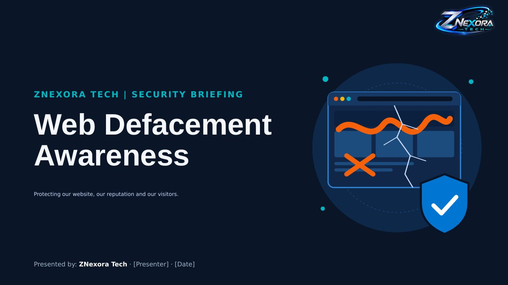

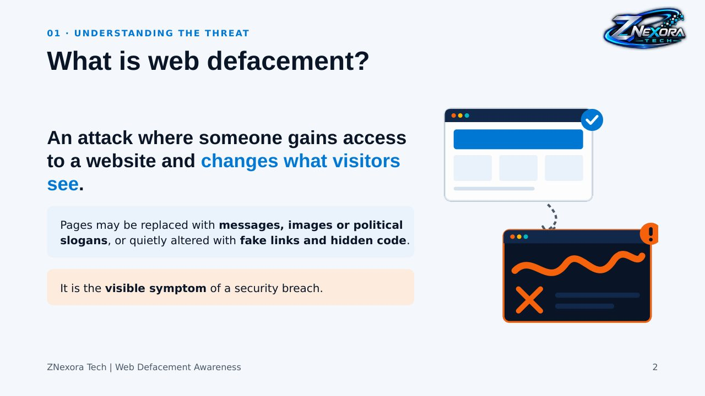

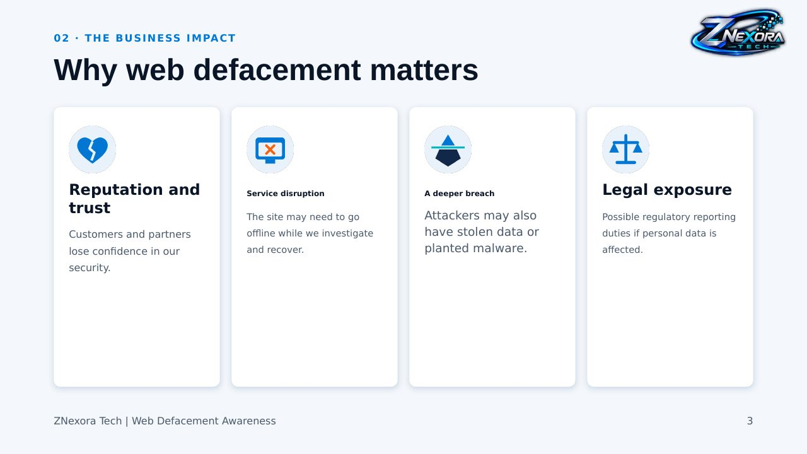

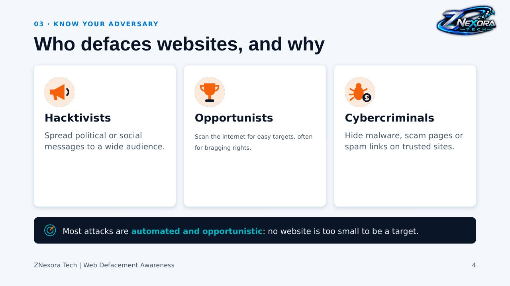

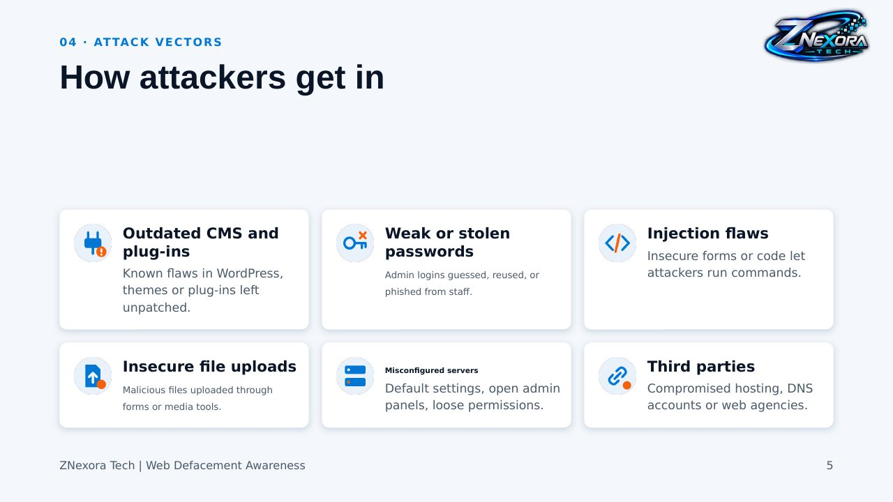

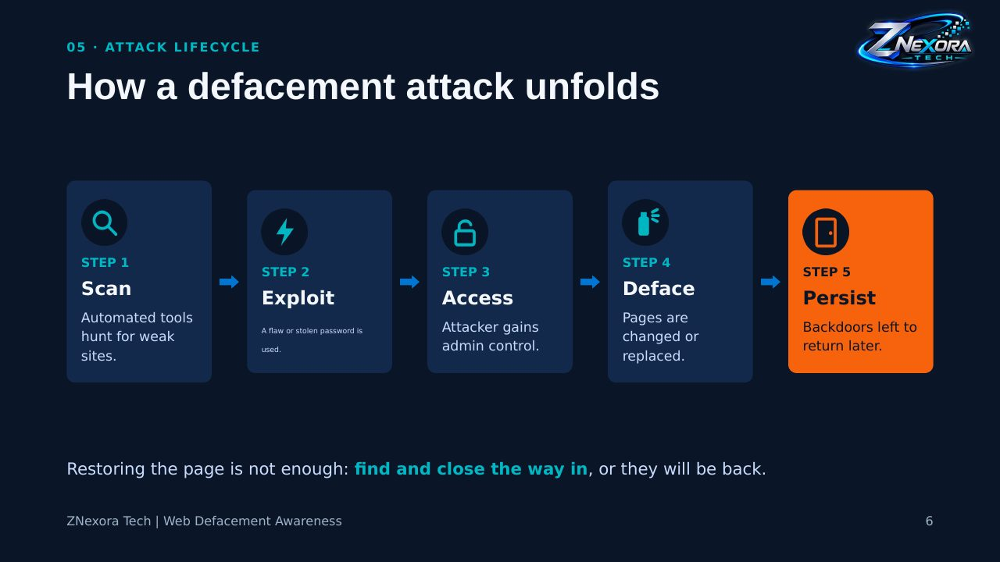

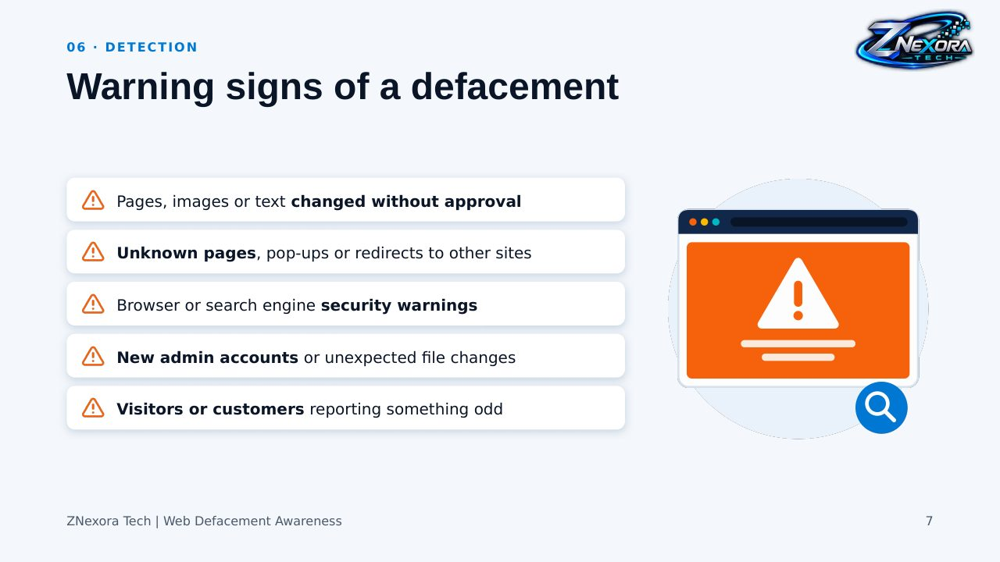

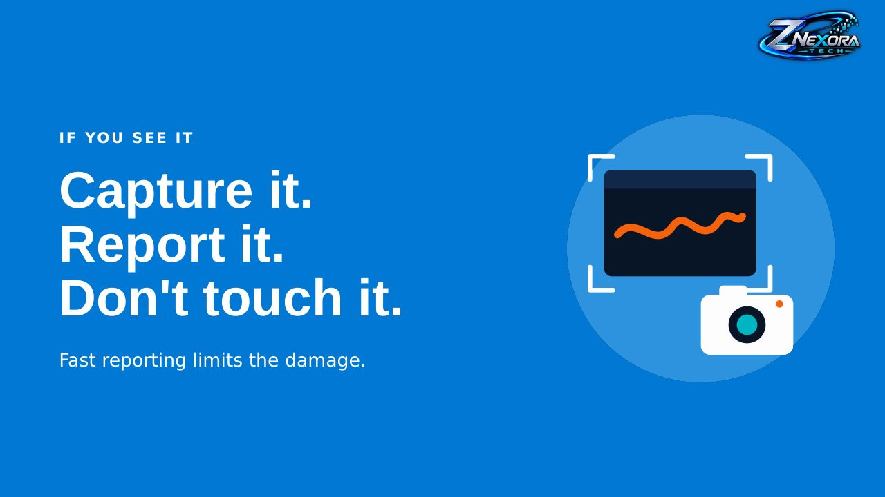

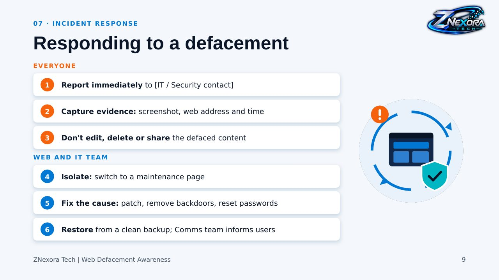

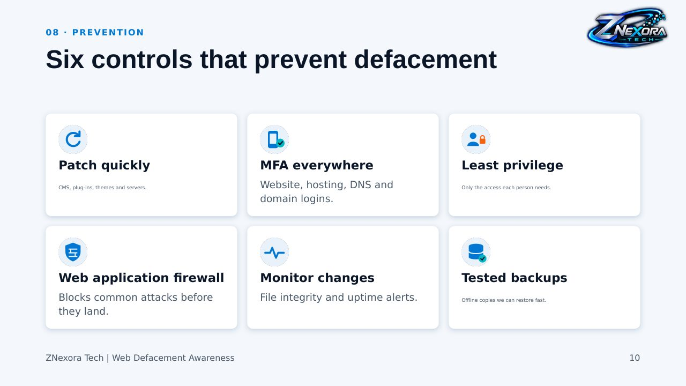

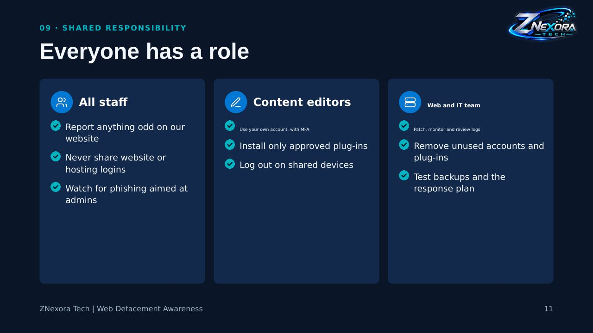

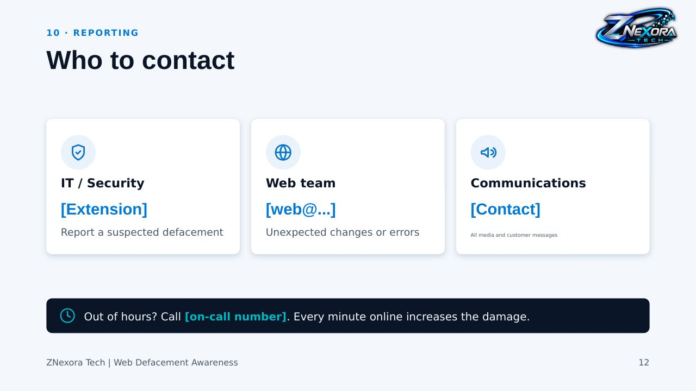

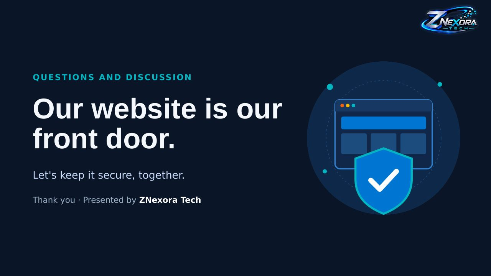
