## Key points

### Monday, 9:00 AM. An ordinary inbox.
- 01 · THE SETUP
- Inbox · 47 unread
- From:  HR Payroll <payroll@hr-portal-update.com>
- Action required: confirm your bonus details today
- Hi Alex, your Q3 bonus is ready. Please review the attached summary and verify your details by 12:00 to avoid delays.
- View bonus summary
- Meet Alex
- Works in finance. Busy Monday. Coffee in one hand, 47 emails waiting.
- The email looks normal. Alex clicks.
- Illustrative scenario based on real attack patterns · Alex is fictional
- ZNexora Tech · 2

[0:35 – 1:25] Meet Alex. Alex works in finance, it's 9 o'clock on a busy Monday, and there are 47 unread emails waiting. One of them looks like it's from HR payroll: 'Action required: confirm your bonus details today.' It's personal, it's about money, and it has a deadline: three classic triggers. If you look closely, the sender's domain isn't our real HR domain. But Alex is busy, the email looks normal, and Alex clicks. Alex is fictional, but this story follows a real and very common attack pattern. Let's see what happens next.

### From one click to a full breach
- 02 · THE TIMELINE
- 0:00
- Click
- 0:01
- Run
- 0:02
- Steal
- 0:10
- Log in
- 0:29
- Spread
- Day 1–3
- Exfiltrate
- Day 5
- Encrypt
- Minutes 0–29:  on Alex's laptop
- Day 1 onward:  across the whole company
- Illustrative scenario based on real attack patterns
- ZNexora Tech · 3

[1:25 – 2:10] Here's the full timeline we'll follow. Minute zero: the click. Minute one: something runs. Minute two: data is stolen. Minute ten: the attacker logs in as Alex. Minute twenty-nine: the attacker spreads to other systems. Days one to three: company data is quietly copied out. And day five: ransomware locks everything. Notice the shape: for the first half hour, the problem is on one laptop. After that, it's a company-wide incident. Keep that 29-minute mark in mind.

### The click and the trap
- 03 · MINUTE 0 TO 1
- Verify you are human
- FAKE
- To view your bonus summary:
- 1
- Press Windows + R
- 2
- Press Ctrl + V
- 3
- Press Enter
- 0:00
- The click
- Alex opens a page that looks like a payroll portal.
- 0:01
- The trick
- A fake check asks Alex to paste and run a command.
- 0:01
- The install
- Hidden malware installs silently. Nothing looks wrong.
- Illustrative scenario based on real attack patterns · ClickFix technique
- ZNexora Tech · 4

[2:10 – 3:10] Minute zero. Alex clicks 'View bonus summary' and lands on a page that looks like a payroll portal. Instead of the document, a box appears: 'Verify you are human.' It says press Windows and R, then Control and V, then Enter. This is the ClickFix trick. The page has already copied a malicious command to Alex's clipboard. By minute one, Alex has pasted and run it. Hidden malware installs silently in the background. The page might even show the real bonus document afterwards. From Alex's point of view, nothing looks wrong at all. And that's the key lesson of this slide: a successful attack usually looks like nothing happened.

### Silent theft, then a quiet login
- 04 · MINUTE 2 TO 10
- 0:02 · STOLEN AND SENT IN SECONDS
- Saved passwords
- Session cookies
- Payment details
- Recent documents
- Everything is packaged and uploaded to the attacker before Alex finishes their coffee.
- 0:10 · THE ATTACKER BECOMES ALEX
- Logs in as Alex using the stolen session cookie: no password or MFA prompt needed
- Reads finance emails and learns who approves payments
- Creates a hidden rule forwarding invoices to the attacker
- Illustrative scenario based on real attack patterns · Infostealer and session hijacking
- ZNexora Tech · 5

[3:10 – 4:10] Minute two. The malware is an infostealer. In seconds, it collects Alex's saved browser passwords, session cookies, payment details and recent documents, packages them, and uploads them to the attacker, all before Alex finishes their coffee. Minute ten. The attacker uses the stolen session cookie to log in as Alex. Because a session cookie proves you've already logged in, there's no password prompt and no MFA challenge. The attacker reads finance emails to learn who approves payments, then quietly creates a hidden rule that forwards invoices to themselves. To the company's systems, this looks exactly like Alex working normally.

### Breakout: from one laptop to the network
- 05 · MINUTE 29
- Alex's laptop
- File server
- Admin account
- Every other system
- 29 min
- average time for attackers to break out to other systems
- 27 sec
- fastest breakout observed
- Source: CrowdStrike 2026 Global Threat Report
- ZNexora Tech · 6

[4:10 – 5:00] Minute twenty-nine. This is the breakout: the moment the attacker moves from Alex's laptop to other systems. Using Alex's access, they reach a shared file server. There they find a script containing an administrator's password, and with admin rights, they can reach almost every system in the company. Is 29 minutes realistic? CrowdStrike's 2026 Global Threat Report found that the average breakout time is exactly that, 29 minutes, and the fastest they observed was just 27 seconds. So if something is going to be stopped cheaply, it has to be stopped in that first half hour.

### Steal, sabotage, then encrypt
- 06 · DAY 1 TO 5
- DAY 1–3
- Steal the data
- Customer records and financial files copied out slowly, to avoid alarms.
- DAY 4
- Sabotage recovery
- Backups found and deleted so the company can't simply restore.
- DAY 5
- Encrypt everything
- Ransomware runs on every system at once, often overnight or at a weekend.
- YOUR FILES ARE ENCRYPTED
- We also copied your data. Pay within 72 hours or it will be published.
- 71:59:42
- Illustrative scenario based on real attack patterns · Double-extortion ransomware
- ZNexora Tech · 7

[5:00 – 5:50] Over the next few days, the attacker works quietly. Days one to three: they copy customer records and financial files out of the company, slowly, to avoid setting off alarms. Day four: they find the backups and delete them, so the company can't simply restore. Day five: ransomware runs on every system at once, often overnight or at a weekend when fewer people are watching. On Monday morning, every screen shows a message like this one: your files are encrypted, we've copied your data, pay within 72 hours or it will be published. This is called double extortion, and it all started with one click, one week earlier.

### What that one click can cost
- 07 · THE REAL COST
- $4.99M
- global average cost of a breach, a record high
- IBM 2026
- 247 days
- average time to identify and contain a breach
- IBM 2026
- 48%
- of breaches now involve ransomware
- Verizon DBIR 2026
- Plus downtime, lost customers, legal costs and reputational damage.
- Sources: IBM Cost of a Data Breach Report 2026 · Verizon DBIR 2026
- ZNexora Tech · 8

[5:50 – 6:30] What does that click cost? IBM's 2026 report puts the global average cost of a breach at 4.99 million dollars, a record high. On average it takes 247 days to identify and contain a breach, which is eight months of disruption. And Verizon found that ransomware is now involved in 48 percent of breaches. On top of that come downtime, lost customers, legal costs and reputational damage. That's the price of a click nobody reported.

### The alternate ending
- 08 · REWIND
- Alex stays silent
- 0:00
- Alex clicks and runs the command
- 0:02
- Data stolen; Alex says nothing
- 0:29
- Attacker spreads to the network
- Day 5
- Ransomware; company stops
- Alex reports in minute 2
- 0:00
- Alex clicks and runs the command
- 0:02
- Alex thinks: that was strange. Calls IT.
- 0:10
- IT isolates the laptop, revokes sessions
- 0:30
- Contained. One laptop rebuilt. Done.
- Same click.  Thirty minutes  of cleanup instead of  months  of recovery.
- Illustrative scenario based on real attack patterns
- ZNexora Tech · 9

[6:30 – 7:30] Now let's rewind and replay the same story with one change. On the left, Alex stays silent: the click, the theft, the spread, and on day five the company stops. On the right, Alex makes exactly the same mistake and clicks and runs the command. But at minute two, Alex thinks, 'That was strange, a real website would never ask me to do that,' and calls IT. By minute ten, IT has isolated the laptop and revoked Alex's sessions, so the stolen cookies are useless. By minute thirty, it's contained: one laptop rebuilt, passwords reset, done. Same click. Thirty minutes of cleanup instead of months of recovery. The difference wasn't the click. It was the report.

### Five moments you can stop the attack
- 09 · YOUR CHECKPOINTS
- 1
- Before you click
- Check the sender, the link and the pressure.
- 2
- Before you run
- Never paste commands a website gives you.
- 3
- Protect your logins
- MFA, a password manager, no browser-saved passwords.
- 4
- Report in minutes
- Something strange? Call IT on [contact] now.
- 5
- Keep it updated
- Updates and EDR slow attackers down.
- Clicked something already?  Report it.  You will never be blamed for reporting.
- ZNexora Tech security guidance
- ZNexora Tech · 10

[7:30 – 8:30] So where could this attack have been stopped? There are five moments. One, before you click: check the sender, the link, and any pressure to act fast. Two, before you run anything: never paste commands a website gives you. Three, protect your logins: use MFA and a password manager, and don't save passwords in your browser. Four, the most important one: report in minutes. If something seems strange, call IT on [contact] straight away. And five, keep your devices updated, because updates and EDR slow attackers down and buy us time. And if you've already clicked something, please report it. You will never be blamed for reporting.

### The first minute matters most.
- QUESTIONS AND DISCUSSION
- Pause before you click. Report the moment it feels wrong.
- Thank you · Presented by ZNexora Tech

[8:30 – 9:00] To wrap up: one click took Alex's company from an ordinary Monday to a full breach in five days. But the same click, reported in two minutes, became a thirty-minute fix. The first minute matters most. Pause before you click, and report the moment something feels wrong. Thank you. I'm happy to take any questions.

## Slides

[Download the slides as PDF](../../assets/files/what-happens-after-you-click.pdf)

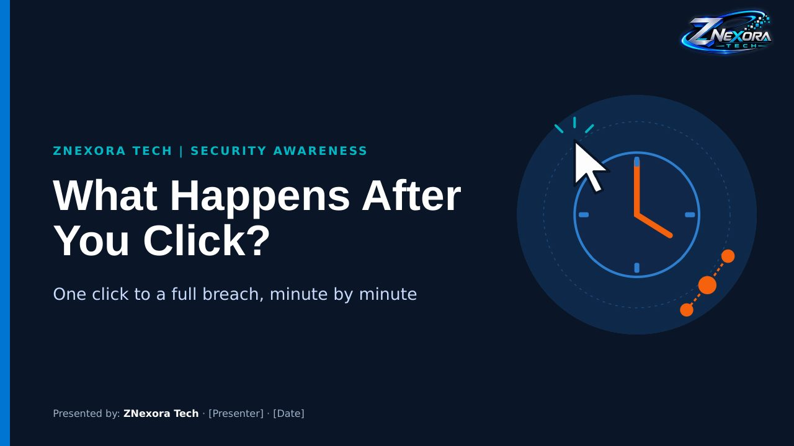

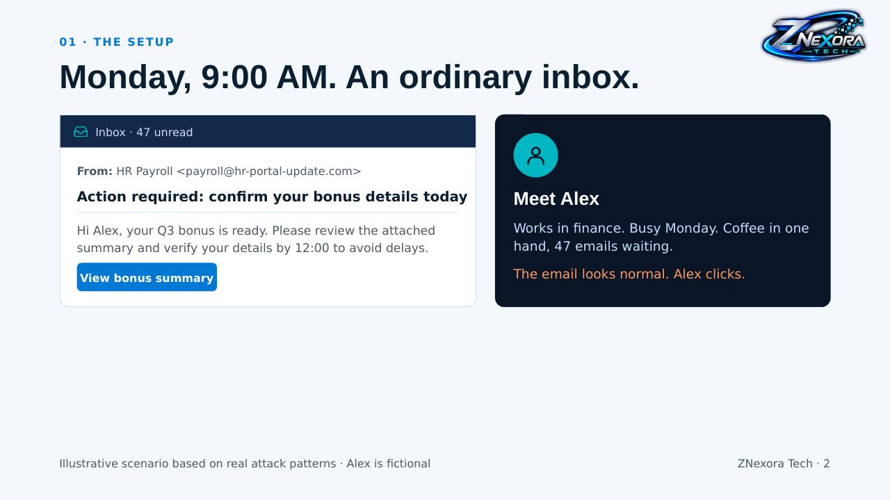

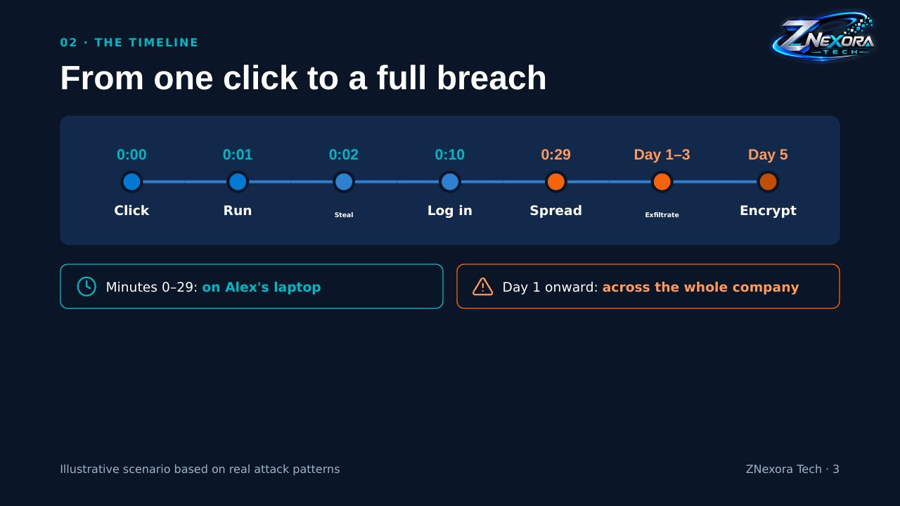

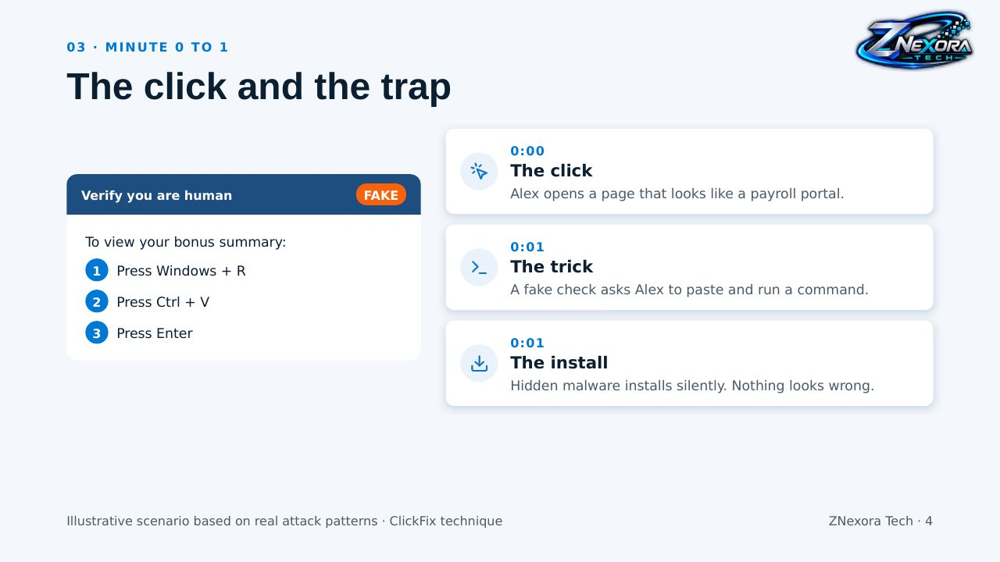

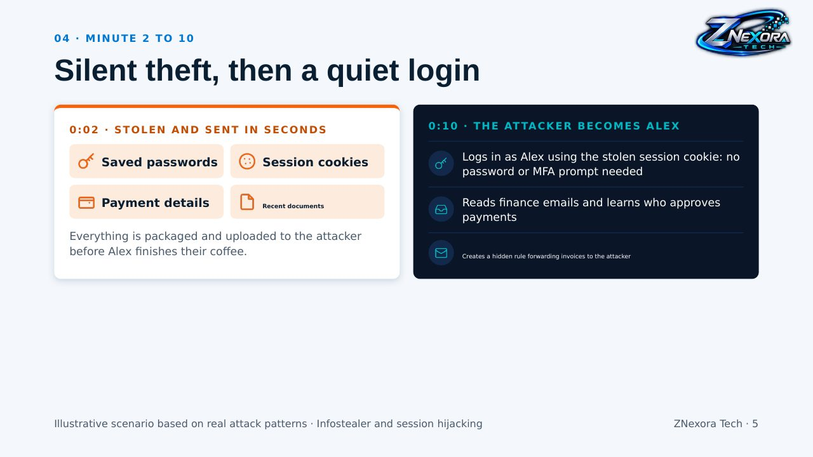

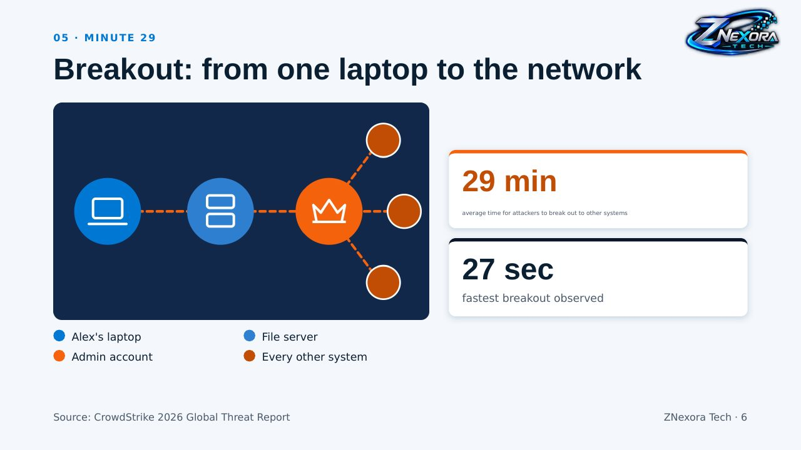

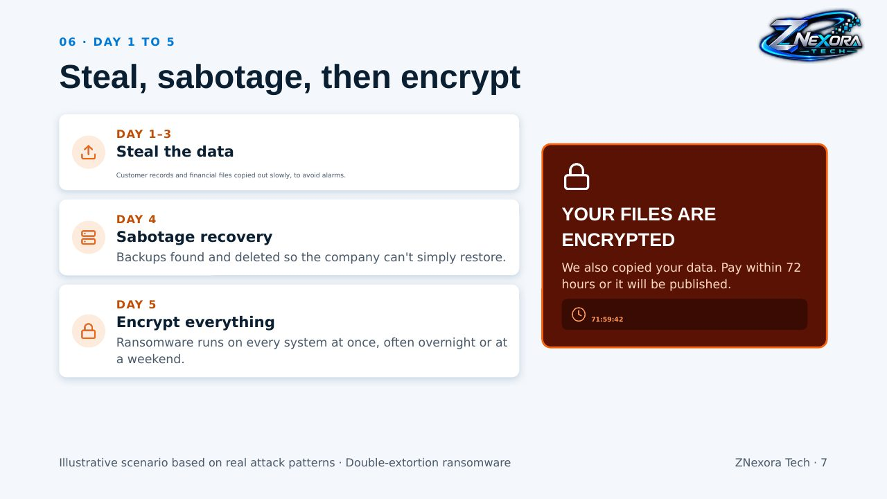

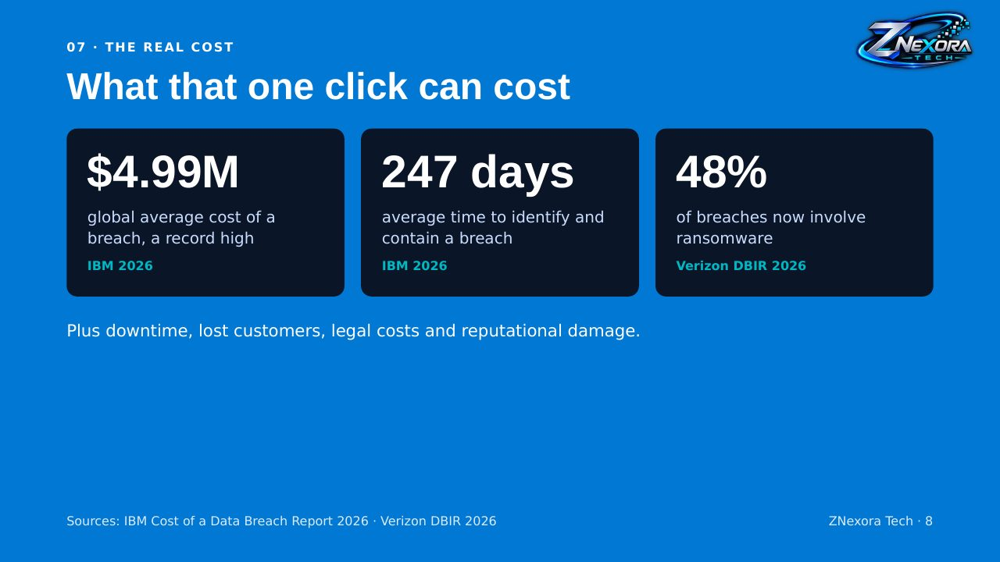

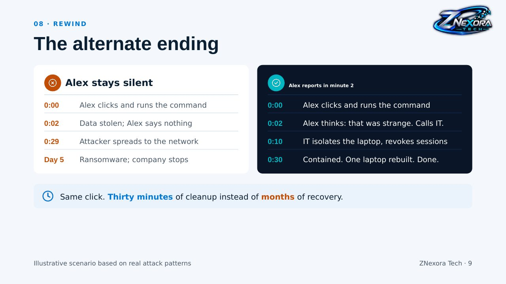

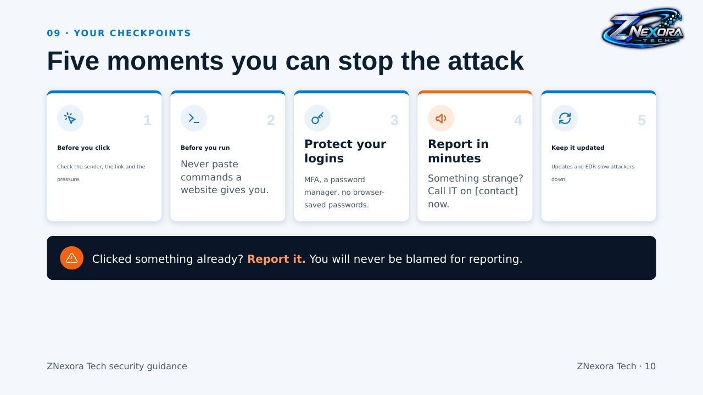

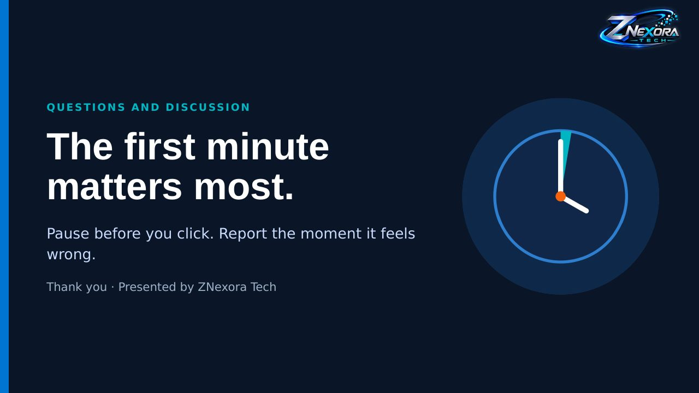
