## Key points

### What is Windows Hardening?
- 01  ·  REDUCING THE ATTACK SURFACE OF WINDOWS SYSTEMS
- Windows hardening is the process of implementing security controls and secure configurations to reduce vulnerabilities and limit opportunities for attackers.
- OBJECTIVES
- Prevent unauthorized access
- Reduce cyber risks
- Strengthen endpoint defenses
- Improve security visibility
- Support regulatory compliance

Hardening means changing default and weak configurations so there are fewer ways in. The five objectives on the left are what every control in this deck supports.

### Why Windows Hardening Matters
- 02  ·  THREATS FACING ENTERPRISE WINDOWS ENVIRONMENTS
- Credential Theft
- Pass-the-Hash   ·   Password Spraying   ·   Credential Dumping
- Malware & Ransomware
- LockBit   ·   Akira   ·   Black Basta
- Misconfigurations
- Weak permissions   ·   Open RDP   ·   Legacy protocols
- KEY MESSAGE    Attackers often exploit weak configurations before exploiting zero-day vulnerabilities.

Most real-world breaches use known techniques: stolen credentials, commodity ransomware and simple misconfigurations such as exposed RDP. Fixing configuration closes these doors long before a zero-day is needed.

### Windows Hardening Framework
- 03  ·  DEFENSE-IN-DEPTH APPROACH
- 01
- Identity Security
- 02
- System Security
- 03
- Network Security
- 04
- Application Security
- 05
- Monitoring & Detection
- 06
- Data Protection
- GOAL
- Secure every layer of the Windows environment
- Independent controls are stacked, so if one layer fails, the next one still protects the endpoint.

We organise hardening into six layers. No single control is perfect, so defense-in-depth means an attacker who gets past one layer still faces the next. The rest of the deck walks through these layers.

### Secure User & Administrator Accounts
- 04  ·  IDENTITY PROTECTION FIRST
- RECOMMENDED CONTROLS
- Multi-Factor Authentication
- Least Privilege Principle
- Separate Admin Accounts
- Privileged Access Workstations
- Account Lockout Policies
- BENEFITS
- Reduced credential compromise
- Reduced lateral movement
- Improved access control

Identity is the new perimeter. Enforce MFA, give users only the rights they need, use separate admin accounts from privileged access workstations, and lock out repeated failed logons. This limits stolen credentials and lateral movement.

### Patch & Vulnerability Management
- 05  ·  KEEP SYSTEMS UPDATED
- 1   Scan
- 2   Prioritize
- 3   Test
- 4   Deploy
- 5   Verify
- CRITICAL AREAS
- Windows Updates
- Microsoft Office
- Microsoft Edge
- Third-Party Applications
- BEST PRACTICES
- Monthly patch cycle
- Emergency patch deployment
- Vulnerability scanning
- Risk-based remediation

Unpatched software is one of the most exploited weaknesses. Cover Windows, Office, Edge and third-party apps, run a monthly cycle with an emergency path for critical fixes, and prioritise by real risk using vulnerability scans.

### Microsoft Defender Security Stack
- 06  ·  BUILT-IN WINDOWS PROTECTION
- Microsoft
- Defender
- Defender Antivirus
- Defender Firewall
- Defender SmartScreen
- Defender for Endpoint
- SECURITY BENEFITS
- Real-time protection
- Scans files and processes as they run
- Behavioral detection
- Flags suspicious activity, not just known malware
- Threat intelligence
- Cloud-delivered insight on emerging threats
- Endpoint visibility
- Central view of device health and alerts

Windows ships with a strong built-in stack. Antivirus, firewall and SmartScreen protect each device, and Defender for Endpoint adds behavioural detection, threat intelligence and central visibility for the security team.

### Attack Surface Reduction
- 07  ·  BLOCK COMMON ATTACK TECHNIQUES
- RECOMMENDED CONTROLS
- Block malicious macros
- Block Office child processes
- Restrict script execution
- Block credential theft attempts
- Control executable files
- RESULT    Reduced ransomware and malware infections

Attack Surface Reduction rules in Defender stop the behaviours malware relies on, such as Office macros launching processes, obfuscated scripts and access to LSASS credentials. Start in audit mode, review the impact, then enforce.

### RDP & Network Hardening
- 08  ·  SECURE REMOTE ACCESS
- Admin Device
- Managed, hardened
- VPN Gateway
- No direct exposure
- MFA Check
- Verify identity
- RDP Host
- NLA enforced
- RDP HARDENING
- Network Level Authentication
- VPN Access Only
- MFA Enforcement
- Restricted Administrative Access
- NETWORK HARDENING
- Windows Firewall
- SMBv1 Disabled
- TLS 1.2 / TLS 1.3
- Unused Services Disabled

Never expose RDP directly to the internet. Route remote access through a VPN, require MFA and Network Level Authentication, and restrict who can connect. On the network side, keep the firewall on, disable SMBv1 and unused services, and require modern TLS.

### Application Control
- 09  ·  PREVENT UNAUTHORIZED SOFTWARE EXECUTION
- Microsoft AppLocker    Controls:
- Executables
- Scripts
- MSI Installers
- DLL Files
- Windows Defender Application Control
- Enforces trusted application execution.
- Reduced malware infection
- Reduced insider threats

Application control flips the model from blocking known bad to allowing only known good. AppLocker controls executables, scripts, installers and DLLs, while WDAC enforces trust at the kernel level. Roll out in audit mode first.

### Logging, Monitoring & Detection
- 10  ·  VISIBILITY ENABLES SECURITY
- INTEGRATE WITH
- Microsoft Sentinel
- Azure Monitor
- SIEM Platforms
- MONITOR
- Account Logons
- Privilege Escalation
- Group Membership Changes
- PowerShell Activities
- Security Events

You cannot defend what you cannot see. Collect logons, privilege changes, group membership changes, PowerShell activity and other security events, and forward them to Microsoft Sentinel, Azure Monitor or your SIEM for correlation and alerting.

### Data Protection with BitLocker
- 11  ·  ENCRYPT CRITICAL DATA
- ADVANTAGES
- Full Disk Encryption
- Protects all data on the drive
- Lost Device Protection
- A stolen laptop reveals nothing
- Compliance Support
- Helps meet data protection rules
- Secure Remote Workforce
- Safeguards devices off-site
- RECOMMENDED
- TPM Enabled
- Recovery Key Management
- AES-256 Encryption

BitLocker encrypts the whole drive, so a lost or stolen laptop does not become a data breach. Use the TPM, escrow recovery keys centrally in Entra ID or Active Directory, and use AES-256 where policy requires.

### Windows Hardening Checklist
- 12  ·  ESSENTIAL SECURITY BASELINE
- MFA Enabled
- Windows Fully Patched
- Defender Enabled
- Firewall Enabled
- BitLocker Enabled
- RDP Secured
- ASR Rules Applied
- AppLocker Configured
- Security Logs Monitored
- Backups Tested
- Review this baseline regularly: hardening is a continuous process, not a one-time project.

Use this as a quick audit of any Windows estate. If any of these ten items is missing, that is where to start. Re-check the baseline after major updates and at least quarterly.

### Key Takeaways
- 13  ·  REMEMBER
- Protect Identities
- MFA, least privilege, separate admin accounts
- Secure Configurations
- Baselines, ASR rules and application control
- Patch Continuously
- Monthly cycle plus emergency patching
- Monitor Everything
- Centralise logs in your SIEM
- Encrypt Sensitive Data
- BitLocker with managed recovery keys
- Prepare for Incidents
- Tested backups and response plans
- FINAL MESSAGE
 Secure Windows systems are built through continuous hardening, monitoring, and improvement.

To summarise: protect identities, lock down configurations, patch continuously, monitor everything, encrypt sensitive data and be ready for incidents. Hardening is never finished; it is a cycle of improvement.

### Thank You
- QUESTIONS & DISCUSSION
- Windows Security Hardening: Practical Defense for Modern Enterprises
- Presented by:  ZNexora Tech
- We welcome your questions and experiences.

Thank you. I am happy to take questions or hear how your teams approach Windows hardening today.

## Slides

[Download the slides as PDF](../../assets/files/windows-hardening.pdf)

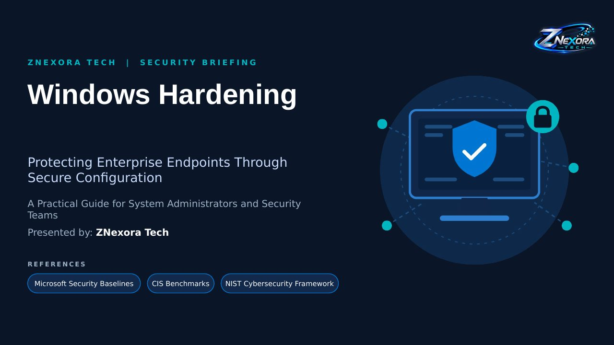

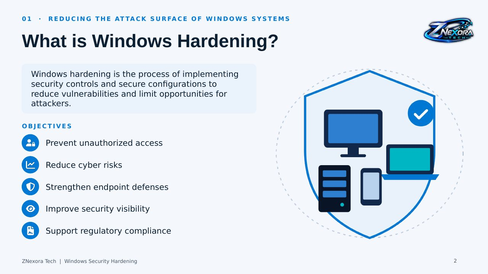

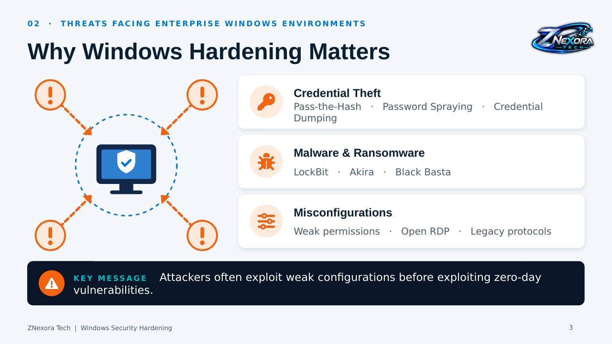

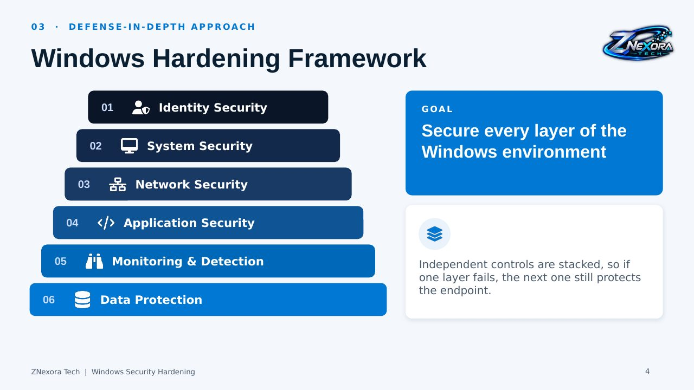

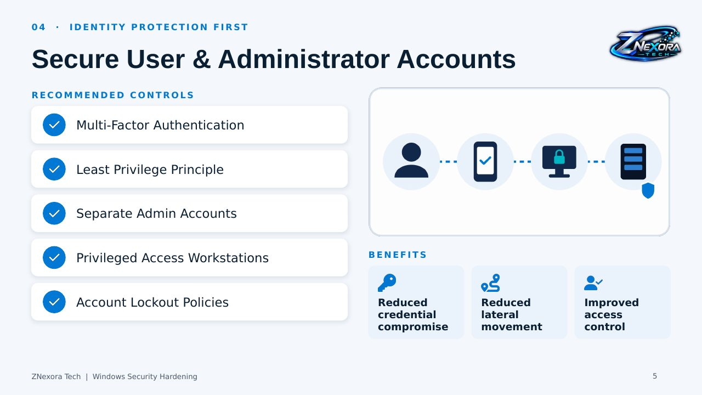

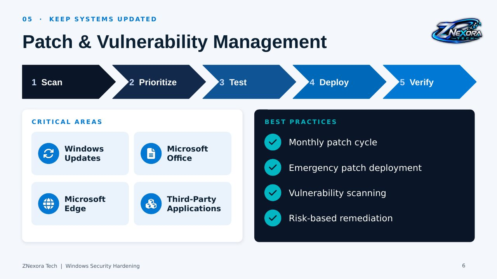

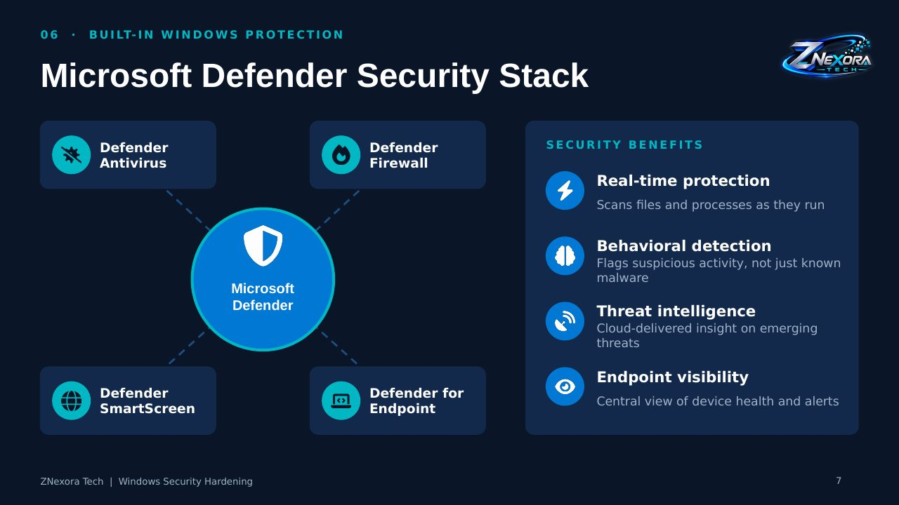

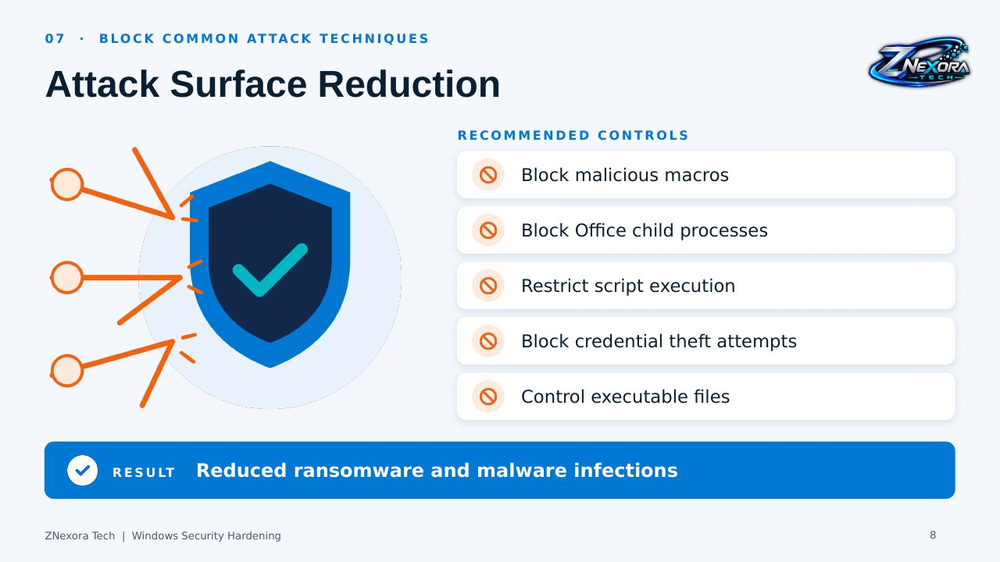

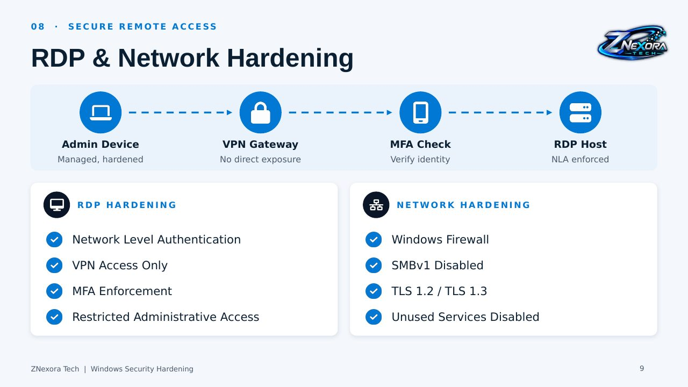

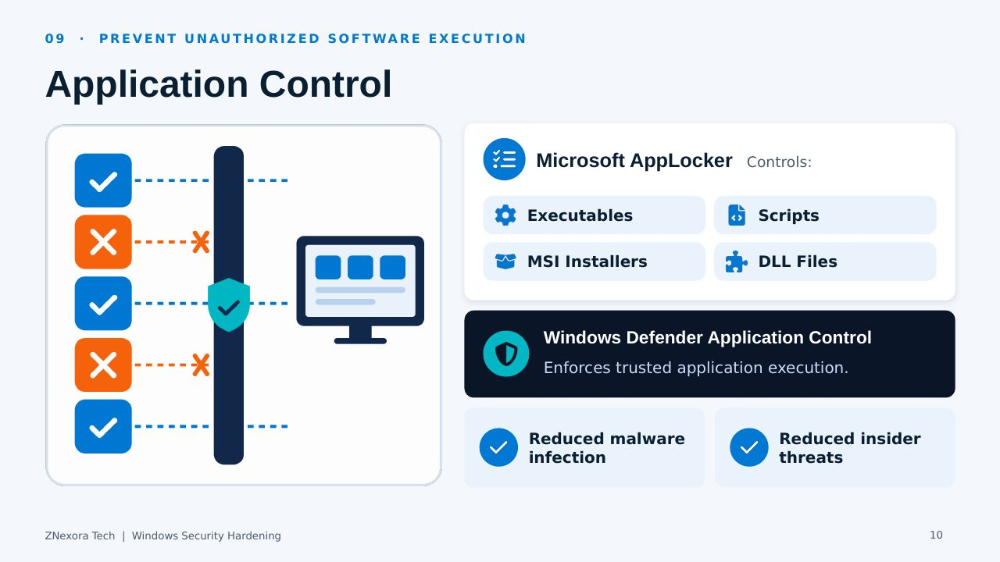

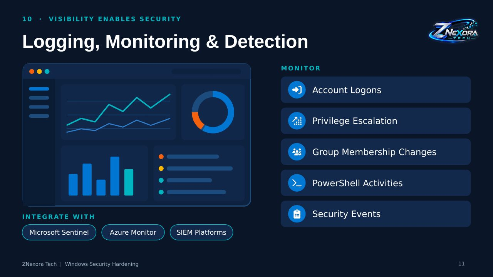

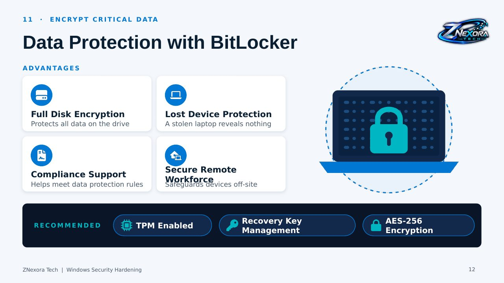

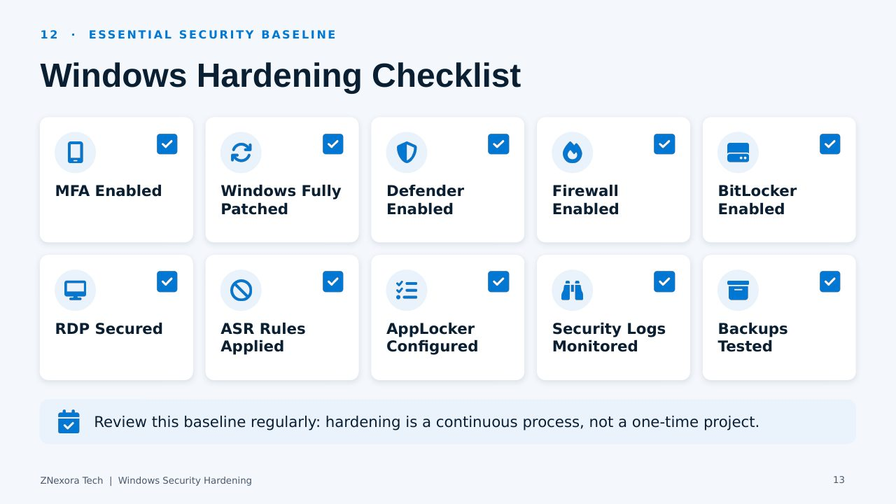

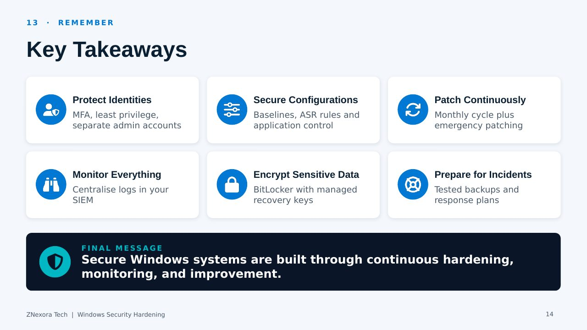

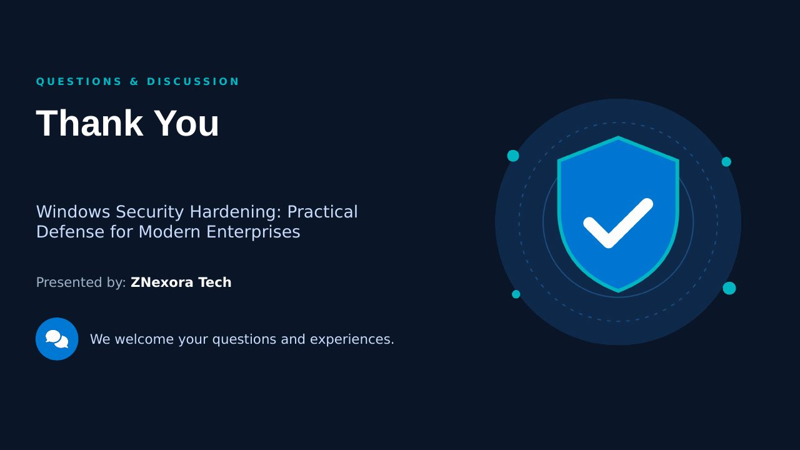
